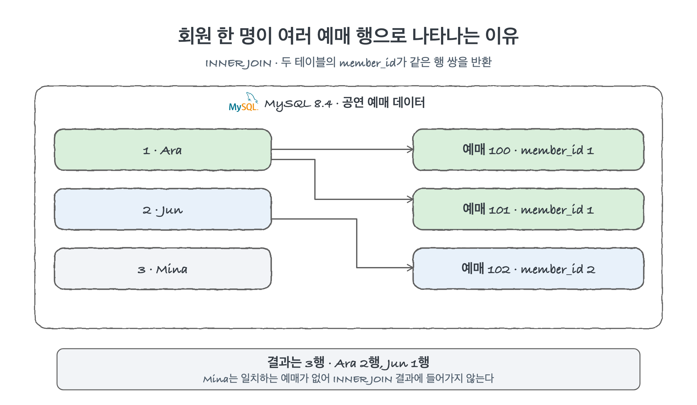

# Inner Joins and Table Relationships

공연 예매를 예로 들어 회원과 예매 내역을 연결하고, 조회 결과에서 한 행이 무엇을 뜻하는지 확인한다. 실습 환경은 MySQL 8.4다. 실습 데이터베이스를 선택한 뒤 같은 세션에서 SQL 블록을 위에서부터 실행한다. 예제의 임시 테이블은 생성한 연결에서만 보인다.

## 1. 연결에 사용할 키 이해하기

회원 이름은 회원 테이블에, 예약 상태는 예매 테이블에 저장한다. 예매에는 회원의 식별자를 기록해 필요한 시점에 두 정보를 결합한다. 아래 예제의 `lab02_reservations.member_id`는 회원의 기본 키인 `lab02_members.member_id`를 가리킨다. 외래 키 제약을 선언하면 데이터베이스가 참조할 키의 존재를 검사한다. [MySQL 외래 키 제약](https://dev.mysql.com/doc/refman/8.4/en/create-table-foreign-keys.html)

```sql
CREATE TEMPORARY TABLE lab02_members (
    member_id INT PRIMARY KEY,
    member_name VARCHAR(30) NOT NULL
);

CREATE TEMPORARY TABLE lab02_reservations (
    reservation_id INT PRIMARY KEY,
    member_id INT NOT NULL,
    status VARCHAR(10) NOT NULL
);

CREATE TEMPORARY TABLE lab02_ticket_types (
    type_id INT PRIMARY KEY,
    type_name VARCHAR(20) NOT NULL
);

CREATE TEMPORARY TABLE lab02_reservation_items (
    reservation_id INT NOT NULL,
    type_id INT NOT NULL,
    quantity INT NOT NULL,
    booked_price INT NOT NULL,
    PRIMARY KEY (reservation_id, type_id)
);

INSERT INTO lab02_members VALUES (1, 'Ara'), (2, 'Jun'), (3, 'Mina');
INSERT INTO lab02_reservations VALUES
    (100, 1, 'PAID'), (101, 1, 'PAID'), (102, 2, 'PENDING');
INSERT INTO lab02_ticket_types VALUES (10, 'Standard'), (20, 'Balcony');
INSERT INTO lab02_reservation_items VALUES
    (100, 10, 2, 30000), (100, 20, 1, 20000),
    (101, 20, 1, 20000), (102, 10, 1, 30000);
```

## 2. INNER JOIN과 행 수

`INNER JOIN ... ON`은 연결 조건이 참인 행 쌍을 결과에 포함한다. 실습에서는 `INNER`가 생략된 `JOIN ... ON`을 사용한다. 별칭을 붙이고 `m.member_id`처럼 테이블을 지정하면 이름이 같은 열을 명확히 구분할 수 있다. [MySQL JOIN 구문](https://dev.mysql.com/doc/refman/8.4/en/join.html)

```sql
SELECT r.reservation_id, m.member_id, m.member_name, r.status
FROM lab02_reservations AS r
JOIN lab02_members AS m ON m.member_id = r.member_id
ORDER BY r.reservation_id;
```

예약 `100`, `101`, `102`가 한 행씩 나온다. `Ara`는 예약마다 한 번씩 나타나고, 예약이 없는 `Mina`는 결과에서 빠진다. 회원 ID가 고유하므로 한 예약이 여러 회원과 연결되는 일은 없다. 회원에서 예약을 조회할 때는 한 회원에 여러 예약이 연결될 수 있다. 결과가 회원당 한 행이어야 한다면 회원 ID로 집계하는 등 결과의 단위를 쿼리에 표현한다.



그림의 근거 · [JOIN](https://dev.mysql.com/doc/refman/8.4/en/join.html)

## 3. 여러 테이블을 연결하고 집계하기

예매와 티켓 종류는 N:M 관계다. 연결 테이블 `lab02_reservation_items`가 각 예매에 포함된 티켓 종류, 수량, 결제 시점의 단가를 기록한다. 집계 전 결과의 한 행은 예매 한 건에 들어 있는 티켓 종류 하나를 뜻한다. `ON`은 행의 연결 조건을, `WHERE`는 집계에 남길 행의 범위를 나타낸다. [MySQL SELECT 구문](https://dev.mysql.com/doc/refman/8.4/en/select.html) · [MySQL 집계 함수](https://dev.mysql.com/doc/refman/8.4/en/aggregate-functions.html)

```sql
SELECT r.reservation_id, m.member_name, t.type_name, i.quantity
FROM lab02_reservations AS r
JOIN lab02_members AS m ON m.member_id = r.member_id
JOIN lab02_reservation_items AS i ON i.reservation_id = r.reservation_id
JOIN lab02_ticket_types AS t ON t.type_id = i.type_id
WHERE r.status = 'PAID'
ORDER BY r.reservation_id, i.type_id;

SELECT m.member_id, m.member_name,
       SUM(i.quantity * i.booked_price) AS total_paid
FROM lab02_members AS m
JOIN lab02_reservations AS r ON r.member_id = m.member_id
JOIN lab02_reservation_items AS i ON i.reservation_id = r.reservation_id
WHERE r.status = 'PAID'
GROUP BY m.member_id, m.member_name
ORDER BY m.member_id;
```

첫 조회에서는 예약 `100`의 두 종류와 예약 `101`의 한 종류가 나온다. 두 번째 조회에서는 `Ara`의 결제 총액 `100000`이 나온다. 회원 ID를 그룹 기준에 포함하면 이름이 같은 회원의 결제액도 분리된다. 예약과 품목을 붙인 결과에서 `COUNT(*)`는 품목 행을 센다. 이 결과에서 예약 건수를 구하려면 `COUNT(DISTINCT r.reservation_id)`로 예약 식별자를 센다.

예약이 없는 회원까지 포함하는 방법은 다음 문서에서 다룬다. [Outer, Self, and Cross Joins](02_outer_self_and_cross_joins.md)
