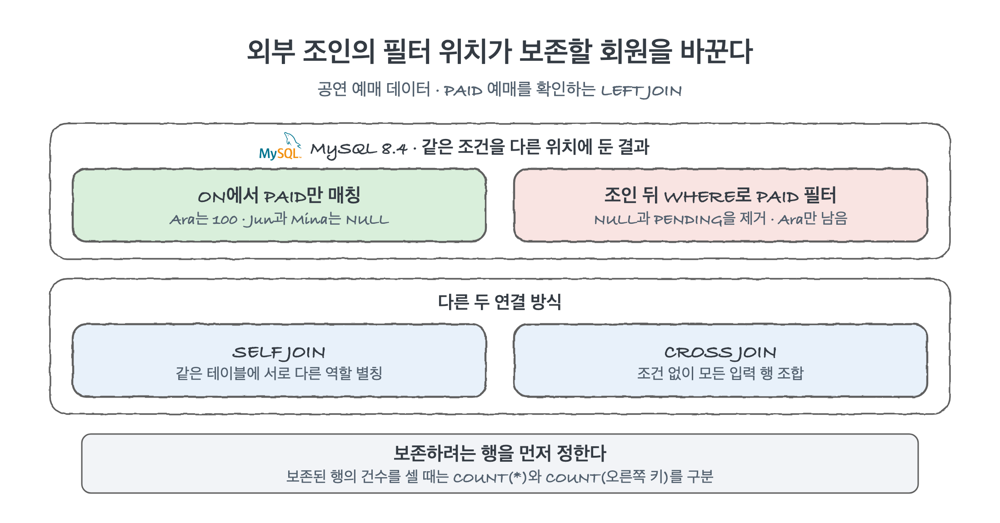

# Outer, Self, and Cross Joins

예약이 없는 회원까지 조회하는 외부 조인, 같은 테이블에서 서로 다른 역할을 연결하는 셀프 조인, 모든 조합을 만드는 크로스 조인을 살펴본다. 실습 환경은 MySQL 8.4다. 실습 데이터베이스를 선택한 뒤 같은 세션에서 SQL 블록을 위에서부터 실행한다.

## 1. LEFT JOIN에서 보존할 행 정하기

`LEFT JOIN`은 왼쪽 행을 보존한다. 연결 조건을 만족하는 오른쪽 행이 여러 개면 해당 왼쪽 행이 여러 쌍으로 나타나고, 연결할 오른쪽 행이 없으면 오른쪽 열을 `NULL`로 채운다. `RIGHT JOIN`은 오른쪽을 보존한다. 테이블 위치를 바꾸어 `LEFT JOIN`으로 같은 연결을 표현할 수 있다.

양쪽의 미연결 행을 모두 보존하는 연산은 전체 외부 조인이다. PostgreSQL처럼 `FULL OUTER JOIN`을 지원하는 DBMS에서는 전용 구문을 사용할 수 있다. MySQL 8.4에서는 왼쪽 외부 조인 결과와 오른쪽의 미연결 행을 `UNION ALL`로 합쳐 같은 결과를 구성한다. [PostgreSQL 외부 조인](https://www.postgresql.org/docs/current/queries-table-expressions.html#QUERIES-JOIN) · [MySQL JOIN 구문](https://dev.mysql.com/doc/refman/8.4/en/join.html) · [MySQL UNION](https://dev.mysql.com/doc/refman/8.4/en/union.html)

```sql
CREATE TEMPORARY TABLE lab03_members (
    member_id INT PRIMARY KEY,
    member_name VARCHAR(30) NOT NULL
);

CREATE TEMPORARY TABLE lab03_reservations (
    reservation_id INT PRIMARY KEY,
    member_id INT NOT NULL,
    status VARCHAR(10) NOT NULL
);

INSERT INTO lab03_members VALUES (1, 'Ara'), (2, 'Jun'), (3, 'Mina');
INSERT INTO lab03_reservations VALUES
    (100, 1, 'PAID'), (101, 1, 'PENDING'), (102, 2, 'PENDING');

SELECT m.member_name, r.reservation_id, r.status
FROM lab03_members AS m
LEFT JOIN lab03_reservations AS r ON r.member_id = m.member_id
ORDER BY m.member_id, r.reservation_id;

SELECT m.member_name
FROM lab03_members AS m
LEFT JOIN lab03_reservations AS r ON r.member_id = m.member_id
WHERE r.reservation_id IS NULL;
```

첫 쿼리의 결과는 총 네 행이다. `Ara`가 두 행, `Jun`이 한 행이고, `Mina`는 예약 열이 `NULL`인 한 행이다. 두 번째 쿼리는 예약이 전혀 없는 `Mina`를 찾는다. 미연결 여부는 실제로 매칭된 행에서 항상 값이 있는 열로 검사한다. 예제에서는 예약 기본 키인 `reservation_id`를 사용한다.

## 2. ON과 WHERE에 조건을 둘 때의 차이

회원 전체를 보존하면서 **결제한 예약만** 붙이려면 예약 상태를 `ON`에 둔다. `WHERE r.status = 'PAID'`로 옮기면 `NULL` 확장 행은 조건을 통과하지 못하고, 결제한 예약이 없는 회원도 결과에서 빠진다. [MySQL 외부 조인 단순화](https://dev.mysql.com/doc/refman/8.4/en/outer-join-simplification.html)

```sql
SELECT m.member_name, COUNT(r.reservation_id) AS paid_count
FROM lab03_members AS m
LEFT JOIN lab03_reservations AS r
    ON r.member_id = m.member_id
   AND r.status = 'PAID'
GROUP BY m.member_id, m.member_name
ORDER BY m.member_id;

SELECT m.member_name, r.reservation_id
FROM lab03_members AS m
LEFT JOIN lab03_reservations AS r ON r.member_id = m.member_id
WHERE r.status = 'PAID'
ORDER BY m.member_id, r.reservation_id;
```

첫 결과는 `Ara` 1건, `Jun`과 `Mina` 0건이다. `COUNT(r.reservation_id)`는 값이 있는 예약만 세므로, 오른쪽이 `NULL`인 행은 0건으로 계산한다. 같은 위치에서 `COUNT(*)`는 `NULL` 확장 행도 한 행으로 센다. 두 번째 결과에는 `Ara`의 예약 `100`만 남는다. [MySQL COUNT 집계](https://dev.mysql.com/doc/refman/8.4/en/aggregate-functions.html#function_count)



그림의 근거 · [JOIN](https://dev.mysql.com/doc/refman/8.4/en/join.html) · [집계 함수](https://dev.mysql.com/doc/refman/8.4/en/aggregate-functions.html)

## 3. 셀프 조인으로 같은 테이블의 역할 나누기

직원과 관리자는 같은 직원 목록에서 가져온다. 두 참조에 서로 다른 별칭을 붙여 직원의 `manager_id`와 관리자의 `employee_id`를 연결한다. 최상위 직원까지 조회하려면 직원을 왼쪽에 두고 `LEFT JOIN` 한다. 이 예제에서는 `WITH`로 한 SQL 문 안에 실습 데이터를 정의한다. [MySQL WITH 구문](https://dev.mysql.com/doc/refman/8.4/en/with.html)

```sql
WITH employees AS (
    SELECT 1 AS employee_id, 'Jin' AS employee_name,
           CAST(NULL AS SIGNED) AS manager_id
    UNION ALL SELECT 2, 'Sol', 1
    UNION ALL SELECT 3, 'Teo', 2
)
SELECT e.employee_name, manager.employee_name AS manager_name
FROM employees AS e
LEFT JOIN employees AS manager ON manager.employee_id = e.manager_id
ORDER BY e.employee_id;
```

`Jin`의 관리자 열에는 `NULL`이 나오고, `Sol`의 관리자는 `Jin`, `Teo`의 관리자는 `Sol`이다.

## 4. CROSS JOIN으로 조합 만들기

조건 없는 `CROSS JOIN`은 왼쪽 행마다 오른쪽 행 전체를 연결한다. 좌석 구역 2개와 회차 3개를 조합하면 6행이다. 입력 행 수를 곱하면 필터링 전 조합의 크기를 가늠할 수 있다. MySQL 8.4는 `CROSS JOIN`에 `ON`을 붙이는 구문도 허용한다. 여러 DBMS에서 같은 구문을 사용하려면 연결 조건이 있는 조인은 `INNER JOIN ... ON`으로, 전체 조합은 `CROSS JOIN`으로 표현한다. [MySQL JOIN 구문](https://dev.mysql.com/doc/refman/8.4/en/join.html)

```sql
WITH seat_sections AS (
    SELECT 'A' AS section_code
    UNION ALL SELECT 'B'
),
show_times AS (
    SELECT 1 AS show_no
    UNION ALL SELECT 2
    UNION ALL SELECT 3
)
SELECT s.section_code, t.show_no
FROM seat_sections AS s
CROSS JOIN show_times AS t
ORDER BY s.section_code, t.show_no;
```
