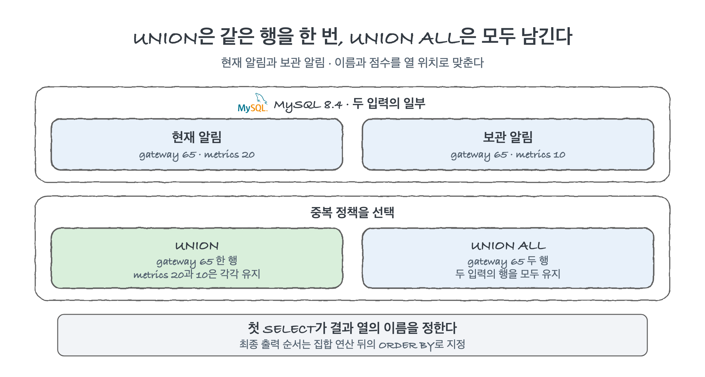

# UNION and UNION ALL

`UNION`은 여러 쿼리의 결과를 같은 열 구조의 행 목록으로 합치는 집합 연산이다. 현재 알림과 보관 알림을 예로 들어 중복의 기준을 확인하고, 각 쿼리에서 고를 행과 최종 결과의 순서를 따로 정한다.

실습 환경은 MySQL 8.4다. 예제는 실습 스키마의 한 세션에서 순서대로 실행한다.

## 1. 열의 개수, 위치, 이름 맞추기

각 `SELECT`의 열 개수는 같아야 한다. 열은 위치를 기준으로 대응하며, 같은 위치의 값은 공통 결과 자료형으로 표현할 수 있어야 한다. 같은 이름의 열도 위치가 다르면 다른 열에 대응한다.

MySQL 8.4는 각 쿼리의 해당 열을 고려해 결과 자료형을 정하고, 첫 번째 `SELECT`의 열 이름을 결과 열 이름으로 사용한다. 암시적 형 변환 규칙은 DBMS마다 다르므로, 여러 DBMS에 옮길 쿼리는 열 순서를 명시하고 필요하면 `CAST`로 자료형을 맞춘다.

```sql
CREATE TEMPORARY TABLE lab05_current_alerts (
    service_name VARCHAR(30) NOT NULL,
    severity INT NOT NULL
);

CREATE TEMPORARY TABLE lab05_archived_alerts (
    component_name VARCHAR(30) NOT NULL,
    priority INT NOT NULL
);

INSERT INTO lab05_current_alerts (service_name, severity)
VALUES ('edge', 42), ('gateway', 65), ('metrics', 20);

INSERT INTO lab05_archived_alerts (component_name, priority)
VALUES ('gateway', 65), ('worker', 70), ('metrics', 10);
```

**공식 문서** [집합 연산의 결과 열 이름과 자료형](https://dev.mysql.com/doc/refman/8.4/en/set-operations.html)

## 2. 필요한 중복 처리 선택하기

| 연산 | 중복 처리 |
| --- | --- |
| `UNION` 또는 `UNION DISTINCT` | 선택한 모든 열의 값이 같은 행을 한 번씩 남긴다. |
| `UNION ALL` | 각 쿼리가 반환한 행을 모두 유지한다. |

```sql
SELECT service_name AS service, severity AS score
FROM lab05_current_alerts
UNION
SELECT component_name, priority
FROM lab05_archived_alerts
ORDER BY service, score;

SELECT service_name AS service, severity AS score
FROM lab05_current_alerts
UNION ALL
SELECT component_name, priority
FROM lab05_archived_alerts
ORDER BY service, score;
```

`UNION`은 `('gateway', 65)`를 한 행으로 합쳐 5행을 반환하고, `UNION ALL`은 같은 조합을 두 번 유지해 6행을 반환한다. `metrics`는 두 행의 점수가 다르므로 두 결과에 모두 두 번 나온다. 행에 출처 표시를 추가하면 그 값도 중복 비교에 포함된다. 모든 기록을 보존해야 할 때는 `UNION ALL`을 사용하면 중복 제거 작업도 생략된다.

**공식 문서** [UNION 문법](https://dev.mysql.com/doc/refman/8.4/en/union.html) · [DISTINCT와 ALL](https://dev.mysql.com/doc/refman/8.4/en/set-operations.html)



그림의 근거 · [집합 연산](https://dev.mysql.com/doc/refman/8.4/en/set-operations.html)

## 3. 각 쿼리의 상위 행과 최종 정렬 구분하기

각 쿼리에서 고를 행의 순서와 합친 결과의 표시 순서는 별도로 지정한다. MySQL 8.4에서는 각 쿼리의 후보를 괄호 안의 `ORDER BY`와 `LIMIT`으로 제한한다. 전체 정렬은 마지막 `ORDER BY`에서 첫 번째 `SELECT`가 정한 결과 열 이름이나 별칭으로 지정한다.

```sql
(SELECT service_name AS service, severity AS score
 FROM lab05_current_alerts
 ORDER BY severity DESC, service_name
 LIMIT 1)
UNION ALL
(SELECT component_name, priority
 FROM lab05_archived_alerts
 ORDER BY priority DESC, component_name
 LIMIT 1)
ORDER BY score DESC, service;
```

현재 알림에서는 `gateway`가, 보관 알림에서는 `worker`가 가장 높은 점수를 얻는다. 최종 결과는 `('worker', 70)`, `('gateway', 65)` 순서다. 괄호 안의 정렬은 각 쿼리에서 상위 한 행을 고르는 데 사용한다. 마지막 정렬은 선택된 두 행의 표시 순서를 결정한다.

**공식 문서** [집합 연산에서 ORDER BY와 LIMIT 사용](https://dev.mysql.com/doc/refman/8.4/en/set-operations.html)
