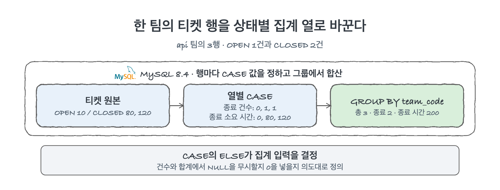

# CASE Expressions and Conditional Aggregation

`CASE` 표현식으로 상태 코드를 이름으로 바꾸고, 숫자 범위로 새 분류를 만들 수 있다. 지원 요청 데이터를 분류한 뒤 팀별 상태 건수와 소요 시간을 한 보고서로 집계한다.

실습 환경은 MySQL 8.4다. 예제는 실습 스키마의 한 세션에서 순서대로 실행한다.

## 실습 데이터

```sql
CREATE TEMPORARY TABLE lab06_tickets (
    ticket_id INT PRIMARY KEY,
    team_code VARCHAR(16) NOT NULL,
    ticket_status VARCHAR(16) NOT NULL,
    elapsed_min INT
);

INSERT INTO lab06_tickets (ticket_id, team_code, ticket_status, elapsed_min)
VALUES
    (1, 'api', 'OPEN', 10),
    (2, 'api', 'CLOSED', 80),
    (3, 'api', 'CLOSED', 120),
    (4, 'billing', 'OPEN', 70),
    (5, 'billing', 'PAUSED', NULL);
```

## 1. 단순 CASE와 검색 CASE

단순 `CASE`는 하나의 값을 각 `WHEN` 값과 비교한다. 검색 `CASE`는 `WHEN`마다 조건식을 둔다. 위에서부터 가장 먼저 일치한 분기의 값을 반환한다. 일치한 분기가 없고 `ELSE`도 생략하면 결과는 `NULL`이다. `NULL`을 명시적으로 분류할 때는 검색 `CASE`에서 `IS NULL`을 사용한다.

```sql
SELECT ticket_id,
       CASE ticket_status
           WHEN 'OPEN' THEN 'In progress'
           WHEN 'CLOSED' THEN 'Resolved'
           WHEN 'PAUSED' THEN 'On hold'
           ELSE 'Unknown'
       END AS status_label,
       CASE
           WHEN elapsed_min IS NULL THEN 'unknown'
           WHEN elapsed_min >= 90 THEN 'long'
           WHEN elapsed_min >= 30 THEN 'medium'
           ELSE 'short'
       END AS duration_band
FROM lab06_tickets
ORDER BY CASE ticket_status WHEN 'OPEN' THEN 0 ELSE 1 END, ticket_id;
```

진행 중인 1번과 4번이 먼저 표시된다. `>= 90`을 `>= 30`보다 먼저 검사해 3번의 120분을 `long`으로 분류한다. `elapsed_min`이 없는 5번은 `unknown`이다.

**공식 문서** [CASE 표현식](https://dev.mysql.com/doc/refman/8.4/en/flow-control-functions.html)

## 2. 분류한 값으로 그룹화하기

```sql
SELECT CASE
           WHEN elapsed_min IS NULL THEN 'unknown'
           WHEN elapsed_min >= 90 THEN 'long'
           WHEN elapsed_min >= 30 THEN 'medium'
           ELSE 'short'
       END AS duration_band,
       COUNT(*) AS ticket_count
FROM lab06_tickets
GROUP BY duration_band
ORDER BY duration_band;
```

MySQL 8.4의 `GROUP BY`에서는 같은 쿼리의 `SELECT`에서 정한 별칭을 사용할 수 있다. 이 문법을 사용할 수 없는 DBMS에서는 파생 테이블이나 CTE에서 먼저 분류 열을 만들고, 바깥 쿼리에서 그 열로 그룹화한다. 실습의 분류 결과는 `long` 1건, `medium` 2건, `short` 1건, `unknown` 1건이다.

**공식 문서** [MySQL의 GROUP BY 처리](https://dev.mysql.com/doc/refman/8.4/en/group-by-handling.html)

## 3. 조건별 집계를 열로 펼치기

`COUNT(expr)`은 `NULL`이 아닌 결과를 센다. 따라서 `COUNT(CASE WHEN ... THEN 1 END)`에서는 조건이 참인 행만 집계된다. `SUM(CASE ... THEN 1 ELSE 0 END)`은 각 행을 1 또는 0으로 바꿔 조건에 맞는 건수를 계산한다. `THEN`에 수치 열을 두면 해당 조건에 맞는 값의 합계를 구할 수 있다.

```sql
SELECT team_code,
       COUNT(*) AS total_tickets,
       COUNT(CASE WHEN ticket_status = 'OPEN' THEN 1 END) AS open_count,
       SUM(CASE WHEN ticket_status = 'CLOSED' THEN 1 ELSE 0 END) AS closed_count,
       SUM(CASE WHEN ticket_status = 'CLOSED' THEN elapsed_min ELSE 0 END)
           AS closed_elapsed_min
FROM lab06_tickets
GROUP BY team_code
ORDER BY team_code;
```

| team_code | total_tickets | open_count | closed_count | closed_elapsed_min |
| --- | ---: | ---: | ---: | ---: |
| api | 3 | 1 | 2 | 200 |
| billing | 2 | 1 | 0 | 0 |

`COUNT(CASE WHEN ... THEN 1 ELSE 0 END)`은 0도 값으로 세므로 모든 입력 행을 집계한다. `GROUP BY` 없이 전체를 집계할 때 입력이 0행이면 `COUNT()`는 0, `SUM()`은 `NULL`을 반환한다.

**공식 문서** [COUNT와 SUM의 NULL 처리](https://dev.mysql.com/doc/refman/8.4/en/aggregate-functions.html)



그림의 근거 · [CASE 표현식](https://dev.mysql.com/doc/refman/8.4/en/flow-control-functions.html) · [집계 함수](https://dev.mysql.com/doc/refman/8.4/en/aggregate-functions.html)
