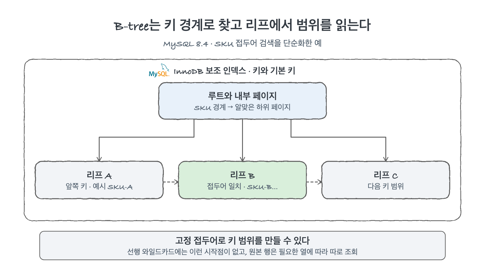

# B-Tree Index Fundamentals

인덱스는 키에 따라 행을 찾는 접근 경로다. B-tree 인덱스는 키의 순서를 유지하므로 동등 비교와 범위 조회에 사용할 수 있다. 인덱스 순서가 쿼리의 정렬 요구와 맞으면 별도 정렬을 줄일 수 있다.

## 1. B-tree 탐색과 페이지 접근

B-tree는 여러 키를 페이지 하나에 모아 관리한다. 내부 페이지의 경계 키를 따라 리프 페이지로 이동한 뒤, 일치하는 키나 범위의 시작점을 찾는다. 범위 조회는 끝 경계까지 키 순서로 인덱스 레코드를 읽는다. 키가 가까운 레코드는 같은 리프 페이지에 모일 수 있고, 그때는 페이지 하나에서 여러 레코드를 가져올 수 있다.

인덱스에서 찾은 후보의 전체 행이 필요하면 행이 담긴 페이지도 읽는다. 인덱스에서 가까운 키에 대응하는 행이 여러 페이지에 흩어져 있을 수 있다. 조회 대상이 많으면 이 추가 접근 비용 때문에 테이블 전체를 읽는 편이 더 저렴할 수 있다. 인덱스 리프가 행 자체를 담는지, 행을 찾는 데 쓰이는 값을 담는지는 저장 엔진과 인덱스 종류에 따라 달라진다. [MySQL에서 인덱스를 사용하는 방식](https://dev.mysql.com/doc/refman/8.4/en/mysql-indexes.html)

### InnoDB의 클러스터형 인덱스와 보조 인덱스

아래는 기본 키를 명시한 InnoDB 테이블의 조회 경로다.

| InnoDB 인덱스 | 저장하는 내용 | 조회 경로 |
| --- | --- | --- |
| 클러스터형 인덱스 | 기본 키의 순서로 구성하고, 리프에 행 데이터를 저장한다. | 기본 키 검색으로 행에 도달한다. |
| 보조 인덱스 | 보조 인덱스 열의 값과 해당 행의 기본 키를 저장한다. | 보조 인덱스에 없는 열이 필요하면 기본 키로 클러스터형 인덱스를 다시 조회한다. |

명시적 기본 키가 없으면 InnoDB는 구성 열이 모두 `NOT NULL`인 첫 번째 `UNIQUE` 인덱스를 클러스터형 인덱스로 사용한다. 그런 인덱스도 없으면 내부 행 식별자를 생성한다. 기본 키 값은 보조 인덱스에도 저장되므로 기본 키의 길이가 여러 보조 인덱스의 크기에 영향을 준다. [InnoDB 인덱스의 물리 구조](https://dev.mysql.com/doc/refman/8.4/en/innodb-physical-structure.html) · [클러스터형 인덱스와 보조 인덱스](https://dev.mysql.com/doc/refman/8.4/en/innodb-index-types.html)

## 2. 실습 · 인덱스 생성과 실행 계획

실습 환경은 MySQL 8.4(InnoDB)다. 실습용 스키마에서 상품 512건을 생성한다. 각 가격에 네 상품을 배정하고, 40번째마다 상품 코드의 접두어를 `KIT-`로 지정한다.

```sql
CREATE TABLE db2_idx08_catalog (
    id INT PRIMARY KEY,
    sku VARCHAR(20) NOT NULL,
    price_cents INT NOT NULL,
    product_name VARCHAR(60) NOT NULL
) ENGINE = InnoDB;

INSERT INTO db2_idx08_catalog (id, sku, price_cents, product_name)
WITH RECURSIVE seq(n) AS (
    SELECT 1
    UNION ALL
    SELECT n + 1 FROM seq WHERE n < 512
)
SELECT n,
       CONCAT(IF(MOD(n, 40) = 0, 'KIT-', 'SKU-'), LPAD(n, 4, '0')),
       1000 + ((n - 1) DIV 4) * 100,
       CONCAT('Catalog item ', n)
FROM seq;

EXPLAIN FORMAT=TRADITIONAL
SELECT id, product_name
FROM db2_idx08_catalog
WHERE price_cents = 2200;

CREATE INDEX idx08_catalog_price ON db2_idx08_catalog (price_cents);
CREATE INDEX idx08_catalog_sku ON db2_idx08_catalog (sku);
SHOW INDEX FROM db2_idx08_catalog;

EXPLAIN FORMAT=TRADITIONAL
SELECT id, product_name
FROM db2_idx08_catalog
WHERE price_cents = 2200;
```

가격 `2200`에 해당하는 ID는 49~52다. MySQL의 `EXPLAIN FORMAT=TRADITIONAL`에서 `possible_keys`는 사용 가능한 후보, `key`는 선택한 인덱스다. `type`은 `ALL`이면 테이블 전체 스캔, `index`이면 인덱스 전체 스캔, `ref`이면 인덱스 키의 동등 조건 조회, `range`이면 인덱스의 하나 이상의 구간을 읽는 접근을 뜻한다. `rows`는 읽을 것으로 추정한 행 수다. 인덱스 생성 전후의 실행 계획을 비교하면 옵티마이저가 예상 비용에 따라 고른 접근 경로를 확인할 수 있다. [CREATE INDEX](https://dev.mysql.com/doc/refman/8.4/en/create-index.html) · [SHOW INDEX](https://dev.mysql.com/doc/refman/8.4/en/show-index.html) · [MySQL의 EXPLAIN 출력](https://dev.mysql.com/doc/refman/8.4/en/explain-output.html)



그림의 근거 · [InnoDB 인덱스 페이지](https://dev.mysql.com/doc/refman/8.4/en/innodb-physical-structure.html) · [범위 최적화](https://dev.mysql.com/doc/refman/8.4/en/range-optimization.html) · [클러스터드·세컨더리 인덱스](https://dev.mysql.com/doc/refman/8.4/en/innodb-index-types.html)

## 3. 범위와 LIKE 접두어 검색

정렬된 키에서 하한과 상한을 구할 수 있으면 그 구간만 읽을 수 있다. 문자열 접두어 비교에서는 인덱스의 문자열 비교 규칙이 그 범위를 결정한다. 아래 예제에서 `LIKE 'KIT-%'`는 접두어로 범위를 만들 수 있다. `LIKE '%0040'`에 해당하는 키는 여러 접두어 구간에 흩어질 수 있다.

```sql
EXPLAIN FORMAT=TRADITIONAL
SELECT id, price_cents
FROM db2_idx08_catalog
WHERE price_cents BETWEEN 2200 AND 2400;

EXPLAIN FORMAT=TRADITIONAL
SELECT id, sku
FROM db2_idx08_catalog
WHERE sku LIKE 'KIT-%';

EXPLAIN FORMAT=TRADITIONAL
SELECT id, sku
FROM db2_idx08_catalog
WHERE sku LIKE '%0040';
```

`BETWEEN`은 양 끝값을 포함하므로 예제 가격 범위는 12건에 해당한다. MySQL은 선행 와일드카드 조건의 접근 경로로 필요한 열을 담은 인덱스의 전체 스캔을 선택할 수도 있다. MySQL에서 단어 단위 검색이 필요한 경우에는 `FULLTEXT`의 토큰화 규칙을 확인한다. [MySQL의 범위 최적화와 LIKE](https://dev.mysql.com/doc/refman/8.4/en/range-optimization.html) · [MySQL 전문 검색](https://dev.mysql.com/doc/refman/8.4/en/fulltext-search.html)

## 4. 인덱스로 정렬하기

인덱스가 쿼리에서 요구하는 순서로 행을 제공할 수 있으면 별도 정렬을 생략할 수 있다. 그 순서가 결과의 요구사항이라면 `ORDER BY`로 명시한다.

```sql
EXPLAIN FORMAT=TRADITIONAL
SELECT id, price_cents
FROM db2_idx08_catalog
ORDER BY price_cents DESC, id DESC
LIMIT 4;

SELECT id, price_cents
FROM db2_idx08_catalog
ORDER BY price_cents DESC, id DESC
LIMIT 4;

DROP INDEX idx08_catalog_sku ON db2_idx08_catalog;
```

가장 높은 가격이 같은 상품은 `id DESC`로 순서를 정해 ID 512, 511, 510, 509를 반환한다. MySQL은 InnoDB 보조 인덱스에 포함되는 기본 키까지 고려해 이 조회에서 `price_cents` 인덱스를 역방향으로 읽을 수 있다. MySQL `EXPLAIN`의 `Extra`에 `Using filesort`가 표시되면 별도 정렬을 수행하며, 정렬이 메모리에서 처리될 수도 있다. 혼합 방향 정렬에는 열별로 `ASC`와 `DESC`를 지정한 복합 인덱스를 검토할 수 있다. [MySQL의 ORDER BY 최적화](https://dev.mysql.com/doc/refman/8.4/en/order-by-optimization.html) · [인덱스 확장](https://dev.mysql.com/doc/refman/8.4/en/index-extensions.html) · [내림차순 인덱스](https://dev.mysql.com/doc/refman/8.4/en/descending-indexes.html) · [DROP INDEX](https://dev.mysql.com/doc/refman/8.4/en/drop-index.html)
