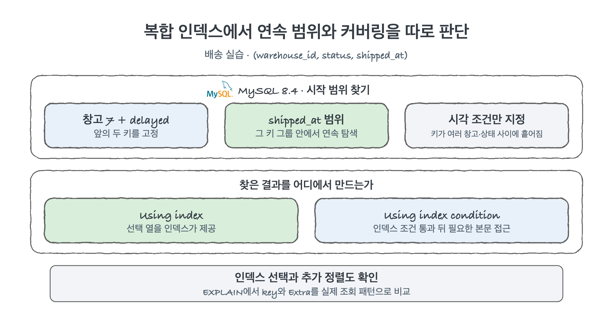

# Composite and Covering Indexes

복합 인덱스는 여러 열의 조합을 키로 저장한다. 조회 조건으로 키의 탐색 범위를 좁힐 수 있는지, 인덱스 순서로 결과를 반환할 수 있는지, 행이 담긴 페이지를 추가로 읽어야 하는지를 각각 살핀다.

## 1. 왼쪽 접두어와 범위 조건

복합 B-tree는 앞 열부터 비교해 키의 순서를 정한다. `(warehouse_id, status, shipped_at DESC)` 키는 같은 창고 안에서 상태로 묶이고, 같은 상태 안에서는 출고 시각의 내림차순을 따른다. 따라서 `(warehouse_id)`와 `(warehouse_id, status)`도 탐색에 쓰이는 왼쪽 접두어다. `WHERE` 절에서 조건을 나열하는 순서는 인덱스의 열 순서와 별개다.

| 조회 조건 | 키의 정렬 순서로 알 수 있는 점 |
| --- | --- |
| `warehouse_id = 7 AND status = 'delayed' AND shipped_at >= ...` | 동등 조건으로 앞 두 열을 고정하면 목표 시각 구간이 연속으로 모인다. |
| `warehouse_id BETWEEN 7 AND 9 AND status = 'delayed'` | 창고 범위에는 여러 상태의 레코드가 포함된다. 그 범위를 읽으며 상태를 추가로 검사할 수 있다. |
| `warehouse_id IN (7, 8, 9) AND status = 'delayed'` | 정수 창고 번호 7~9는 위와 같은 집합이다. 창고별로 상태까지 고정한 세 구간을 탐색할 수 있다. |
| `shipped_at >= ...` | 대상 시각의 키가 창고와 상태 구간마다 흩어진다. |

앞 두 열을 동등 조건으로 고정하면 같은 인덱스의 시각 순서로 `ORDER BY shipped_at DESC`를 처리할 수 있다. 여러 창고가 대상이면 각 창고의 시각 순서를 전체 결과에 맞게 합치는 처리가 필요할 수 있다. [복합 인덱스와 왼쪽 접두어](https://dev.mysql.com/doc/refman/8.4/en/multiple-column-indexes.html) · [ORDER BY와 인덱스 순서](https://dev.mysql.com/doc/refman/8.4/en/order-by-optimization.html)

MySQL 옵티마이저는 선행 열에 조건이 없을 때에도 요건과 비용에 따라 선행 키의 고유 값을 순회하며 범위를 읽는 Skip Scan을 선택할 수 있다. MySQL `EXPLAIN`의 `Extra`에서 `Using index for skip scan`은 이 접근을 나타낸다. [MySQL의 복합 범위와 Skip Scan](https://dev.mysql.com/doc/refman/8.4/en/range-optimization.html)

## 2. 실습 · 복합 인덱스 생성과 실행 계획

실습 환경은 MySQL 8.4(InnoDB)다. 실습용 스키마에서 출고 데이터 720건을 생성한다. 창고 24개에 행을 고르게 배정하고, 출고 시각을 한 시간씩 늘리면서 일부 출고를 지연 상태로 표시한다.

```sql
CREATE TABLE db2_idx09_shipments (
    shipment_id INT PRIMARY KEY,
    warehouse_id SMALLINT NOT NULL,
    status VARCHAR(16) NOT NULL,
    shipped_at DATETIME NOT NULL,
    package_note VARCHAR(100) NOT NULL
) ENGINE = InnoDB;

INSERT INTO db2_idx09_shipments
    (shipment_id, warehouse_id, status, shipped_at, package_note)
WITH RECURSIVE seq(n) AS (
    SELECT 1
    UNION ALL
    SELECT n + 1 FROM seq WHERE n < 720
)
SELECT n,
       1 + MOD(n - 1, 24),
       IF(MOD((n - 1) DIV 24, 6) = 0, 'delayed', 'shipped'),
       TIMESTAMP('2025-01-01 00:00:00') + INTERVAL n HOUR,
       CONCAT('Package ', n)
FROM seq;

EXPLAIN FORMAT=TRADITIONAL
SELECT shipment_id, shipped_at
FROM db2_idx09_shipments
WHERE warehouse_id = 7 AND status = 'delayed'
  AND shipped_at >= '2025-01-10 00:00:00'
ORDER BY shipped_at DESC
LIMIT 3;

CREATE INDEX idx09_shipments_lookup
    ON db2_idx09_shipments (warehouse_id, status, shipped_at DESC);
ANALYZE TABLE db2_idx09_shipments;
```

옵티마이저는 인덱스 탐색, 행 조회, 정렬 등의 예상 비용을 비교한다. 대상 행이 많거나 테이블이 작으면 테이블 전체 스캔이 더 저렴할 수 있다. 접근 방식은 데이터 분포, 필요한 열, 통계와 비용 모델에 따라 달라진다. MySQL의 `ANALYZE TABLE`로 키 분포 통계를 갱신하고, 다음 절에서 같은 조회의 `key`, `rows`, `Extra`를 다시 본다. [MySQL의 테이블 전체 스캔과 옵티마이저](https://dev.mysql.com/doc/refman/8.4/en/table-scan-avoidance.html) · [ANALYZE TABLE](https://dev.mysql.com/doc/refman/8.4/en/analyze-table.html)

## 3. 커버링 여부를 같은 조회로 비교하기

조건을 검사하고 결과를 반환하는 데 필요한 값을 모두 인덱스에서 얻을 수 있으면 그 인덱스가 조회를 커버한다. 별도 행 조회를 줄이면 인덱스 순서와 행 저장 순서가 달라 여러 페이지에 접근하는 비용도 줄일 수 있다. 커버링 여부는 인덱스와 쿼리의 조합으로 결정되며, 실제 접근 방식은 실행 계획에서 확인한다.

실습에서는 `warehouse_id`, `status`, `shipped_at`을 복합 인덱스에 명시했다. InnoDB는 보조 인덱스에 기본 키도 저장하므로 `shipment_id`도 여기서 읽을 수 있다. 이는 InnoDB의 저장 방식에 따른 결과다. [InnoDB 보조 인덱스](https://dev.mysql.com/doc/refman/8.4/en/innodb-index-types.html)

```sql
EXPLAIN FORMAT=TRADITIONAL
SELECT shipment_id, shipped_at
FROM db2_idx09_shipments
WHERE warehouse_id = 7 AND status = 'delayed'
  AND shipped_at >= '2025-01-10 00:00:00'
ORDER BY shipped_at DESC
LIMIT 3;

EXPLAIN FORMAT=TRADITIONAL
SELECT shipment_id, shipped_at, package_note
FROM db2_idx09_shipments
WHERE warehouse_id = 7 AND status = 'delayed'
  AND shipped_at >= '2025-01-10 00:00:00'
ORDER BY shipped_at DESC
LIMIT 3;

SELECT shipment_id, shipped_at
FROM db2_idx09_shipments
WHERE warehouse_id = 7 AND status = 'delayed'
  AND shipped_at >= '2025-01-10 00:00:00'
ORDER BY shipped_at DESC
LIMIT 3;
```

두 번째 조회는 `package_note`를 가져오기 위해 행에 접근해야 한다. 결과의 출고 ID는 두 조회 모두 583, 439, 295 순서다.

| MySQL `EXPLAIN`의 `Extra` | 의미 |
| --- | --- |
| `Using index` | 쿼리에 필요한 열을 인덱스에서 읽는 커버링 접근이다. |
| `Using index condition` | 인덱스에서 검사할 수 있는 조건을 먼저 적용하고, 통과한 후보의 전체 행을 읽는다. |
| `Using filesort` | 인덱스에서 읽은 순서와 별도로 정렬한다. |

MySQL에서 실행 비용을 비교할 때는 `EXPLAIN ANALYZE`로 조회를 실제 실행해 예상 행 수와 실측 행 수를 함께 볼 수 있다. [EXPLAIN 출력](https://dev.mysql.com/doc/refman/8.4/en/explain-output.html) · [Index Condition Pushdown](https://dev.mysql.com/doc/refman/8.4/en/index-condition-pushdown-optimization.html) · [EXPLAIN ANALYZE](https://dev.mysql.com/doc/refman/8.4/en/explain.html)



그림의 근거 · [복합 인덱스](https://dev.mysql.com/doc/refman/8.4/en/multiple-column-indexes.html) · [범위 최적화](https://dev.mysql.com/doc/refman/8.4/en/range-optimization.html) · [ICP](https://dev.mysql.com/doc/refman/8.4/en/index-condition-pushdown-optimization.html) · [EXPLAIN 출력](https://dev.mysql.com/doc/refman/8.4/en/explain-output.html)

## 4. 자주 실행하는 조회에서 인덱스 설계하기

반복되는 필터, 조인 키, 정렬 순서에서 후보를 고른다. 예제처럼 특정 창고와 상태를 고정하는 조회에서는 동등 조건의 열을 앞에, 시각 범위나 정렬에 쓰는 열을 뒤에 둔다. 창고 없이 상태만 자주 찾거나 창고 전체의 최신 출고가 중요하면 해당 조회 패턴을 별도로 검토한다.

값 종류가 적은 상태 열은 단독 인덱스에서 많은 행이 같은 키로 모일 수 있다. 창고와 함께 조회하는 경우에는 복합 인덱스 안에서 상태 열이 읽는 범위를 줄일 수 있다. MySQL의 `SHOW INDEX`에서 `Cardinality`는 고유 값 수의 추정치다. [SHOW INDEX의 Cardinality](https://dev.mysql.com/doc/refman/8.4/en/show-index.html)

반환 열을 추가하면 일부 조회가 커버링된다. 그만큼 인덱스 항목이 커져 더 많은 페이지를 쓰고, 인덱스에 반영해야 하는 쓰기 작업의 비용이 늘 수 있다. 인덱스를 정리할 때는 전체 조회 패턴과 제약 조건을 확인하고, 읽기 개선과 쓰기 비용을 함께 비교한다. [MySQL의 인덱스 사용 방식](https://dev.mysql.com/doc/refman/8.4/en/mysql-indexes.html)
