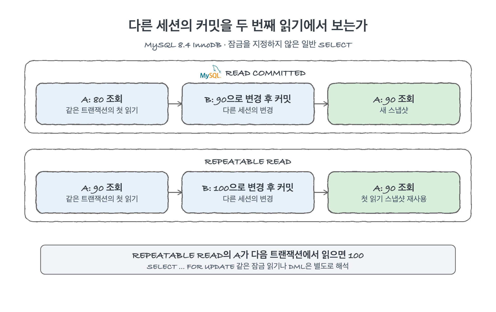

# Transactions and Isolation Levels

자금 이체처럼 여러 변경이 함께 성공해야 하는 작업은 하나의 트랜잭션으로 묶는다. 트랜잭션의 경계와 격리 수준은 여러 요청이 동시에 같은 데이터를 사용할 때도 기대한 결과를 낼 수 있도록 정한다. 실습 환경은 MySQL 8.4의 InnoDB다.

## 1. 커밋과 롤백

커밋은 변경을 확정하고, 롤백은 트랜잭션에서 수행한 변경을 되돌린다. MySQL에서는 기본으로 `autocommit`이 활성화되어 있어 명시적 트랜잭션이 없으면 성공한 각 문장이 개별적으로 커밋된다. `START TRANSACTION`으로 시작한 작업은 `COMMIT` 또는 `ROLLBACK`으로 끝낸다. MySQL의 일반 `CREATE TABLE`과 `ALTER TABLE` 등 여러 DDL은 암묵적 커밋을 일으키므로 실습에서는 업무 트랜잭션의 DML과 분리한다.

빈 스키마에서 다음 두 계좌를 만든다. 첫 트랜잭션은 출금 이후 오류가 발생한 상황을 가정해 롤백한다. 두 번째에서 이체를 완료한다.

```sql
CREATE TABLE db11_accounts (
    account_id INT PRIMARY KEY,
    balance INT NOT NULL CHECK (balance >= 0)
) ENGINE = InnoDB;
INSERT INTO db11_accounts VALUES (1, 100), (2, 60);

START TRANSACTION;
UPDATE db11_accounts SET balance = balance - 20 WHERE account_id = 1;
ROLLBACK;
SELECT account_id, balance FROM db11_accounts ORDER BY account_id;

START TRANSACTION;
UPDATE db11_accounts SET balance = balance - 20 WHERE account_id = 1;
UPDATE db11_accounts SET balance = balance + 20 WHERE account_id = 2;
COMMIT;
SELECT account_id, balance FROM db11_accounts ORDER BY account_id;
```

롤백 뒤 잔액은 `100, 60`, 커밋 뒤에는 `80, 80`이다. 실제 이체에서는 계좌가 존재하는지 확인하고, 출금 조건을 만족하는 행이 갱신됐는지 검사한 뒤 입금을 진행한다. 문장 하나가 실패했을 때 전체 트랜잭션이 항상 롤백된다고 가정하면 앞서 성공한 변경이 남을 수 있다. 애플리케이션은 실패 시 트랜잭션을 명시적으로 종료한다.

**공식 문서** [START TRANSACTION, COMMIT, and ROLLBACK](https://dev.mysql.com/doc/refman/8.4/en/commit.html) · [Statements That Cause an Implicit Commit](https://dev.mysql.com/doc/refman/8.4/en/implicit-commit.html) · [InnoDB Error Handling](https://dev.mysql.com/doc/refman/8.4/en/innodb-error-handling.html)

## 2. ACID와 읽기 현상

| 속성 | 의미 |
| --- | --- |
| 원자성 · Atomicity | 트랜잭션의 변경을 함께 확정하거나 되돌린다. |
| 일관성 · Consistency | 커밋 전후로 제약 조건과 업무 규칙이 성립하도록 한다. 제약으로 표현할 수 없는 규칙은 트랜잭션 안에서 검증한다. |
| 격리성 · Isolation | 동시에 실행되는 작업이 어떤 변경을 볼 수 있고 언제 서로 대기하는지 정한다. |
| 지속성 · Durability | 설정된 내구성 보장 범위에서 커밋된 변경을 장애 후에도 복구할 수 있다. |

더티 리드는 미커밋 값을 읽는 현상이다. 반복 불가능 읽기는 한 트랜잭션에서 같은 행을 다시 읽을 때 값이 달라지는 현상이다. 팬텀 읽기는 같은 조건의 조회 결과에 행이 추가되거나 빠지는 현상이다.

SQL 표준의 격리 수준은 동시 실행에서 허용할 수 있는 현상을 정의한다. 가장 강한 수준인 `SERIALIZABLE`은 동시 실행 결과가 트랜잭션을 어떤 순서로 하나씩 실행한 결과와 같도록 한다. DBMS는 스냅샷과 잠금 방식에 따라 표준보다 더 강한 보장을 제공할 수 있다.

| 격리 수준 | SQL 표준이 허용할 수 있는 읽기 현상 | MySQL InnoDB 동작 |
| --- | --- | --- |
| `READ UNCOMMITTED` | 더티 리드, 반복 불가능 읽기, 팬텀 읽기 | 다른 트랜잭션의 미커밋 변경을 볼 수 있다. |
| `READ COMMITTED` | 반복 불가능 읽기, 팬텀 읽기 | 각 일반 `SELECT`가 새 스냅샷을 사용한다. |
| `REPEATABLE READ` | 팬텀 읽기 | InnoDB 기본값이다. 일반 읽기는 첫 읽기가 만든 스냅샷을 이어서 사용한다. 잠금 읽기와 DML은 이 스냅샷 읽기와 동작이 다르며, 인덱스 범위에 넥스트 키 락을 사용할 수 있다. |
| `SERIALIZABLE` | 세 현상 모두 금지 | `autocommit`이 비활성인 경우 일반 `SELECT`를 공유 잠금 읽기로 처리한다. 읽기와 쓰기의 경합이 늘어날 수 있다. |

**공식 문서** [SQL 표준과 격리 수준 · PostgreSQL](https://www.postgresql.org/docs/current/transaction-iso.html) · [InnoDB and the ACID Model](https://dev.mysql.com/doc/refman/8.4/en/mysql-acid.html) · [Transaction Isolation Levels](https://dev.mysql.com/doc/refman/8.4/en/innodb-transaction-isolation-levels.html) · [Consistent Nonlocking Reads](https://dev.mysql.com/doc/refman/8.4/en/innodb-consistent-read.html)

## 3. 두 연결에서 같은 행 읽기

앞 실습을 마친 스키마에 연결 A와 B를 연다. A에서 첫 조회까지 실행한다.

```sql
SET TRANSACTION ISOLATION LEVEL READ COMMITTED;
START TRANSACTION;
SELECT balance FROM db11_accounts WHERE account_id = 1;
```

B에서 같은 행을 변경하고 커밋한다.

```sql
START TRANSACTION;
UPDATE db11_accounts SET balance = balance + 10 WHERE account_id = 1;
COMMIT;
```

A에서 다시 조회하고 종료한다.

```sql
SELECT balance FROM db11_accounts WHERE account_id = 1;
COMMIT;
```

A는 첫 조회에서 80, 두 번째에서 90을 본다. A의 격리 수준을 `REPEATABLE READ`로 바꾸고 순서를 반복하면 A의 두 조회가 모두 90을 반환한다. B가 커밋한 100은 A의 다음 트랜잭션에서 보인다. 범위나 행을 잠가 다음 쓰기까지 보호해야 할 때는 `SELECT ... FOR UPDATE` 같은 잠금 읽기와 트랜잭션 범위를 함께 검토한다. [SET TRANSACTION](https://dev.mysql.com/doc/refman/8.4/en/set-transaction.html) · [Locking Reads](https://dev.mysql.com/doc/refman/8.4/en/innodb-locking-reads.html)



그림의 근거 · [InnoDB 일관된 읽기](https://dev.mysql.com/doc/refman/8.4/en/innodb-consistent-read.html) · [격리 수준](https://dev.mysql.com/doc/refman/8.4/en/innodb-transaction-isolation-levels.html)
