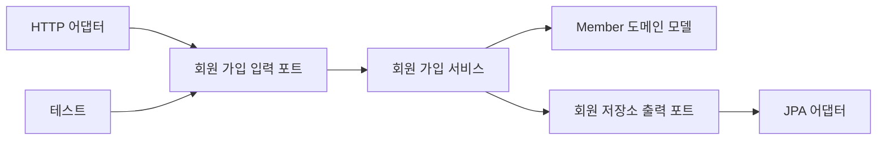

# Designing a Hexagonal Member Application

헥사고날 아키텍처는 애플리케이션과 외부 기술이 만나는 지점을 포트와 어댑터로 표현한다. 포트는 응용 프로그램과 외부의 대화 목적을 드러낸다. HTTP 컨트롤러, 배치, 테스트는 같은 입력 포트를 호출할 수 있고, JPA와 인메모리 구현은 같은 출력 계약을 만족할 수 있다. [Alistair Cockburn · Hexagonal Architecture](https://alistair.cockburn.us/hexagonal-architecture)

## 1. 호출 흐름과 코드 의존성

아래 화살표는 실행 중 호출을 나타낸다. 런타임에 저장소 호출은 JPA 어댑터로 이어지지만, 코드에서 JPA 어댑터가 애플리케이션 소유의 저장소 포트를 구현한다.

패키지명이나 인터페이스 개수보다 경계를 건너는 타입이 중요하다. 입력 포트는 가입 명령과 결과를 정의한다. 출력 포트는 가입에 필요한 조회와 저장 능력을 표현한다. 컨트롤러의 요청 객체와 JPA의 조회 타입은 각 어댑터에서 변환한다. 하나의 목적을 수행하는 관련 작업은 한 포트로 묶을 수 있다. [포트와 어댑터 개요](../architecture-pattern/09_decoupling_business_logic_from_technology_with_ports_and_adapters.md)

## 2. 회원 가입의 책임 나누기

| 위치 | 책임 |
| --- | --- |
| `membership.adapter.in.web` | HTTP 요청을 읽고 유스케이스 명령으로 변환한다. 결과를 HTTP 상태와 응답으로 바꾼다. |
| `membership.application.port.in`·`port.out` | `RegisterMember`, `MemberRepository`처럼 경계를 넘는 계약을 소유한다. |
| `membership.application.service` | 트랜잭션 안에서 중복 여부를 조회하고 도메인에 회원 생성을 요청한 뒤 저장한다. |
| `membership.domain` | 회원·이메일 값과 상태 전이 규칙을 표현한다. |
| `membership.adapter.out.persistence` | 포트의 조회·저장 계약을 실제 영속 기술로 구현한다. |

유스케이스의 요청 명령에는 업무 입력만 담는다. 필수 값과 문자열 형식은 요청 경계에서 검사할 수 있고, 도메인은 언제 호출하더라도 불변식을 지킨다. 이메일 중복에 대한 사전 조회는 빠른 피드백을 주지만, 두 트랜잭션이 동시에 통과할 수 있다. 업무에서 정한 이메일 비교 기준과 맞는 DB 유일 제약을 적용하고, 해당 제약 위반을 중복 이메일 결과로 변환한다. [Spring Bean Validation](https://docs.spring.io/spring-framework/reference/core/validation/beanvalidation.html) · [Jakarta Persistence 3.2](https://jakarta.ee/specifications/persistence/3.2/)

## 3. 변경과 테스트의 경계

회원 활성화를 추가할 때 입력 포트의 요청과 결과를 먼저 정한다. 서비스는 대상 회원과 필요한 사실을 확보하고, 활성화 가능 여부와 상태 변경은 도메인에 맡긴다. 다음 수준에서 서로 다른 실패를 검증한다.

| 테스트 | 확인하는 계약 |
| --- | --- |
| 도메인 단위 테스트 | 현재 회원 상태에서 허용하거나 거절하는 행동 |
| 서비스 테스트 | 포트를 통한 조회·저장 순서와 실패 분기, 필요한 도메인 호출 |
| 저장 어댑터 통합 테스트 | 실제 매핑, DB 제약, 동시 가입, 커밋 경계 |
| 웹 테스트 | HTTP 요청에서 명령으로 변환한 값, 상태 코드와 오류 계약 |

인메모리 어댑터는 업무 흐름을 빠르게 확인하는 데 유용하다. DB 제약 위반이 flush나 commit에서 드러나는 시점은 실제 영속 어댑터와 함께 검증한다. 식별자와 매핑 선택은 [04번](04_jpa_mapping_and_entity_identity_in_domain_models.md), HTTP 계약은 [06번](06_designing_web_api_adapters_and_error_contracts.md)에서 다룬다.
