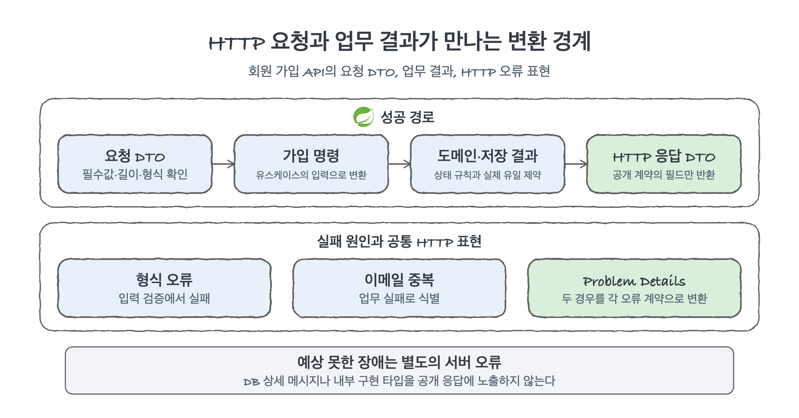

# Designing Web API Adapters and Error Contracts

웹 어댑터는 HTTP 요청을 애플리케이션 명령으로 변환하고, 유스케이스 결과를 HTTP 응답으로 돌려준다. 회원 도메인 모델을 API 응답에 직접 사용하면 상태·저장 관계·지연 로딩 방식의 변화가 클라이언트 계약에 영향을 줄 수 있다. [Alistair Cockburn · Hexagonal Architecture](https://alistair.cockburn.us/hexagonal-architecture)

## 1. 엔티티와 입출력 DTO의 역할

| 타입 | 소유하는 계약 |
| --- | --- |
| 웹 요청 DTO | JSON 필드 이름과 필수 항목, 형식, 요청 버전 |
| 애플리케이션 명령과 결과 | 유스케이스가 요구하는 입력과 호출자에게 돌려줄 결과 |
| 도메인 엔티티 | 회원의 정체성, 상태 전이와 불변식 |
| 웹 응답 DTO | 외부에 공개할 필드와 표현 방식 |

단순한 계약에서는 요청 DTO와 명령이 같은 모양일 수 있다. HTTP 형식·버전이나 업무 요구가 독립적으로 바뀐다면 각 경계에서 변환한다. 공개 응답에는 회원 ID, 표시 이름, 공개 상태처럼 필요한 필드만 선택한다.

## 2. 입력 검증과 오류 변환

컨트롤러의 `@Valid`는 요청 객체의 필수 값과 형식을 검사하는 데 쓸 수 있다. 활성화 가능한 상태나 중복 가입 규칙은 도메인과 애플리케이션이 판단한다. 웹 어댑터는 결과를 HTTP 상태에 매핑한다. 표는 회원 API 계약의 예다. [Spring MVC Validation](https://docs.spring.io/spring-framework/reference/web/webmvc/mvc-controller/ann-validation.html)

| 유스케이스 결과 | HTTP 응답 예 |
| --- | --- |
| 필수 필드 누락 또는 형식 오류 | `400 Bad Request` |
| 대상 회원 없음 | `404 Not Found` |
| 이메일 중복 또는 현재 상태와 충돌 | `409 Conflict` |
| 분류되지 않은 서버 장애 | `500 Internal Server Error`와 일반화된 설명 |

Spring MVC에서는 `@ControllerAdvice`와 `ProblemDetail`로 오류 응답을 구성할 수 있다. `type`과 코드로 실패 종류를 안정적으로 약속하고, `detail`은 사람이 이해할 설명으로 둔다. 응답에는 API 계약에서 공개하기로 한 정보만 담는다. 다음은 이메일 중복을 공개하도록 정한 가입 API의 응답 예다. [Spring MVC Error Responses](https://docs.spring.io/spring-framework/reference/web/webmvc/mvc-ann-rest-exceptions.html) · [RFC 9457](https://www.rfc-editor.org/rfc/rfc9457.html)

```json
{
  "type": "https://api.example.test/problems/email-already-registered",
  "title": "Email already registered",
  "status": 409,
  "detail": "A member already uses this email address.",
  "code": "MEMBER_EMAIL_ALREADY_REGISTERED"
}
```

`application/problem+json` 응답의 HTTP 상태와 `status` 필드는 일치시킨다. 로그인처럼 실패 상세를 공개하기 어려운 계약은 [인증 포트 설계](07_designing_application_ports_for_member_authentication.md)에서 다룬다.



그림의 근거 · [Spring MVC 입력 검증](https://docs.spring.io/spring-framework/reference/web/webmvc/mvc-controller/ann-validation.html) · [Spring MVC 오류 응답](https://docs.spring.io/spring-framework/reference/web/webmvc/mvc-ann-rest-exceptions.html) · [RFC 9457](https://www.rfc-editor.org/rfc/rfc9457.html)

## 3. 테스트 경계 정하기

웹 단위 테스트는 요청 변환, 검증, 상태 코드, 오류 본문을 확인한다. 애플리케이션 포트를 대역으로 둬 각 실패를 쉽게 재현할 수 있다. API 통합 테스트는 실제 요청 경로에서 직렬화, 설정, 예외 변환이 함께 작동하는지 확인한다. 도메인 테스트는 회원 행동 자체에 집중한다. 아키텍처 테스트는 웹 어댑터가 저장소 구현을 직접 참조하는 구조처럼 동작 테스트만으로 드러나지 않는 의존성을 검증한다. [Spring MockMvc](https://docs.spring.io/spring-framework/reference/testing/mockmvc.html) · [테스트와 아키텍처 규칙](09_verifying_hexagonal_architecture_boundaries.md)
