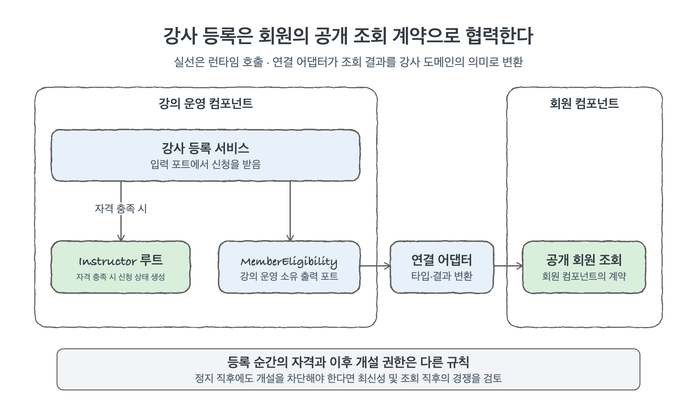

# Connecting Aggregates Through Application Components

애플리케이션 컴포넌트는 함께 바뀌는 업무 기능과 공개 계약을 묶는 단위다. 애그리거트는 그 안에서 트랜잭션 일관성을 지키는 단위다. 강사 등록에 회원 자격이 필요하더라도 강사 승인 상태와 회원 활성 상태를 소유하는 객체는 각각의 업무 규칙에 따라 설계할 수 있다. [Domain-Driven Design Reference](https://www.domainlanguage.com/ddd/reference/) · [Effective Aggregate Design](https://www.dddcommunity.org/library/vernon_2011/)

## 1. 회원과 강사 컴포넌트의 책임

| 구성 | 소유하는 사실과 행동 | 외부에 공개할 계약 |
| --- | --- | --- |
| `membership` | 회원의 가입, 활성화, 이용 정지와 현재 자격 | 회원 식별자와 자격을 확인하는 조회 |
| `teaching` | 강사 신청, 승인, 프로필과 강의 개설 자격 | 강사 등록·승인 유스케이스와 필요한 조회 |
| `Instructor` 애그리거트 | 한 강사의 승인 상태와 허용되는 상태 전이 | 애그리거트 루트의 업무 행동 |

강사의 정체성은 `InstructorId`로 모델링하고, 어떤 회원이 신청했는지는 `MemberId`로 연결한다. 회원이 강사를 하나만 가질 수 있다는 규칙이 필요하다면 그 유일성 범위와 동시 신청을 차단하는 방법을 명시한다.

## 2. 공개 계약으로 협력하기

강사 등록의 입력 포트는 신청 명령을 받는다. 강사 서비스는 자신이 필요로 하는 `MemberEligibility` 출력 포트에서 회원 자격을 확인한다. 연결 어댑터는 회원 컴포넌트가 공개한 조회 계약을 호출하고 결과를 강사 쪽 의미로 변환한다. 조건이 충족되면 `Instructor`가 신규 신청 상태를 만들고 저장 포트가 이를 저장한다.

그림의 근거 · [포트와 어댑터](https://alistair.cockburn.us/hexagonal-architecture) · [애그리거트 협력](https://www.dddcommunity.org/wp-content/uploads/files/pdf_articles/Vernon_2011_2.pdf)

실행 중에는 강사 등록이 회원 조회를 부른다. 코드에서는 연결 어댑터가 강사 쪽의 출력 포트와 회원 쪽의 공개 타입에 의존한다. 회원 컴포넌트의 저장소나 도메인 엔티티를 강사 서비스가 직접 가져오지 않으면, 내부 매핑 변경이 컴포넌트 간 계약으로 퍼지는 범위를 줄일 수 있다. [Alistair Cockburn · Ports and Adapters](https://alistair.cockburn.us/hexagonal-architecture)

## 3. 자격 확인 시점과 코드 리뷰

등록 순간에 유효한 자격만 요구하는지, 회원 정지 이후 이미 등록된 강사도 즉시 제약해야 하는지 구분한다. 이후 상태 전달에 지연을 허용한다면 회원 상태 변경 이벤트와 강사 쪽 후속 처리를 둘 수 있다. 즉시 차단이 요구된다면 강의 개설 유스케이스에서 최신 자격을 판단할 방법과, 조회 직후 계정 상태가 바뀌는 경쟁을 함께 검토한다.

코드 리뷰에서는 다음을 확인한다.

- 강사 상태 전이 규칙이 `Instructor` 루트에 모여 있는가.
- 서비스가 소유하지 않는 애그리거트를 저장소나 ORM 객체를 통해 직접 수정할 수 있는가.
- 외부 컴포넌트와 연결하는 데 필요한 값만 공개 계약으로 전달하는가.
- 경계 밖 변경의 실패나 지연을 어디에서 관측하고 재처리하는가.

컴포넌트 경계는 같은 애플리케이션 안에서도 유지할 수 있다. 독립 배포가 필요해지면 현재 공개 계약을 기준으로 호출 방식, 지연과 장애 처리를 다시 설계한다. [Vaughn Vernon · Aggregate 간 협력](https://www.dddcommunity.org/wp-content/uploads/files/pdf_articles/Vernon_2011_2.pdf)
