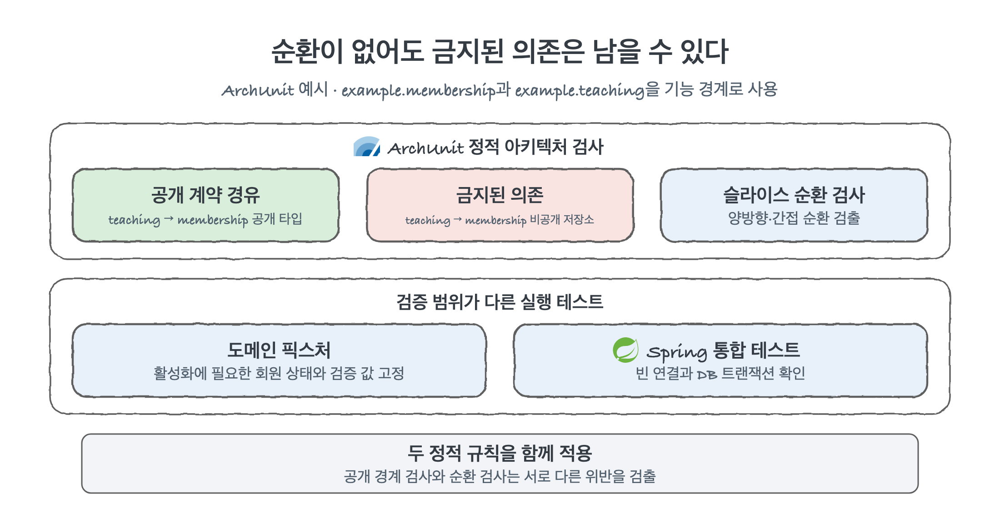

# Verifying Hexagonal Architecture Boundaries

아키텍처 규칙을 코드에 드러내고, 넘어가면 안 되는 의존성을 자동으로 검증한다. 도메인 테스트의 데이터 구성은 규칙에 중요한 값을 잘 보이게 유지한다. 두 작업을 함께 하면 실패했을 때 업무 동작의 문제인지 코드 구조의 문제인지 찾기 쉽다.

## 1. 애플리케이션 역할을 드러내는 스테레오타입

Spring의 `@Component`를 메타 애노테이션으로 붙인 합성 애노테이션을 만들면 컴포넌트 스캔 대상이 될 수 있다. 예를 들어 `@UseCase`로 애플리케이션 서비스를 표시하고 `@PersistenceAdapter`로 영속 어댑터를 표시할 수 있다. 이름과 적용 범위는 패키지 규칙과 맞춘다. 스캔, 트랜잭션 적용, 역할 검증은 해당 애노테이션이 실제로 합성한 기능과 테스트 규칙을 기준으로 판단한다. [Spring Component Javadoc](https://docs.spring.io/spring-framework/docs/current/javadoc-api/org/springframework/stereotype/Component.html) · [Spring Classpath Scanning](https://docs.spring.io/spring-framework/reference/core/beans/classpath-scanning.html)

| 표시 위치 | 검증할 약속 |
| --- | --- |
| `@UseCase` 서비스 | 도메인과 자신이 사용하는 출력 포트로 협력한다. |
| `@PersistenceAdapter` 구현 | 애플리케이션이 소유한 출력 포트를 구현한다. |
| 도메인 모델 | 업무 규칙을 유지하고 웹 어댑터나 서비스 구현에 의존하지 않는다. |

## 2. 테스트 픽스처에 의미가 보이게 하기

활성화 테스트에서는 회원 상태와 이메일 검증 상태를 명시한다. 이 값들은 결과를 결정하므로 케이스별로 고정한다. 이름이나 요청 추적 값처럼 결과에 영향을 주지 않는 주변 데이터는 Instancio 등으로 생성할 수 있다. 생성이 도메인 팩터리를 우회하는 경우에는 테스트 대상이 요구하는 유효 상태를 만들었는지 확인한다.

무작위 데이터로 실패하면 재현에 필요한 seed를 기록한다. 시각이나 외부 상태에 의존하는 테스트라면 테스트 시계와 외부 응답도 고정한다. 경계값, 상태 전이와 금지 조합은 구체적인 사례로 남겨 테스트가 업무 규칙을 설명하도록 한다. [Instancio User Guide · Seed](https://www.instancio.org/user-guide/#seed)

## 3. ArchUnit으로 경계 검증

예제 패키지의 최상위 기능 단위가 `example.membership`과 `example.teaching`이라고 가정한다. 각 타입이 어느 컴포넌트에 속하는지 정한 뒤, 다음 두 규칙을 함께 점검한다.

| 규칙 | 잡아내는 변경 |
| --- | --- |
| 허용된 의존 방향 | 도메인이 웹/저장소 어댑터에 의존하거나, 강사 기능이 회원의 비공개 저장소를 직접 가져오는 경우 |
| 기능 슬라이스의 순환 금지 | 회원과 강사 컴포넌트가 직간접으로 서로를 참조하는 경우 |

아래 ArchUnit 규칙은 `example` 다음의 첫 패키지 요소를 슬라이스로 나눠 순환 의존을 확인한다. 실제 테스트에서 경계를 분석할 때 운영 클래스 범위를 가져오고, 규칙에 걸려야 하는 대표 의존도 확인한다. [ArchUnit · Slices](https://www.archunit.org/userguide/html/000_Index.html#_slices)

```java
var noComponentCycles = SlicesRuleDefinition.slices()
        .matching("example.(*)..")
        .should().beFreeOfCycles();
```

순환 검사는 금지된 단방향 참조까지 알려주지 않는다. 예를 들어 `teaching`이 `membership.adapter.out.persistence`만 참조한다면, 순환이 없는 상태에서도 공개 계약을 우회한다. 패키지별 의존 규칙과 공개 타입 검사를 함께 적용한다. ArchUnit은 바이트코드 의존성을 검사하므로 실제 Spring 빈 조합과 DB 트랜잭션 동작은 통합 테스트에서 확인한다. [ArchUnit 테스트 구성 예시](../java-testing/06_architecture_testing_with_archunit.md)



그림의 근거 · [ArchUnit 슬라이스](https://www.archunit.org/userguide/html/000_Index.html#_slices) · [ArchUnit 의존성 표현](https://www.archunit.org/userguide/html/000_Index.html#_the_core_api) · [Spring 컴포넌트](https://docs.spring.io/spring-framework/reference/core/beans/classpath-scanning.html)
