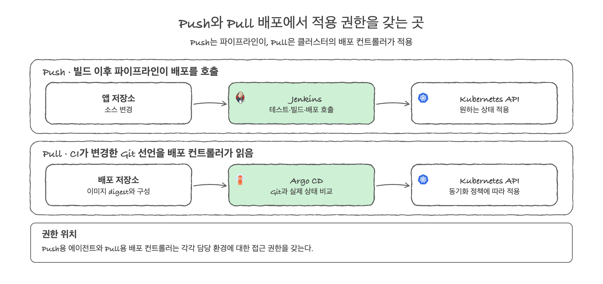

# CI/CD, Push·Pull 배포와 GitOps

## 1. 통합, 배포 준비, 실제 배포

CI(지속적 통합)는 변경을 자주 통합하고 빌드와 테스트로 결과를 빠르게 확인하는 방식이다. 지속적 전달(Continuous Delivery)은 검증된 변경을 언제든 배포할 수 있게 만들며 운영 배포 앞에 승인 단계를 둘 수 있다. 지속적 배포(Continuous Deployment)는 검증을 통과한 변경을 운영까지 자동 배포한다. 어느 경우든 소스 커밋, 테스트 결과, 배포한 산출물을 연결해야 환경별 결과를 비교할 수 있다. [Microsoft Learn · Continuous Integration](https://learn.microsoft.com/en-us/devops/develop/what-is-continuous-integration) · [Jenkins · Pipeline](https://www.jenkins.io/doc/book/pipeline/) · [Kubernetes · Images](https://kubernetes.io/docs/concepts/containers/images/)

예를 들어 상품 목록 API는 스모크 테스트와 오류율 기준으로 배포를 판단할 수 있다. 승인과 추적성이 중요한 서비스에서는 승인자, 승인할 이미지 식별자, 배포 환경을 함께 기록한다. 배포 속도보다 변경 위험이 큰 구간에서는 운영 적용 전에 검증 결과를 검토하는 전달 방식을 선택할 수 있다. [Microsoft Learn · Continuous Delivery](https://learn.microsoft.com/en-us/devops/deliver/what-is-continuous-delivery) · [Jenkins · Pipeline Input Step](https://www.jenkins.io/doc/pipeline/steps/pipeline-input-step/) · [Argo Rollouts · Analysis](https://argo-rollouts.readthedocs.io/en/stable/features/analysis/)

## 2. Kubernetes가 맡는 제어 루프

서버 호스트에서 배포하는 스크립트는 파일 배치, 프로세스 재시작, 정상 상태 확인을 순서대로 실행할 수 있다. Kubernetes를 사용하는 방식에서는 Deployment로 이미지, 복제본, 업데이트 전략이라는 원하는 상태를 선언한다. Kubernetes 컨트롤러가 이를 관찰해 ReplicaSet과 Pod 상태를 맞춘다. 배포 주체는 선언을 Kubernetes API에 반영하고, 실행 상태를 수렴시키는 일은 클러스터의 컨트롤러에 맡긴다. [Kubernetes · Deployments](https://kubernetes.io/docs/concepts/workloads/controllers/deployment/) · [Kubernetes · Controllers](https://kubernetes.io/docs/concepts/architecture/controller/) · [Kubernetes · kubectl apply](https://kubernetes.io/docs/reference/kubectl/generated/kubectl_apply/)

## 3. Push와 Pull에서 바뀌는 실행 주체

Push에서는 Jenkins 같은 배포 파이프라인이 대상 API에 접근해 원하는 상태를 적용한다. 에이전트에는 해당 환경과 리소스에 맞는 인증 수단 및 권한이 필요하다. 장애를 보면 파이프라인 단계, API 접속, 대상 Kubernetes 롤아웃을 함께 확인한다. [Jenkins · Using a Jenkinsfile](https://www.jenkins.io/doc/book/pipeline/jenkinsfile/) · [Kubernetes · kubectl apply](https://kubernetes.io/docs/reference/kubectl/generated/kubectl_apply/) · [Kubernetes · kubeconfig와 컨텍스트](https://kubernetes.io/docs/concepts/configuration/organize-cluster-access-kubeconfig/) · [Kubernetes · Using RBAC Authorization](https://kubernetes.io/docs/reference/access-authn-authz/rbac/)

Pull에서는 Argo CD가 지정된 저장소와 경로를 읽고, 원하는 상태와 대상 클러스터의 실제 상태를 비교한 뒤 정책에 따라 동기화한다. Argo CD가 소스와 대상에 접근할 권한을 갖는다. CI는 이미지 게시와 매니페스트 갱신까지 맡을 수 있으며 그 경우 대상 클러스터에 직접 배포할 자격 증명은 Argo CD 쪽에 둔다. [Argo CD · GitOps CD](https://argo-cd.readthedocs.io/en/stable/) · [Argo CD · Architectural Overview](https://argo-cd.readthedocs.io/en/stable/operator-manual/architecture/) · [Argo CD · Automated Sync Policy](https://argo-cd.readthedocs.io/en/stable/user-guide/auto_sync/)

GitOps의 네 원칙은 선언적 상태, 버전이 붙은 불변 이력, 자동으로 가져오기, 지속적으로 상태 맞추기다. 빌드·테스트·이미지 발행은 CI의 영역으로 두고, 이미지 digest를 반영한 배포 선언을 Git에서 검토한 뒤 컨트롤러가 지속적으로 상태를 비교하도록 연결할 수 있다. [OpenGitOps · GitOps 원칙](https://opengitops.dev/#principles) · [Kubernetes · Images](https://kubernetes.io/docs/concepts/containers/images/) · [Argo CD · Automated Sync Policy](https://argo-cd.readthedocs.io/en/stable/user-guide/auto_sync/)

원하는 상태를 읽는 곳과 실제 적용 권한을 가진 실행 주체를 비교했다. [Jenkins · Using a Jenkinsfile](https://www.jenkins.io/doc/book/pipeline/jenkinsfile/) · [Kubernetes · kubectl apply](https://kubernetes.io/docs/reference/kubectl/generated/kubectl_apply/) · [Argo CD · Architectural Overview](https://argo-cd.readthedocs.io/en/stable/operator-manual/architecture/) · [Argo CD · Automated Sync Policy](https://argo-cd.readthedocs.io/en/stable/user-guide/auto_sync/)

## 4. 도입 상태를 점검하는 기준

- 선언과 이력. 현재 배포 상태를 저장소의 특정 리비전에서 재구성할 수 있는지, 태그가 바뀌어도 같은 digest를 사용할 수 있는지 확인한다. [OpenGitOps · GitOps 원칙](https://opengitops.dev/#principles) · [Kubernetes · Images](https://kubernetes.io/docs/concepts/containers/images/)
- 적용과 차이. 누가 어떤 권한으로 배포하는지, 운영 중 생긴 차이를 탐지만 할지 자동 보정할지, 삭제는 어떤 정책에 따르는지 확인한다. [OpenGitOps · GitOps 원칙](https://opengitops.dev/#principles) · [Argo CD · Automated Sync Policy](https://argo-cd.readthedocs.io/en/stable/user-guide/auto_sync/) · [Kubernetes · Using RBAC Authorization](https://kubernetes.io/docs/reference/access-authn-authz/rbac/)
- 복구와 검증. 이전 선언으로 돌아가는 경로와 서비스 정상 판정 기준을 갖추고, 적용 완료와 실제 사용자 요청 성공을 각각 확인한다. [Git · git revert](https://git-scm.com/docs/git-revert) · [Kubernetes · Deployments](https://kubernetes.io/docs/concepts/workloads/controllers/deployment/) · [Argo CD · Resource Health](https://argo-cd.readthedocs.io/en/stable/operator-manual/health/)
