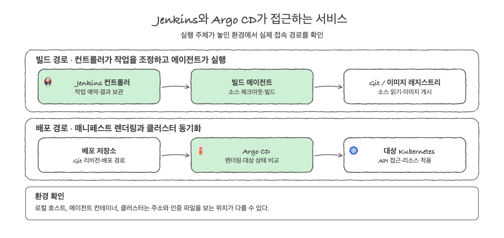

# Jenkins와 Argo CD 환경 설계

## 1. 제어 지점과 네트워크 경로

Jenkins 컨트롤러는 작업을 계획하고 결과를 저장하며, 에이전트가 체크아웃·테스트·이미지 빌드·배포 명령을 실행한다. Argo CD는 Kubernetes 안에서 애플리케이션 상태를 비교하고 적용하는 컨트롤러와 매니페스트를 생성하는 저장소 서버 등을 실행한다. 두 도구를 함께 구성할 때는 Jenkins 에이전트에서 Git과 레지스트리까지, Argo CD에서 Git과 대상 클러스터 API까지의 접속 경로를 확인한다. [Jenkins · Managing Nodes](https://www.jenkins.io/doc/book/managing/nodes/) · [Jenkins · Controller Isolation](https://www.jenkins.io/doc/book/security/controller-isolation/) · [Argo CD · Architectural Overview](https://argo-cd.readthedocs.io/en/stable/operator-manual/architecture/)

빌드 에이전트와 배포 컨트롤러에 필요한 연결을 나눠 그렸다. [Jenkins · Managing Nodes](https://www.jenkins.io/doc/book/managing/nodes/) · [Argo CD · Architectural Overview](https://argo-cd.readthedocs.io/en/stable/operator-manual/architecture/) · [Kubernetes · kubeconfig와 컨텍스트](https://kubernetes.io/docs/concepts/configuration/organize-cluster-access-kubeconfig/) · [Docker · Docker Compose](https://docs.docker.com/compose/)

## 2. macOS와 Windows에서 확인할 실행 조건

Docker Desktop과 Compose의 지원 조건은 호스트 운영체제와 CPU 아키텍처에 맞춰 확인한다. macOS에서는 Intel과 Apple Silicon용 설치 파일을 구분하고, Windows에서 WSL 2 백엔드를 사용할 때는 Docker를 실행할 Windows 또는 WSL 터미널과 배포판 통합 설정을 일치시킨다. Kubernetes 명령도 같은 환경에서 kubeconfig가 접근 가능한지 확인한다. [Docker · Docker Desktop on Mac](https://docs.docker.com/desktop/setup/install/mac-install/) · [Docker · Docker Desktop WSL 2 backend](https://docs.docker.com/desktop/features/wsl/) · [Docker · Docker Compose](https://docs.docker.com/compose/) · [Kubernetes · kubeconfig와 컨텍스트](https://kubernetes.io/docs/concepts/configuration/organize-cluster-access-kubeconfig/)

컨테이너 기반 로컬 Kubernetes로 kind를 사용할 수 있다. `kubectl`의 현재 컨텍스트와 네임스페이스를 확인하고, Jenkins의 배포 단계가 실행되는 에이전트에서 동일한 클러스터 API에 접속 가능한지 확인한다. 같은 머신에서 시작했어도 에이전트가 컨테이너에 있으면 그 환경에서 보이는 주소와 파일 경로를 사용한다. [kind · Quick Start](https://kind.sigs.k8s.io/docs/user/quick-start/) · [Kubernetes · kubeconfig와 컨텍스트](https://kubernetes.io/docs/concepts/configuration/organize-cluster-access-kubeconfig/) · [Docker · Docker Compose](https://docs.docker.com/compose/) · [Jenkins · Managing Nodes](https://www.jenkins.io/doc/book/managing/nodes/)

## 3. Docker Compose로 Jenkins 구성

Compose의 서비스로 Jenkins 컨트롤러를 정의할 수 있다. 운영 중 사용할 Jenkins 릴리스와 Java 지원 범위를 확인하고, Jenkins 홈(`/var/jenkins_home`)을 지속되는 볼륨에 저장한다. 에이전트용 빌드 도구, 레지스트리 접근, 컨트롤러 UI 접근은 역할에 맞게 구성한다. Jenkins 자체를 컨테이너에서 실행하는 것과 에이전트가 이미지를 빌드할 수 있도록 빌더를 준비하는 것은 별도의 구성이다. [Jenkins · Docker 설치](https://www.jenkins.io/doc/book/installing/docker/) · [Jenkins · Java Support Policy](https://www.jenkins.io/doc/book/platform-information/support-policy-java/) · [Docker · Docker Compose](https://docs.docker.com/compose/) · [Jenkins · Controller Isolation](https://www.jenkins.io/doc/book/security/controller-isolation/)

## 4. Argo CD 컨트롤러·CLI·Git 저장소

Argo CD 배포 구성은 Kubernetes에 설치하고, `argocd` CLI는 사용자 단말에서 API 서버와 통신한다. macOS와 Windows에서는 운영체제에 맞는 바이너리를 준비하고, 대상 서버와 버전, 접속 인증을 확인한다. 설치 후에는 Argo CD 구성 요소의 상태와 저장소 접근을 살핀 다음, 어떤 저장소 경로를 어느 클러스터와 네임스페이스에 적용할지 정한다. [Argo CD · Getting Started](https://argo-cd.readthedocs.io/en/stable/getting_started/) · [Argo CD · CLI Installation](https://argo-cd.readthedocs.io/en/stable/cli_installation/) · [Argo CD · Architectural Overview](https://argo-cd.readthedocs.io/en/stable/operator-manual/architecture/) · [Argo CD · Application Specification](https://argo-cd.readthedocs.io/en/stable/user-guide/application-specification/)

저장소는 애플리케이션 소스와 배포 선언의 변경 권한을 정한 뒤 생성한다. 초기 커밋에는 각 저장소가 맡는 파일과 최소 구성을 기록하고, 비공개 저장소에는 파이프라인의 쓰기 권한과 Argo CD의 읽기 권한을 나눠 부여한다. [상품 API의 이미지와 매니페스트](03_preparing_container_images_and_kustomize_manifests.md)는 두 저장소 구조를 사용한다. [Git · git init](https://git-scm.com/docs/git-init) · [Argo CD · 배포 구성 저장소 분리](https://argo-cd.readthedocs.io/en/stable/user-guide/best_practices/#separating-config-vs-source-code-repositories) · [Argo CD · Security Considerations](https://argo-cd.readthedocs.io/en/stable/operator-manual/security/)
