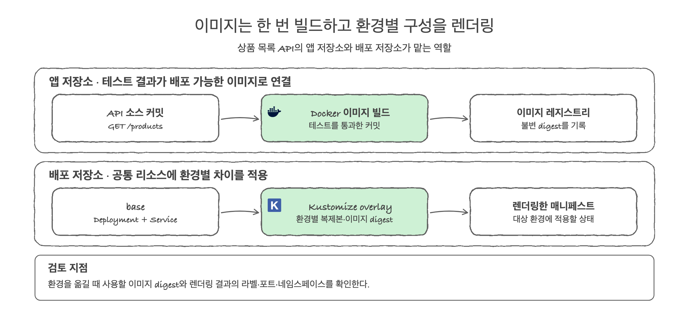

# 상품 목록 API의 컨테이너 이미지와 Kustomize 구성

## 1. 상품 목록 API를 배포 가능한 이미지로 만들기

이 문서에서는 `GET /products`가 상품 목록을 반환하는 API를 예로 든다. CI는 해당 커밋으로 테스트를 실행하고, Dockerfile로 런타임 이미지를 빌드해 레지스트리에 게시한다. 멀티스테이지 빌드를 사용하면 빌드에 필요한 도구와 런타임에 필요한 파일을 분리할 수 있다. 배포 선언에는 검증을 통과한 이미지의 digest를 남겨 환경을 옮길 때 같은 바이트를 가리키게 한다. [Jenkins · Using a Jenkinsfile](https://www.jenkins.io/doc/book/pipeline/jenkinsfile/) · [Docker · Building best practices](https://docs.docker.com/build/building/best-practices/) · [Kubernetes · Images](https://kubernetes.io/docs/concepts/containers/images/)

## 2. Deployment와 Service 연결

Deployment는 Pod 템플릿에 이미지, 포트, 상태 검사와 리소스를 선언하고 ReplicaSet을 통해 업데이트를 관리한다. Service는 셀렉터에 맞는 Pod에 접근할 안정적인 주소를 제공한다. 예를 들어 Service의 `port: 80`을 앱의 `targetPort: 8080`에 연결하고, Service 셀렉터와 Deployment의 Pod 라벨이 일치하는지 확인한다. 준비 상태 검사에 실패한 Pod는 일반적인 Service 트래픽의 준비된 대상에서 제외된다. [Kubernetes · Deployments](https://kubernetes.io/docs/concepts/workloads/controllers/deployment/) · [Kubernetes · Service](https://kubernetes.io/docs/concepts/services-networking/service/) · [Kubernetes · Readiness, liveness 및 startup probes](https://kubernetes.io/docs/tasks/configure-pod-container/configure-liveness-readiness-startup-probes/)

## 3. Kustomize 공통 구성과 환경별 차이

공통 Deployment와 Service는 `base/`에 두고, `overlays/dev`, `overlays/staging`, `overlays/production`에서 필요한 차이만 선언한다. 예를 들어 운영 환경의 복제본 수와 이미지 digest를 overlay에서 지정한다. Argo CD의 Application은 배포할 overlay 경로를 가리킨다. 리뷰에서는 구성 파일과 함께 해당 overlay를 빌드한 결과의 이미지, 포트, 이름과 네임스페이스를 확인한다. [Kubernetes · Kustomize](https://kubernetes.io/docs/tasks/manage-kubernetes-objects/kustomization/) · [Argo CD · Kustomize](https://argo-cd.readthedocs.io/en/stable/user-guide/kustomize/) · [Argo CD · Application Specification](https://argo-cd.readthedocs.io/en/stable/user-guide/application-specification/)

초기 저장소의 예다. 앱에서는 이미지 빌드에 필요한 파일을 버전 관리하고, 매니페스트 저장소의 각 overlay는 공통 리소스를 가져와 배포 환경에 맞는 변경을 적용한다. [Argo CD · 배포 구성 저장소 분리](https://argo-cd.readthedocs.io/en/stable/user-guide/best_practices/#separating-config-vs-source-code-repositories) · [Git · git init](https://git-scm.com/docs/git-init) · [Kubernetes · Kustomize](https://kubernetes.io/docs/tasks/manage-kubernetes-objects/kustomization/)

```text
products-api/
  src/
  Dockerfile
  Jenkinsfile

products-deploy/
  base/
    deployment.yaml
    service.yaml
    kustomization.yaml
  overlays/
    dev/kustomization.yaml
    staging/kustomization.yaml
    production/kustomization.yaml
```



이미지 생성과 배포 매니페스트 렌더링을 두 경로로 표시했다. [Docker · Building best practices](https://docs.docker.com/build/building/best-practices/) · [Kubernetes · Images](https://kubernetes.io/docs/concepts/containers/images/) · [Kubernetes · Kustomize](https://kubernetes.io/docs/tasks/manage-kubernetes-objects/kustomization/) · [Kubernetes · Service](https://kubernetes.io/docs/concepts/services-networking/service/)

## 4. 두 저장소의 초기 커밋과 승격

앱 저장소에서는 테스트 방법과 빌드 가능한 Dockerfile을 초기 커밋에 남긴다. 매니페스트 저장소에서는 공통 리소스, 환경별 overlay, 최초 검증 이미지의 참조를 커밋한다. 이후 운영 승격은 환경 선언이 가리키는 digest가 어떻게 달라지는지 Git 변경에서 확인한다. 저장소에는 토큰, kubeconfig, 평문 자격 증명을 넣지 않고, 해당 값을 참조해 주입할 방식을 환경에 맞게 정한다. [Git · git init](https://git-scm.com/docs/git-init) · [Argo CD · 배포 구성 저장소 분리](https://argo-cd.readthedocs.io/en/stable/user-guide/best_practices/#separating-config-vs-source-code-repositories) · [Kubernetes · Images](https://kubernetes.io/docs/concepts/containers/images/) · [Kubernetes · Secrets](https://kubernetes.io/docs/concepts/configuration/secret/) · [Jenkins · Using Credentials](https://www.jenkins.io/doc/book/using/using-credentials/)
