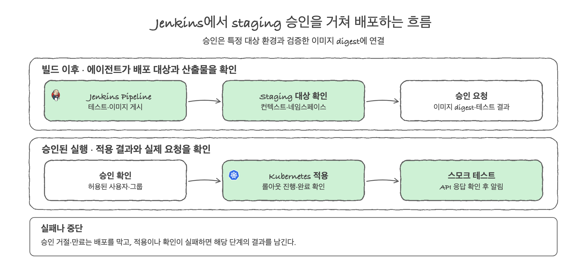

# Jenkins로 Push 기반 CI/CD 설계하기

## 1. 컨트롤러, 에이전트와 Jenkinsfile

컨트롤러는 파이프라인 실행을 조정하고, 에이전트가 워크스페이스에서 빌드와 테스트, 배포 명령을 실행한다. `Jenkinsfile`을 저장소에 두면 파이프라인 변경도 코드 변경과 함께 검토할 수 있다. Declarative Pipeline에서는 `agent`로 실행 위치를 정하고, `stages`와 `steps`로 확인 지점과 실행을 정의한다. [Jenkins · Managing Nodes](https://www.jenkins.io/doc/book/managing/nodes/) · [Jenkins · Pipeline](https://www.jenkins.io/doc/book/pipeline/) · [Jenkins · Using a Jenkinsfile](https://www.jenkins.io/doc/book/pipeline/jenkinsfile/) · [Jenkins · Declarative Pipeline Syntax](https://www.jenkins.io/doc/book/pipeline/syntax/)

상품 API에서는 체크아웃 → 테스트 → 이미지 빌드·게시 → 대상 환경 확인 → 적용 → 롤아웃·스모크 테스트 순서로 구성할 수 있다. 배포 단계에는 앞서 게시한 digest와 허용된 대상 컨텍스트·네임스페이스를 넘긴다. Kubernetes API가 설정을 받아들였는지, Deployment 롤아웃이 완료됐는지, API 요청이 성공했는지를 순서대로 확인한다. [Jenkins · Using a Jenkinsfile](https://www.jenkins.io/doc/book/pipeline/jenkinsfile/) · [Kubernetes · Images](https://kubernetes.io/docs/concepts/containers/images/) · [Kubernetes · kubectl apply](https://kubernetes.io/docs/reference/kubectl/generated/kubectl_apply/) · [Kubernetes · Deployments](https://kubernetes.io/docs/concepts/workloads/controllers/deployment/)

## 2. 자격 증명과 에이전트 권한

Jenkins 자격 증명에는 비밀 문자열, 사용자 이름과 비밀번호, 파일, SSH 키 등이 있다. `credentials()` 또는 `withCredentials`로 필요한 단계에만 바인딩한다. 레지스트리 게시용과 환경별 배포용 자격 증명은 목적에 맞게 분리한다. 콘솔 마스킹은 로그의 우발적 노출을 줄여 주므로, 스크립트 디버그 출력과 비밀을 다루는 에이전트의 작업 격리도 함께 검토한다. [Jenkins · Using Credentials](https://www.jenkins.io/doc/book/using/using-credentials/) · [Jenkins · Declarative Pipeline Syntax](https://www.jenkins.io/doc/book/pipeline/syntax/) · [Jenkins · Credentials Binding](https://www.jenkins.io/doc/pipeline/steps/credentials-binding/) · [Jenkins · Controller Isolation](https://www.jenkins.io/doc/book/security/controller-isolation/)

Kubernetes 배포 단계는 허용한 환경의 리소스에 필요한 동작만 수행하도록 RBAC를 정한다. 에이전트에 전달하는 kubeconfig는 승인된 클러스터와 인증 경로를 가리켜야 한다. Jenkins의 작업 실행 권한과 Kubernetes 리소스 변경 권한은 각각 설정하고 확인한다. [Kubernetes · kubeconfig와 컨텍스트](https://kubernetes.io/docs/concepts/configuration/organize-cluster-access-kubeconfig/) · [Kubernetes · Using RBAC Authorization](https://kubernetes.io/docs/reference/access-authn-authz/rbac/) · [Jenkins · Managing Security](https://www.jenkins.io/doc/book/security/managing-security/)

## 3. 파라미터와 승인 단계

`parameters`의 선택형 파라미터로 `dev` 또는 `staging`을 고르게 할 수 있다. 파라미터 값은 미리 정한 컨텍스트와 네임스페이스에 매핑하고, 해당 배포에 사용할 이미지 digest와 테스트 결과를 승인 화면에 남긴다. Staging 앞에 `input`을 배치하고 승인할 사용자나 그룹(`submitter`)을 지정한다. 승인 대기에는 타임아웃을 둔다. [Jenkins · Declarative Pipeline Syntax](https://www.jenkins.io/doc/book/pipeline/syntax/) · [Jenkins · Pipeline Input Step](https://www.jenkins.io/doc/pipeline/steps/pipeline-input-step/) · [Kubernetes · kubeconfig와 컨텍스트](https://kubernetes.io/docs/concepts/configuration/organize-cluster-access-kubeconfig/)

Jenkins의 인증과 인가는 별개다. 역할 기반 인가 플러그인을 사용한다면 전역 역할과 작업 또는 폴더에 적용하는 역할의 범위를 구분한다. 작업을 읽거나 빌드할 수 있는 사람, 승인할 사람, 작업 설정을 변경할 사람을 각각 정한다. Jenkins 관리자에게는 별도 권한이 있으므로 승인자 목록은 전체 관리자 권한 모델과 함께 검토한다. [Jenkins · Managing Security](https://www.jenkins.io/doc/book/security/managing-security/) · [Jenkins 플러그인 · Role-based Authorization Strategy](https://plugins.jenkins.io/role-strategy/) · [Jenkins · Pipeline Input Step](https://www.jenkins.io/doc/pipeline/steps/pipeline-input-step/)

승인에 사용한 정보와 배포 성공을 판정하는 지점을 표시했다. [Jenkins · Declarative Pipeline Syntax](https://www.jenkins.io/doc/book/pipeline/syntax/) · [Jenkins · Pipeline Input Step](https://www.jenkins.io/doc/pipeline/steps/pipeline-input-step/) · [Kubernetes · Deployments](https://kubernetes.io/docs/concepts/workloads/controllers/deployment/) · [Jenkins 플러그인 · Slack Notification](https://plugins.jenkins.io/slack/)

## 4. post 블록, Slack 알림과 배포 결과

Declarative Pipeline의 `post`에서는 `success`, `failure`, `aborted`, `always` 등 단계나 전체 파이프라인의 결과에 맞춰 알림과 기록을 남긴다. Slack Notification 플러그인을 쓰면 `slackSend`로 결과를 전송할 수 있다. 메시지에는 작업 링크, 환경, 배포 digest, 실패한 단계처럼 원인 조사에 필요한 정보만 넣는다. 인증 토큰은 자격 증명 저장소에서 관리한다. [Jenkins · Declarative Pipeline Syntax](https://www.jenkins.io/doc/book/pipeline/syntax/) · [Jenkins 플러그인 · Slack Notification](https://plugins.jenkins.io/slack/) · [Jenkins · Credentials Binding](https://www.jenkins.io/doc/pipeline/steps/credentials-binding/)

배포 성공 알림은 Kubernetes 상태 확인과 스모크 테스트를 통과한 뒤에 보낸다. 빌드 성공과 배포 성공을 따로 기록하면, 이미지 발행이 끝났으나 클러스터 적용이 실패한 경우에도 게시된 이미지와 이전 운영 리비전을 찾을 수 있다. [Jenkins · Using a Jenkinsfile](https://www.jenkins.io/doc/book/pipeline/jenkinsfile/) · [Kubernetes · Deployments](https://kubernetes.io/docs/concepts/workloads/controllers/deployment/) · [Jenkins 플러그인 · Slack Notification](https://plugins.jenkins.io/slack/)
