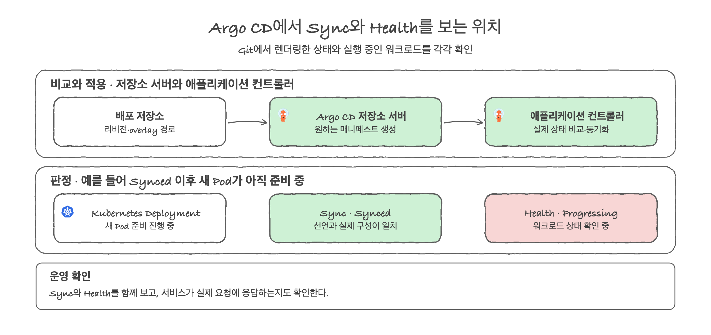

# Argo CD로 Pull 기반 배포 운영하기

## 1. API 서버, 저장소 서버와 애플리케이션 컨트롤러

Argo CD API 서버는 UI와 CLI 요청, 인증·인가를 처리한다. 저장소 서버는 소스 리비전과 경로를 사용해 원하는 매니페스트를 생성한다. 애플리케이션 컨트롤러는 렌더링 결과와 클러스터의 실제 리소스를 비교하고 동기화를 수행한다. 접근 오류, 매니페스트 렌더링 오류, 클러스터 적용 오류는 서로 다른 지점에서 확인한다. [Argo CD · Architectural Overview](https://argo-cd.readthedocs.io/en/stable/operator-manual/architecture/)

## 2. Application이 묶는 배포 단위와 상태

`Application`은 어떤 프로젝트 정책 아래에서 소스(`repoURL`, `targetRevision`, `path`)의 선언을 어디(`destination`의 클러스터와 네임스페이스)에 적용할지 정의한다. 상품 API의 경우 `products-deploy` 저장소의 `overlays/production`을 운영 네임스페이스에 연결할 수 있다. [Argo CD · Application Specification](https://argo-cd.readthedocs.io/en/stable/user-guide/application-specification/) · [Argo CD · Kustomize](https://argo-cd.readthedocs.io/en/stable/user-guide/kustomize/)

Sync는 원하는 구성과 실제 구성이 일치하는지를, Health는 리소스별 상태 검사에 비춰 워크로드가 정상인지 보여 준다. `Synced`인 동시에 `Progressing` 또는 `Degraded`일 수 있다. 사용자가 체감하는 정상 여부는 서비스 요청과 운영 지표로도 확인한다. [Argo CD · GitOps CD](https://argo-cd.readthedocs.io/en/stable/) · [Argo CD · Resource Health](https://argo-cd.readthedocs.io/en/stable/operator-manual/health/) · [Kubernetes · Deployments](https://kubernetes.io/docs/concepts/workloads/controllers/deployment/) · [Kubernetes · Readiness, liveness 및 startup probes](https://kubernetes.io/docs/tasks/configure-pod-container/configure-liveness-readiness-startup-probes/)

동기화 여부와 워크로드 정상 여부가 각각 답하는 질문을 비교했다. [Argo CD · Architectural Overview](https://argo-cd.readthedocs.io/en/stable/operator-manual/architecture/) · [Argo CD · Application Specification](https://argo-cd.readthedocs.io/en/stable/user-guide/application-specification/) · [Argo CD · Resource Health](https://argo-cd.readthedocs.io/en/stable/operator-manual/health/) · [Kubernetes · Deployments](https://kubernetes.io/docs/concepts/workloads/controllers/deployment/)

## 3. 자동 동기화, 삭제와 드리프트 보정

- `automated.enabled`는 자동 동기화를 제어한다. `prune`은 Git에서 사라진 관리 리소스를 자동으로 삭제하도록 허용하며, `allowEmpty`는 자동 삭제가 전체 리소스를 비우는 경우에 적용되는 별도 제어다. 삭제가 승격의 일부라면 먼저 동기화 대상과 영향 범위를 확인한다. [Argo CD · Automated Sync Policy](https://argo-cd.readthedocs.io/en/stable/user-guide/auto_sync/)
- `selfHeal`은 실제 상태에서 발생한 드리프트를 Git의 선언에 맞추도록 한다. HPA나 다른 컨트롤러가 필드를 관리한다면 어느 제어 루프가 그 값을 관리할지 정한다. 차이 표시를 무시하는 규칙을 실제 동기화에도 적용하려는 경우 `RespectIgnoreDifferences`의 적용 조건을 확인한다. [Argo CD · Automated Sync Policy](https://argo-cd.readthedocs.io/en/stable/user-guide/auto_sync/) · [Argo CD · Diff Customization](https://argo-cd.readthedocs.io/en/stable/user-guide/diffing/) · [Argo CD · RespectIgnoreDifferences](https://argo-cd.readthedocs.io/en/stable/user-guide/sync-options/#respect-ignore-differences-configs) · [Kubernetes · Horizontal Pod Autoscaling](https://kubernetes.io/docs/concepts/workloads/autoscaling/horizontal-pod-autoscale/)

## 4. App of Apps와 ApplicationSet

App of Apps에서는 부모 Application의 소스가 자식 Application들의 선언을 포함한다. 부트스트랩에서 유용하며 자식 Application의 프로젝트를 지정할 수 있는 저장소의 변경 권한은 관리자 범위로 관리한다. 자식과 워크로드의 삭제가 어떻게 이어질지는 설정한 finalizer와 동기화 정책을 대조한다. [Argo CD · Cluster Bootstrapping](https://argo-cd.readthedocs.io/en/stable/operator-manual/cluster-bootstrapping/) · [Argo CD · Application Specification](https://argo-cd.readthedocs.io/en/stable/user-guide/application-specification/)

ApplicationSet은 템플릿에 List·Git·Cluster 등의 generator 결과를 넣어 여러 Application을 생성한다. 예를 들어 dev, staging, production마다 다른 overlay와 네임스페이스를 연결할 수 있다. 생성된 Application의 소유 관계와 삭제 시 워크로드 보존 동작을 확인하고, 생성된 Application의 정책 변경은 ApplicationSet 템플릿에서 관리한다. [Argo CD · ApplicationSet](https://argo-cd.readthedocs.io/en/stable/operator-manual/applicationset/) · [Argo CD · Generators](https://argo-cd.readthedocs.io/en/stable/operator-manual/applicationset/Generators/) · [Argo CD · Application Pruning & Resource Deletion](https://argo-cd.readthedocs.io/en/stable/operator-manual/applicationset/Application-Deletion/) · [Argo CD · Automated Sync Policy](https://argo-cd.readthedocs.io/en/stable/user-guide/auto_sync/)

## 5. AppProject, RBAC와 토큰

`AppProject`는 허용할 소스 저장소, 대상 클러스터·네임스페이스, 리소스 종류를 제한한다. 사용자가 어떤 Application을 읽거나 동기화할 수 있는지는 Argo CD RBAC와 프로젝트 역할이 정한다. 자동화에 프로젝트 역할 JWT가 필요하면 필요한 권한만 부여하고, 유효기간과 발급·폐기 책임을 정한다. 컨트롤러가 Kubernetes에서 수행할 수 있는 작업 범위는 클러스터 자격 증명과 Kubernetes 권한도 함께 확인한다. [Argo CD · Projects](https://argo-cd.readthedocs.io/en/stable/user-guide/projects/) · [Argo CD · RBAC Configuration](https://argo-cd.readthedocs.io/en/stable/operator-manual/rbac/) · [Argo CD · Security Considerations](https://argo-cd.readthedocs.io/en/stable/operator-manual/security/) · [Kubernetes · Using RBAC Authorization](https://kubernetes.io/docs/reference/access-authn-authz/rbac/)

## 6. 이력 조회와 복구

`argocd app history`로 적용 이력과 ID를 확인할 수 있다. `argocd app rollback`은 이전 이력으로 동기화하며 자동 동기화가 활성화된 Application에서는 수행할 수 없다. GitOps 복구에서는 승인된 이전 이미지·설정을 Git에 복원하고 Argo CD가 그 선언을 적용하도록 한다. 복구가 끝났는지는 리비전, Sync·Health, 실제 요청 결과를 함께 확인한다. [Argo CD · argocd app history](https://argo-cd.readthedocs.io/en/stable/user-guide/commands/argocd_app_history/) · [Argo CD · argocd app rollback](https://argo-cd.readthedocs.io/en/stable/user-guide/commands/argocd_app_rollback/) · [Argo CD · Automated Sync Policy](https://argo-cd.readthedocs.io/en/stable/user-guide/auto_sync/) · [Git · git revert](https://git-scm.com/docs/git-revert) · [Argo CD · Resource Health](https://argo-cd.readthedocs.io/en/stable/operator-manual/health/)
