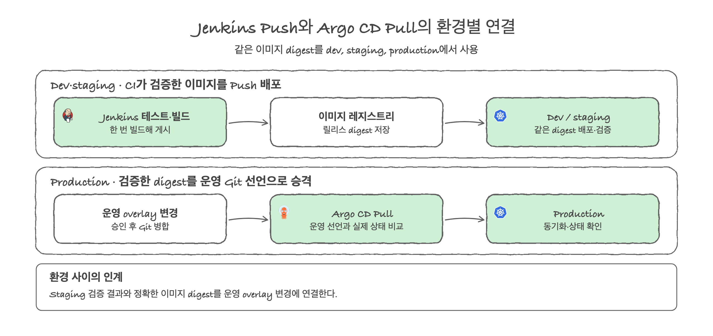

# Jenkins Push와 Argo CD Pull을 결합하는 파이프라인

## 1. 빌드 한 번, 환경별 승격

상품 API의 한 릴리스에서 Jenkins는 테스트와 이미지 게시를 맡는다. Dev와 staging에는 Jenkins 에이전트가 같은 이미지 digest를 사용해 Push 배포한다. Production은 운영 overlay의 digest 변경을 Git으로 검토한 뒤 Argo CD가 원하는 상태를 적용한다. 승인 기준에는 이전 환경의 검증 결과, 승격할 digest와 되돌릴 Git 리비전을 포함한다. [Jenkins · Using a Jenkinsfile](https://www.jenkins.io/doc/book/pipeline/jenkinsfile/) · [Jenkins · Pipeline Input Step](https://www.jenkins.io/doc/pipeline/steps/pipeline-input-step/) · [Kubernetes · Images](https://kubernetes.io/docs/concepts/containers/images/) · [Argo CD · 배포 구성 저장소 분리](https://argo-cd.readthedocs.io/en/stable/user-guide/best_practices/#separating-config-vs-source-code-repositories) · [Argo CD · Automated Sync Policy](https://argo-cd.readthedocs.io/en/stable/user-guide/auto_sync/)

아래 흐름에서 운영 환경의 적용은 Git 변경을 Argo CD가 관찰한 뒤에 일어난다. [Kubernetes · Images](https://kubernetes.io/docs/concepts/containers/images/) · [Argo CD · 배포 구성 저장소 분리](https://argo-cd.readthedocs.io/en/stable/user-guide/best_practices/#separating-config-vs-source-code-repositories) · [Argo CD · Automated Sync Policy](https://argo-cd.readthedocs.io/en/stable/user-guide/auto_sync/)

환경별 배포 주체는 다르고 검증한 산출물은 같은 흐름이다. [Kubernetes · Images](https://kubernetes.io/docs/concepts/containers/images/) · [Argo CD · 배포 구성 저장소 분리](https://argo-cd.readthedocs.io/en/stable/user-guide/best_practices/#separating-config-vs-source-code-repositories) · [Argo CD · Automated Sync Policy](https://argo-cd.readthedocs.io/en/stable/user-guide/auto_sync/) · [Jenkins · Pipeline Input Step](https://www.jenkins.io/doc/pipeline/steps/pipeline-input-step/)

## 2. 환경별 배포 주체와 권한

Dev·staging Push 자격 증명은 해당 클러스터 또는 네임스페이스를 대상으로만 발급한다. Production에서는 Argo CD의 `AppProject`가 승인된 저장소, 대상, 리소스 종류를 제한한다. 운영 저장소 쓰기·병합 권한, Argo CD의 저장소 읽기 권한, 대상 Kubernetes 변경 권한을 따로 확인한다. 운영 리소스별 배포 주체를 정해 Jenkins와 Argo CD가 같은 필드를 반복해서 덮어쓰는 상황을 예방한다. 배포 단계는 [Jenkins Push](04_designing_jenkins_push_delivery_pipelines.md)와 [Argo CD Pull](05_operating_pull_based_delivery_with_argo_cd.md)에서 각각 확인할 수 있다. [Kubernetes · Using RBAC Authorization](https://kubernetes.io/docs/reference/access-authn-authz/rbac/) · [Argo CD · Projects](https://argo-cd.readthedocs.io/en/stable/user-guide/projects/) · [Argo CD · Security Considerations](https://argo-cd.readthedocs.io/en/stable/operator-manual/security/) · [Argo CD · Diff Customization](https://argo-cd.readthedocs.io/en/stable/user-guide/diffing/) · [GitHub · Protected branches](https://docs.github.com/en/repositories/configuring-branches-and-merges-in-your-repository/managing-protected-branches/about-protected-branches)

## 3. 실패 지점별 중단과 복구

- 테스트·이미지 게시 실패. 새 리비전의 운영 overlay 변경을 만들기 전에 실패한 단계를 확인한다. Jenkins 작업 결과와 레지스트리의 이미지 존재 여부를 보고 재시도할 지점을 정한다. [Jenkins · Using a Jenkinsfile](https://www.jenkins.io/doc/book/pipeline/jenkinsfile/) · [Kubernetes · Images](https://kubernetes.io/docs/concepts/containers/images/)
- Staging 롤아웃·검증 실패. 운영 승격을 보류하고 이벤트, Deployment 진행 상태, API 확인 결과를 대조한다. 복구한 뒤 다시 검증한 digest를 승격 대상으로 삼는다. [Kubernetes · Deployments](https://kubernetes.io/docs/concepts/workloads/controllers/deployment/) · [Kubernetes · Debug Running Pods](https://kubernetes.io/docs/tasks/debug/debug-application/debug-running-pod/) · [Jenkins · Pipeline Input Step](https://www.jenkins.io/doc/pipeline/steps/pipeline-input-step/)
- Production 동기화·Health 실패. Argo CD 알림에서 운영 변경의 리비전과 실패 상태를 확인하고, 이전 운영 선언이 필요한 경우 Git에서 변경을 복원한다. 알림은 대상 환경과 상태를 구분해 CI 성공 메시지와 실제 배포 결과를 연결한다. [Argo CD · Notifications](https://argo-cd.readthedocs.io/en/stable/operator-manual/notifications/) · [Argo CD · Notification Triggers](https://argo-cd.readthedocs.io/en/stable/operator-manual/notifications/triggers/) · [Argo CD · Automated Sync Policy](https://argo-cd.readthedocs.io/en/stable/user-guide/auto_sync/) · [Git · git revert](https://git-scm.com/docs/git-revert)

## 4. 점진적 도입과 운영 전 확인

기존 Jenkins Push 경로에서 운영 리소스의 선언을 Git에 정리하고, Argo CD에서 원하는 상태와 실제 상태를 비교한다. 테스트 환경에서 수동 동기화와 복구 방법을 확인한 뒤 운영 적용 주체를 Argo CD로 넘긴다. 자동 동기화, self-heal, prune은 영향 범위와 복구 방법을 확인하며 환경별로 결정한다. 이 순서는 병행 운영에서 먼저 확인할 지점을 정한 도입 예다. [OpenGitOps · GitOps 원칙](https://opengitops.dev/#principles) · [Argo CD · Automated Sync Policy](https://argo-cd.readthedocs.io/en/stable/user-guide/auto_sync/) · [Argo CD · Diff Customization](https://argo-cd.readthedocs.io/en/stable/user-guide/diffing/) · [Argo CD · Projects](https://argo-cd.readthedocs.io/en/stable/user-guide/projects/)
