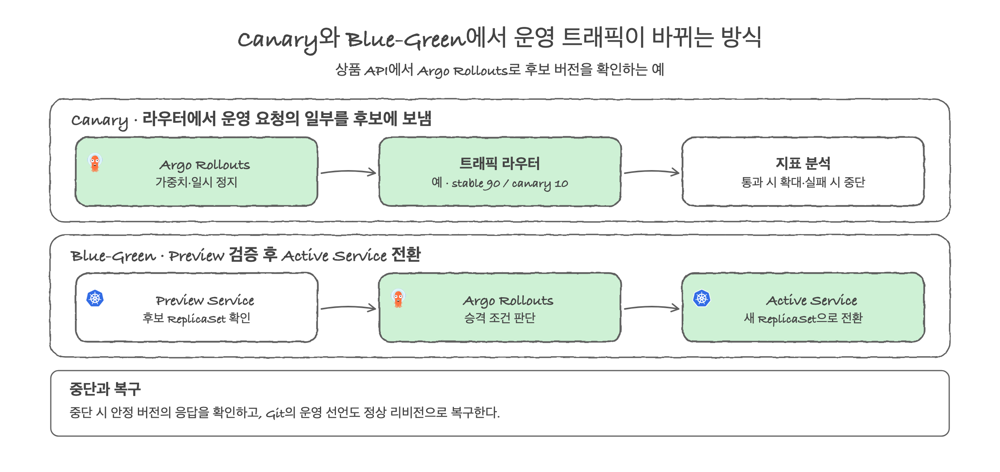

# Argo Rollouts로 Canary·Blue-Green 배포하기

## 1. 배포 선언, 배포 진행, 클라이언트의 역할

Argo CD는 Git의 배포 선언을 Kubernetes에 동기화하고, Argo Rollouts 컨트롤러는 적용된 `Rollout`에 따라 ReplicaSet, Service와 트래픽 라우팅을 조정한다. 새 환경에서는 Rollout CRD와 컨트롤러를 준비하고 대상 네임스페이스를 관리 범위에 포함한다. `kubectl argo rollouts` 플러그인은 상태를 관찰하고 승격·중단 등을 요청하는 클라이언트다. 운영체제에 맞는 플러그인을 설치하고 배포 대상 kubeconfig를 대조한다. [Argo CD · GitOps CD](https://argo-cd.readthedocs.io/en/stable/) · [Argo Rollouts · Installation](https://argo-rollouts.readthedocs.io/en/stable/installation/) · [Argo Rollouts · Basic Usage](https://argo-rollouts.readthedocs.io/en/stable/getting-started/) · [Kubernetes · kubeconfig와 컨텍스트](https://kubernetes.io/docs/concepts/configuration/organize-cluster-access-kubeconfig/)

## 2. Canary 가중치, 일시 정지와 분석

Canary에서는 안정 버전과 새 버전이 공존한다. `setWeight`와 `pause`로 트래픽 확대 시점과 관찰 구간을 정할 수 있다. 트래픽 라우터가 없는 기본 전략은 ReplicaSet의 Pod 수를 조정해 가중치를 근사한다. 세밀한 요청 비율이 필요하면 Istio 같은 트래픽 라우터와 연동하고, 지원되는 라우트와 Service의 역할을 확인한다. [Argo Rollouts · Canary](https://argo-rollouts.readthedocs.io/en/stable/features/canary/) · [Argo Rollouts · Istio Traffic Management](https://argo-rollouts.readthedocs.io/en/stable/features/traffic-management/istio/)

AnalysisTemplate은 측정할 지표, 조건, 허용 실패 등을 정의한다. AnalysisRun에서 실제 평가를 수행하며, 실패한 분석은 설정에 따라 배포 중단으로 이어진다. 예를 들어 상품 API의 오류율과 지연을 조회하되, 표본이 작거나 수집 실패로 결과가 비어 있을 때의 정책을 따로 정한다. [Argo Rollouts · Analysis](https://argo-rollouts.readthedocs.io/en/stable/features/analysis/) · [Prometheus · Alerting practices](https://prometheus.io/docs/practices/alerting/)

## 3. Blue-Green의 Preview와 Active Service

Blue-Green에서는 `activeService`가 현재 운영 버전을 가리킨다. `previewService`를 함께 지정하면 새 버전의 후보 Pod에 미리 접속해 확인할 수 있다. 검증 또는 승격이 끝나면 컨트롤러가 Active Service의 셀렉터를 새 ReplicaSet으로 전환한다. 기존 ReplicaSet을 줄이기 전에 `scaleDownDelaySeconds`로 셀렉터 변경이 전파될 시간을 줄 수 있다. [Argo Rollouts · BlueGreen](https://argo-rollouts.readthedocs.io/en/stable/features/bluegreen/)

Canary는 일부 운영 요청에서 후보 버전을 관찰하는 경로이고, Blue-Green은 Preview에서 후보를 확인한 뒤 운영 Service가 가리키는 버전을 전환하는 경로다. 선택할 때는 트래픽을 나눌 수 있는지, 검증에 필요한 표본을 확보할 수 있는지, 두 버전을 동시에 띄울 자원이 있는지 확인한다. [Argo Rollouts · Canary](https://argo-rollouts.readthedocs.io/en/stable/features/canary/) · [Argo Rollouts · BlueGreen](https://argo-rollouts.readthedocs.io/en/stable/features/bluegreen/) · [Argo Rollouts · Analysis](https://argo-rollouts.readthedocs.io/en/stable/features/analysis/)

두 전략에서 후보를 검증하는 위치와 운영 전환 시점을 표시했다. [Argo Rollouts · Canary](https://argo-rollouts.readthedocs.io/en/stable/features/canary/) · [Argo Rollouts · BlueGreen](https://argo-rollouts.readthedocs.io/en/stable/features/bluegreen/) · [Argo Rollouts · Analysis](https://argo-rollouts.readthedocs.io/en/stable/features/analysis/) · [Argo Rollouts · Basic Usage](https://argo-rollouts.readthedocs.io/en/stable/getting-started/) · [Argo CD · Automated Sync Policy](https://argo-cd.readthedocs.io/en/stable/user-guide/auto_sync/)

## 4. 승격, 중단, Git으로 복구

일시 정지한 배포는 승인 조건을 확인한 뒤 `promote`로 진행할 수 있다. 진행 중 문제가 발생하면 `abort`로 안정 버전이 서비스하도록 되돌릴 수 있다. 이때 Rollout의 원하는 버전은 여전히 실패한 선언을 가리킬 수 있다. GitOps 환경에서 장기 상태까지 복구하려면 Git의 운영 선언을 검증된 이전 리비전으로 돌리고 다시 동기화한다. [Argo Rollouts · Basic Usage](https://argo-rollouts.readthedocs.io/en/stable/getting-started/) · [Argo Rollouts · Rollback Window](https://argo-rollouts.readthedocs.io/en/stable/features/rollback/) · [Argo CD · Automated Sync Policy](https://argo-cd.readthedocs.io/en/stable/user-guide/auto_sync/) · [Git · git revert](https://git-scm.com/docs/git-revert)

Argo CD와 Rollouts, Istio를 함께 운영하는 경우 Git은 Rollout과 라우트의 기준 설정을 갖고, 진행 중인 트래픽 가중치의 변경은 Rollouts에 맡긴다. 실제 동기화 시에도 이 소유권이 유지되도록 정책을 점검한다. 전환을 되돌릴 때에는 이미지뿐 아니라 함께 도입한 스키마·설정이 이전 버전에서 동작하는지도 애플리케이션 검증에 포함한다. [Argo Rollouts · GitOps 연동](https://argo-rollouts.readthedocs.io/en/stable/features/traffic-management/istio/#integrating-with-gitops) · [Argo CD · Diff Customization](https://argo-cd.readthedocs.io/en/stable/user-guide/diffing/) · [Argo CD · RespectIgnoreDifferences](https://argo-cd.readthedocs.io/en/stable/user-guide/sync-options/#respect-ignore-differences-configs) · [Microsoft Learn · Continuous Delivery](https://learn.microsoft.com/en-us/devops/deliver/what-is-continuous-delivery)
