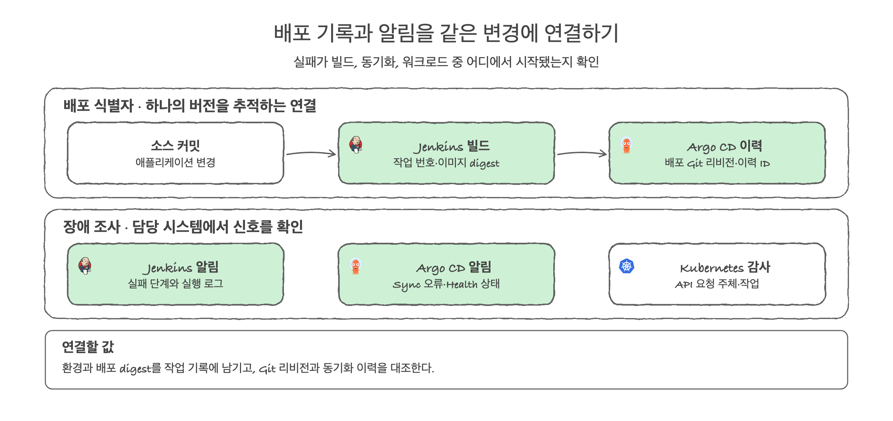

# Jenkins·Argo CD 알림, 권한, 감사와 장애 진단

## 1. Jenkins 알림과 Argo CD Notifications

Jenkins는 `post` 또는 플러그인을 통해 빌드, 승인, 배포 단계의 결과를 알릴 수 있다. Argo CD Notifications는 Application의 상태를 보고 이벤트를 발송한다. 예를 들어 Jenkins는 이미지 게시 또는 Push 실패를, Argo CD는 운영 동기화 실패나 동기화 후 `Healthy`가 된 상태를 알리도록 구성할 수 있다. [Jenkins · Declarative Pipeline Syntax](https://www.jenkins.io/doc/book/pipeline/syntax/) · [Jenkins 플러그인 · Slack Notification](https://plugins.jenkins.io/slack/) · [Argo CD · Notifications](https://argo-cd.readthedocs.io/en/stable/operator-manual/notifications/) · [Argo CD · Notification Triggers](https://argo-cd.readthedocs.io/en/stable/operator-manual/notifications/triggers/)

Argo CD에서는 trigger가 발송 조건을, template이 메시지 형식을, subscription이 수신 대상을 정한다. `oncePer`를 사용하면 특정 필드 값에 대해 반복 알림을 줄일 수 있다. 여러 앱이 한 저장소를 공유하면 저장소의 HEAD 대신 앱이 실제 배포한 리비전을 중복 방지 키로 고려한다. 수신 설정과 비밀 설정도 각각 점검한다. [Argo CD · Notifications](https://argo-cd.readthedocs.io/en/stable/operator-manual/notifications/) · [Argo CD · Notification Triggers](https://argo-cd.readthedocs.io/en/stable/operator-manual/notifications/triggers/) · [Argo CD · Notification Subscriptions](https://argo-cd.readthedocs.io/en/stable/operator-manual/notifications/subscriptions/)

## 2. Jenkins RBAC와 Argo CD RBAC의 범위

Jenkins에서는 사용자가 어떤 폴더와 작업을 보고 실행·설정할 수 있는지 관리한다. Argo CD에서는 RBAC로 Application 조회·동기화 등의 권한을 부여하고, AppProject에서 허용할 저장소·대상·리소스를 제한한다. Kubernetes API에는 별도 권한이 적용된다. 예를 들어 Jenkins 작업의 빌드 권한, Argo CD의 운영 Application 동기화 권한, 운영 Kubernetes에 대한 쓰기 권한을 함께 확인한다. [Jenkins · Managing Security](https://www.jenkins.io/doc/book/security/managing-security/) · [Jenkins 플러그인 · Role-based Authorization Strategy](https://plugins.jenkins.io/role-strategy/) · [Argo CD · RBAC Configuration](https://argo-cd.readthedocs.io/en/stable/operator-manual/rbac/) · [Argo CD · Projects](https://argo-cd.readthedocs.io/en/stable/user-guide/projects/) · [Kubernetes · Using RBAC Authorization](https://kubernetes.io/docs/reference/access-authn-authz/rbac/)

## 3. 배포 이력과 감사 기록 연결

한 배포를 소스 커밋, Jenkins 빌드 번호, 레지스트리 digest, 배포 선언 커밋, Argo CD 이력 ID로 연결하면 어느 변경이 배포됐는지 역추적할 수 있다. 승인 단계에서 승인자 식별을 함께 저장하려면 Jenkins `input`의 `submitterParameter` 등을 사용한다. Kubernetes API에서 누가 어떤 요청을 보냈는지까지 분석하려면 활성화한 Kubernetes 감사 정책과 백엔드의 로그를 확인한다. 기록마다 실행 주체와 범위를 함께 남긴다. [Jenkins · Using a Jenkinsfile](https://www.jenkins.io/doc/book/pipeline/jenkinsfile/) · [Jenkins · Pipeline Input Step](https://www.jenkins.io/doc/pipeline/steps/pipeline-input-step/) · [Kubernetes · Images](https://kubernetes.io/docs/concepts/containers/images/) · [Argo CD · argocd app history](https://argo-cd.readthedocs.io/en/stable/user-guide/commands/argocd_app_history/) · [Kubernetes · Kubernetes Auditing](https://kubernetes.io/docs/tasks/debug/debug-cluster/audit/)

배포를 식별하는 기록과 장애를 조사하는 신호를 나눠 그렸다. [Jenkins · Using a Jenkinsfile](https://www.jenkins.io/doc/book/pipeline/jenkinsfile/) · [Kubernetes · Images](https://kubernetes.io/docs/concepts/containers/images/) · [Argo CD · argocd app history](https://argo-cd.readthedocs.io/en/stable/user-guide/commands/argocd_app_history/) · [Kubernetes · Kubernetes Auditing](https://kubernetes.io/docs/tasks/debug/debug-cluster/audit/) · [Argo CD · Notification Triggers](https://argo-cd.readthedocs.io/en/stable/operator-manual/notifications/triggers/)

## 4. 배포 실패를 좁히는 순서

1. 빌드와 게시. Jenkins의 실패 단계와 자격 증명의 목적지, 이미지 digest 발행 여부를 확인한다. [Jenkins · Using a Jenkinsfile](https://www.jenkins.io/doc/book/pipeline/jenkinsfile/) · [Jenkins · Using Credentials](https://www.jenkins.io/doc/book/using/using-credentials/) · [Kubernetes · Images](https://kubernetes.io/docs/concepts/containers/images/)
2. 비교와 적용. Argo CD가 올바른 리비전과 경로로 매니페스트를 만들었는지 확인한 뒤, Application 조건과 sync 결과의 오류를 확인한다. 계속 `OutOfSync`라면 다른 컨트롤러가 조정한 필드, 렌더링 결과, 차이 비교 설정을 확인한다. [Argo CD · Architectural Overview](https://argo-cd.readthedocs.io/en/stable/operator-manual/architecture/) · [Argo CD · Application Specification](https://argo-cd.readthedocs.io/en/stable/user-guide/application-specification/) · [Argo CD · Diff Customization](https://argo-cd.readthedocs.io/en/stable/user-guide/diffing/)
3. 롤아웃과 요청. 적용 이후에는 Deployment와 Pod 이벤트, 이미지 가져오기, readiness, Service 셀렉터와 실제 API 응답을 확인한다. `Synced`라도 이 단계에서 실패할 수 있다. [Argo CD · Resource Health](https://argo-cd.readthedocs.io/en/stable/operator-manual/health/) · [Kubernetes · Deployments](https://kubernetes.io/docs/concepts/workloads/controllers/deployment/) · [Kubernetes · Debug Running Pods](https://kubernetes.io/docs/tasks/debug/debug-application/debug-running-pod/) · [Kubernetes · Readiness, liveness 및 startup probes](https://kubernetes.io/docs/tasks/configure-pod-container/configure-liveness-readiness-startup-probes/) · [Kubernetes · Service](https://kubernetes.io/docs/concepts/services-networking/service/)
