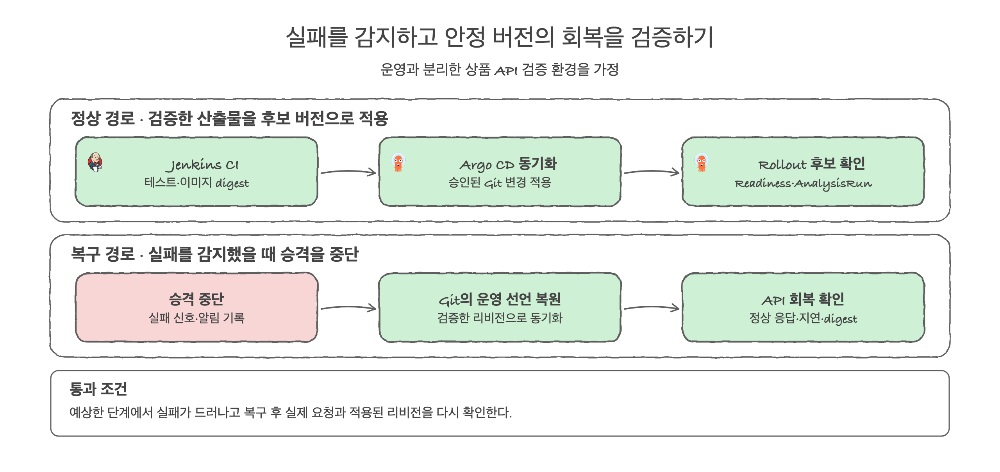

# 상품 API 배포 전 과정과 복구 검증

## 1. 시나리오와 준비 상태

상품 목록 API를 대상으로 Jenkins에서 테스트한 이미지 하나를 dev·staging으로 Push 배포한 뒤, production의 Git 선언을 변경해 Argo CD가 Pull 배포하는 흐름을 검증한다. 전환 전략을 확인할 때는 production 역할을 하는 독립된 검증 환경에서 Rollout을 사용한다. 준비 항목은 앱·매니페스트 저장소, 레지스트리, 환경별 kubeconfig, 배포 주체별 권한, 현재 정상 버전의 digest와 배포 리비전이다. [Jenkins · Using a Jenkinsfile](https://www.jenkins.io/doc/book/pipeline/jenkinsfile/) · [Kubernetes · Images](https://kubernetes.io/docs/concepts/containers/images/) · [Argo CD · 배포 구성 저장소 분리](https://argo-cd.readthedocs.io/en/stable/user-guide/best_practices/#separating-config-vs-source-code-repositories) · [Argo CD · Application Specification](https://argo-cd.readthedocs.io/en/stable/user-guide/application-specification/) · [Kubernetes · Using RBAC Authorization](https://kubernetes.io/docs/reference/access-authn-authz/rbac/) · [Argo Rollouts · Installation](https://argo-rollouts.readthedocs.io/en/stable/installation/)

## 2. 네 단계로 확인하는 배포 흐름

1. CI가 배포할 산출물 만들기. 커밋과 테스트 결과가 이미지 digest로 이어지고, 테스트가 실패하면 다음 환경에 새 이미지를 적용하지 않는지 확인한다. [Jenkins · Using a Jenkinsfile](https://www.jenkins.io/doc/book/pipeline/jenkinsfile/) · [Jenkins · Declarative Pipeline Syntax](https://www.jenkins.io/doc/book/pipeline/syntax/) · [Kubernetes · Images](https://kubernetes.io/docs/concepts/containers/images/)
2. Dev·staging Push와 승인. Jenkins가 허용된 컨텍스트와 네임스페이스에 같은 digest를 적용하고, staging 승인과 롤아웃·API 확인 결과를 남기는지 확인한다. [Kubernetes · kubeconfig와 컨텍스트](https://kubernetes.io/docs/concepts/configuration/organize-cluster-access-kubeconfig/) · [Kubernetes · Using RBAC Authorization](https://kubernetes.io/docs/reference/access-authn-authz/rbac/) · [Jenkins · Pipeline Input Step](https://www.jenkins.io/doc/pipeline/steps/pipeline-input-step/) · [Kubernetes · Deployments](https://kubernetes.io/docs/concepts/workloads/controllers/deployment/)
3. Production Pull과 점진 배포. 리뷰한 Git 변경을 Argo CD가 의도한 환경에 동기화하고, Rollout이 설정한 단계와 일시 정지·승격 조건에 따라 진행하는지 확인한다. [Argo CD · Application Specification](https://argo-cd.readthedocs.io/en/stable/user-guide/application-specification/) · [Argo CD · Automated Sync Policy](https://argo-cd.readthedocs.io/en/stable/user-guide/auto_sync/) · [Argo Rollouts · Canary](https://argo-rollouts.readthedocs.io/en/stable/features/canary/) · [Argo Rollouts · BlueGreen](https://argo-rollouts.readthedocs.io/en/stable/features/bluegreen/)
4. 배포 관측과 복구 이력. 사용자 요청, 동기화 리비전, Health, 배포 알림이 같은 변경을 가리키는지 확인하고 이전 정상 리비전으로 복원할 수 있는지 확인한다. 실패 지점의 확인 순서는 [배포 장애 진단](08_operating_delivery_alerts_rbac_and_audit_trails.md)을 따른다. [Argo CD · Resource Health](https://argo-cd.readthedocs.io/en/stable/operator-manual/health/) · [Argo CD · Notification Triggers](https://argo-cd.readthedocs.io/en/stable/operator-manual/notifications/triggers/) · [Argo CD · argocd app history](https://argo-cd.readthedocs.io/en/stable/user-guide/commands/argocd_app_history/) · [Git · git revert](https://git-scm.com/docs/git-revert)

## 3. 제한된 환경에서 장애와 정상 복구 확인

검증 환경에서 한 번에 한 가지 실패 조건을 선택한다. 먼저 정상 응답률·지연과 기존 digest를 기록한다. 후보 버전의 readiness가 실패하도록 준비한 경우 새 대상이 트래픽을 받을 준비를 마치지 못한 상태가 드러나는지 확인한다. 지표 기반 배포에서는 준비된 검증 입력으로 AnalysisRun이 실패 상태를 감지하고 설정대로 진행을 멈추는지 확인한다. 어느 경우든 예상한 중단 지점, 알림, 이전 버전 응답의 회복을 기록한다. [Principles of Chaos Engineering · 장애 검증 원칙](https://principlesofchaos.org/) · [Kubernetes · Readiness, liveness 및 startup probes](https://kubernetes.io/docs/tasks/configure-pod-container/configure-liveness-readiness-startup-probes/) · [Kubernetes · Deployments](https://kubernetes.io/docs/concepts/workloads/controllers/deployment/) · [Argo Rollouts · Analysis](https://argo-rollouts.readthedocs.io/en/stable/features/analysis/) · [Argo Rollouts · Basic Usage](https://argo-rollouts.readthedocs.io/en/stable/getting-started/)

드리프트 복구는 self-heal이 켜진 검증 Application에서 관리 필드의 일시적인 변경이 선언 상태로 수렴하는지 확인한다. Rollout의 운영 선언 자체가 잘못됐을 때는 승인된 이전 설정으로 Git을 복원해 재동기화하고, 이미지뿐 아니라 서비스 응답도 원래 기준을 충족하는지 확인한다. 실패를 실행하기 전에 중단 조건과 복구 방법을 정한다. [Principles of Chaos Engineering · 장애 검증 원칙](https://principlesofchaos.org/) · [Argo CD · Automated Sync Policy](https://argo-cd.readthedocs.io/en/stable/user-guide/auto_sync/) · [Git · git revert](https://git-scm.com/docs/git-revert) · [Argo CD · Resource Health](https://argo-cd.readthedocs.io/en/stable/operator-manual/health/)

후보 검증에서 실패를 감지한 뒤 정상 상태를 재확인하는 흐름이다. [Principles of Chaos Engineering · 장애 검증 원칙](https://principlesofchaos.org/) · [Kubernetes · Readiness, liveness 및 startup probes](https://kubernetes.io/docs/tasks/configure-pod-container/configure-liveness-readiness-startup-probes/) · [Argo Rollouts · Analysis](https://argo-rollouts.readthedocs.io/en/stable/features/analysis/) · [Argo Rollouts · Basic Usage](https://argo-rollouts.readthedocs.io/en/stable/getting-started/) · [Git · git revert](https://git-scm.com/docs/git-revert) · [Argo CD · Resource Health](https://argo-cd.readthedocs.io/en/stable/operator-manual/health/)

## 4. 완료 기준

- 재현 가능성. 처음부터 끝까지 소스 커밋, 이미지 digest, 배포 선언과 실행 중인 버전을 연결할 수 있다. [OpenGitOps · GitOps 원칙](https://opengitops.dev/#principles) · [Kubernetes · Images](https://kubernetes.io/docs/concepts/containers/images/) · [Argo CD · argocd app history](https://argo-cd.readthedocs.io/en/stable/user-guide/commands/argocd_app_history/)
- 변경 통제. 승인자와 환경별 적용 주체가 기록되고, 권한 범위와 자동 삭제·보정 정책이 의도와 일치한다. [Jenkins · Pipeline Input Step](https://www.jenkins.io/doc/pipeline/steps/pipeline-input-step/) · [Argo CD · Projects](https://argo-cd.readthedocs.io/en/stable/user-guide/projects/) · [Argo CD · Automated Sync Policy](https://argo-cd.readthedocs.io/en/stable/user-guide/auto_sync/) · [Kubernetes · Kubernetes Auditing](https://kubernetes.io/docs/tasks/debug/debug-cluster/audit/)
- 장애 대응. 실패가 지정한 단계에서 드러나고, 승격 중단과 Git 복구 이후 정상 요청과 운영 리비전을 다시 확인할 수 있다. [Argo Rollouts · Analysis](https://argo-rollouts.readthedocs.io/en/stable/features/analysis/) · [Argo Rollouts · Basic Usage](https://argo-rollouts.readthedocs.io/en/stable/getting-started/) · [Git · git revert](https://git-scm.com/docs/git-revert) · [Argo CD · Resource Health](https://argo-cd.readthedocs.io/en/stable/operator-manual/health/)
