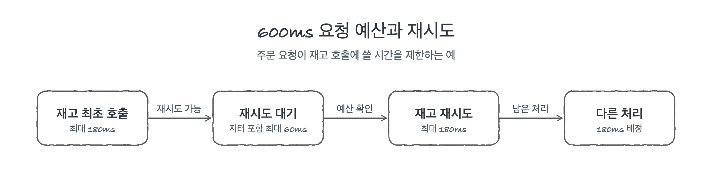

# Designing Resilience and Observability Patterns

주문 서비스에서 재고 호출이 느려지는 시나리오를 기준으로 대기 시간을 제한하고, 실패가 공유 자원으로 번지는 경로를 줄인 뒤, 관측 신호로 그 효과를 확인한다. [AWS · Timeouts, Retries, and Backoff with Jitter](https://aws.amazon.com/builders-library/timeouts-retries-and-backoff-with-jitter/) · [Microsoft · Bulkhead](https://learn.microsoft.com/en-us/azure/architecture/patterns/bulkhead) · [OpenTelemetry · Signals](https://opentelemetry.io/docs/concepts/signals/)

## 1. 호출 한 번과 전체 요청의 시간 예산을 정한다

전체 요청에 600ms를 예산으로 준다면 재고 1차 호출 180ms, 지터를 포함한 대기 최대 60ms, 재시도 180ms를 배정할 수 있다. 나머지 180ms는 다른 처리에 남긴다. 타임아웃 뒤 남은 시간과 재시도 가능한 오류인지 확인하고, 쓰기는 멱등성이나 결과 조회가 확보된 경우에 재시도한다. 호출 체인의 여러 계층이 같은 실패를 반복 재시도하지 않도록 책임을 한 곳에 둔다. [AWS · Timeouts, Retries, and Backoff with Jitter](https://aws.amazon.com/builders-library/timeouts-retries-and-backoff-with-jitter/)

그림의 근거 · [AWS · Timeouts, Retries, and Backoff with Jitter](https://aws.amazon.com/builders-library/timeouts-retries-and-backoff-with-jitter/)

## 2. 실패한 의존성과 사용 중인 자원을 분리한다

| 정책 | 무엇을 제어하는가 | 확인할 것 | 근거 |
| --- | --- | --- | --- |
| Circuit Breaker | 반복 실패 시 호출을 제한하고, 복구 탐색에서 일부 요청을 허용한다. | 열림 횟수, 탐색 성공률, 복구까지 걸린 시간 | [Microsoft · Circuit Breaker](https://learn.microsoft.com/en-us/azure/architecture/patterns/circuit-breaker) |
| Bulkhead | 재고 호출의 동시성 또는 연결 풀을 분리해 공유 자원이 고갈되는 범위를 줄인다. | 재고 요청이 밀려도 주문 조회 경로가 동작하는지 | [Microsoft · Bulkhead](https://learn.microsoft.com/en-us/azure/architecture/patterns/bulkhead) |
| Fallback | 업무가 허용하면 마지막으로 확인한 조회 값을 제공하거나 기능을 제한한다. | 표시한 값의 시각과 허용된 최신성. 예약 실패를 성공으로 응답하지 않는지 | [Microsoft · Circuit Breaker](https://learn.microsoft.com/en-us/azure/architecture/patterns/circuit-breaker) · [Microsoft · Microservice Data Considerations](https://learn.microsoft.com/en-us/azure/architecture/microservices/design/data-considerations) |

## 3. 대시보드에서 시작해 요청의 실패 지점을 찾는다

메트릭으로 오류율·지연·자원 포화를 확인하고, 트레이스로 주문에서 재고까지 느린 스팬을 찾은 뒤, 관련 로그에서 실패 유형을 본다. HTTP 경계를 넘을 때 W3C Trace Context를 전달해 서비스 간 스팬을 이어 붙인다. 고유한 주문 ID로 오류율 메트릭을 나누기보다 트레이스나 접근이 제한된 로그에서 개별 요청을 조사한다. [OpenTelemetry · Signals](https://opentelemetry.io/docs/concepts/signals/) · [OpenTelemetry · Context Propagation](https://opentelemetry.io/docs/concepts/context-propagation/) · [OpenTelemetry · Metrics SDK](https://opentelemetry.io/docs/specs/otel/metrics/sdk/#cardinality-limits)
