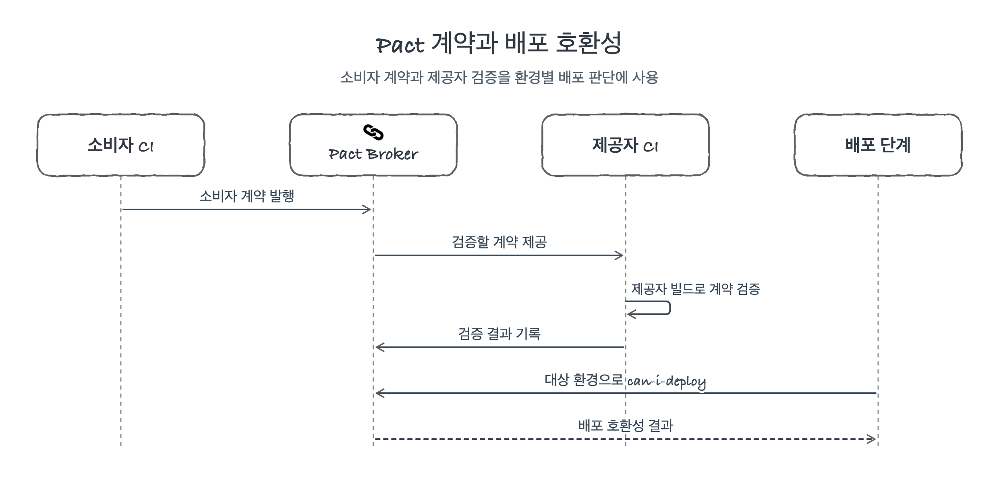

# Verifying Service Contracts with Pact

Pact의 소비자 테스트는 주문 클라이언트가 필요로 하는 요청과 응답을 계약 파일로 만든다. 제공자 검증은 그 계약을 실행 중인 재고 서비스에 재생한다. [Pact JS · Consumer Tests](https://docs.pact.io/implementation_guides/javascript/docs/consumer) · [Pact JS · Provider Verification](https://docs.pact.io/implementation_guides/javascript/docs/provider)

## 1. 소비자의 요구를 계약으로 작성한다

별도 빈 실습 디렉터리에서 의존성을 준비한다. 주문 클라이언트가 읽는 available 필드를 정수 매처로 표현하고, 소비자 코드가 사용하지 않는 필드는 계약에 포함하지 않는다. [Pact JS · Overview](https://docs.pact.io/implementation_guides/javascript/readme) · [Pact JS · Consumer Tests](https://docs.pact.io/implementation_guides/javascript/docs/consumer) · [Jest 30 · Getting Started](https://jestjs.io/docs/30.0/getting-started)

```bash
npm init -y
npm install --save-dev --save-exact jest@30.2.0 @pact-foundation/pact@16.0.2
```

## 2. 계약을 생성하고 실행 중인 제공자에 재생한다

다음 코드 블록을 inventory.pact.test.cjs로 저장하고 npx jest --runInBand inventory.pact.test.cjs를 실행한다. 실습에서는 두 단계를 한 테스트에 넣고, 제공자 상태에서 준비한 7이 소비자 모의 서버의 예시값 3과 달라도 정수 계약을 만족하는지 확인한다. [Pact JS · Consumer Tests](https://docs.pact.io/implementation_guides/javascript/docs/consumer) · [Pact JS · Provider Verification](https://docs.pact.io/implementation_guides/javascript/docs/provider)

```javascript
// inventory.pact.test.cjs
const { PactV3, MatchersV3, Verifier } = require('@pact-foundation/pact');
const { mkdtemp, readdir, rm } = require('node:fs/promises');
const { createServer } = require('node:http');
const { tmpdir } = require('node:os');
const { join } = require('node:path');

async function fetchStock(baseUrl, sku) {
  const response = await fetch(`${baseUrl}/inventory/${encodeURIComponent(sku)}`);
  if (!response.ok) throw new Error(`inventory HTTP ${response.status}`);
  const data = await response.json();
  return data.available;
}

test('the inventory provider satisfies the order client contract', async () => {
  const dir = await mkdtemp(join(tmpdir(), 'inventory-pact-'));
  const stock = new Map();
  const provider = createServer((request, response) => {
    if (request.method !== 'GET' || request.url !== '/inventory/sku-1'
        || !stock.has('sku-1')) {
      response.writeHead(404).end();
      return;
    }
    response.writeHead(200, { 'content-type': 'application/json' });
    response.end(JSON.stringify({ available: stock.get('sku-1') }));
  });
  try {
    const pact = new PactV3({
      consumer: 'OrderClient', provider: 'InventoryService', dir,
    });
    pact.given('sku-1 is stocked')
      .uponReceiving('an inventory lookup from the order client')
      .withRequest({ method: 'GET', path: '/inventory/sku-1' })
      .willRespondWith({
        status: 200,
        headers: { 'Content-Type': 'application/json' },
        body: { available: MatchersV3.integer(3) },
      });
    await pact.executeTest(async ({ url }) => {
      await expect(fetchStock(url, 'sku-1')).resolves.toBe(3);
    });

    await new Promise((resolve, reject) => {
      provider.once('error', reject);
      provider.listen(0, '127.0.0.1', resolve);
    });
    const [file] = (await readdir(dir)).filter(name => name.endsWith('.json'));
    if (!file) throw new Error('Pact file not generated');
    await new Verifier({
      provider: 'InventoryService',
      providerBaseUrl: `http://127.0.0.1:${provider.address().port}`,
      pactUrls: [join(dir, file)],
      stateHandlers: {
        'sku-1 is stocked': async () => { stock.set('sku-1', 7); },
      },
    }).verifyProvider();
  } finally {
    if (provider.listening) {
      await new Promise(resolve => provider.close(resolve));
    }
    await rm(dir, { recursive: true, force: true });
  }
}, 15000);
```

## 3. CI에서 배포 환경과 버전에 맞춰 검증한다

실제 프로젝트에서는 소비자 CI가 계약을 발행하고 제공자 CI가 자신의 빌드에 대해 검증을 실행한다. 검증 결과와 실제 배포 버전을 Broker에 기록하고, 배포 직전에 대상 환경을 지정해 can-i-deploy로 호환성을 확인한다. 중복 예약, 저장소 트랜잭션, 사용자 요청의 전체 완료는 별도 테스트로 다룬다. [Pact JS · Provider Verification](https://docs.pact.io/implementation_guides/javascript/docs/provider) · [Pact Broker · Can I Deploy](https://docs.pact.io/pact_broker/can_i_deploy) · [Ham Vocke · The Practical Test Pyramid](https://martinfowler.com/articles/practical-test-pyramid.html)



그림의 근거 · [Pact JS · Provider Verification](https://docs.pact.io/implementation_guides/javascript/docs/provider) · [Pact Broker · Can I Deploy](https://docs.pact.io/pact_broker/can_i_deploy) · [Ham Vocke · The Practical Test Pyramid](https://martinfowler.com/articles/practical-test-pyramid.html)
