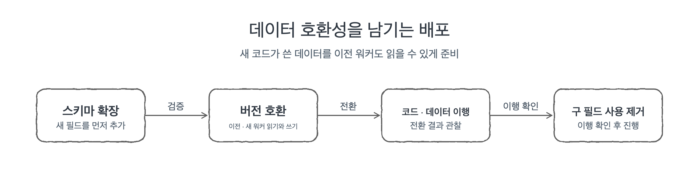

# Choosing Deployment Patterns for Distributed Services

분산 서비스의 배포 방식은 새 인스턴스를 준비하는 방법, 새 버전으로 트래픽을 보낼 방법, 이상이 발생했을 때 되돌릴 수 있는 경로를 함께 결정한다. [Kubernetes · Deployments](https://kubernetes.io/docs/concepts/workloads/controllers/deployment/) · [AWS · Blue/Green Deployments](https://docs.aws.amazon.com/whitepapers/latest/blue-green-deployments/introduction.html) · [AWS · Ensuring Rollback Safety](https://aws.amazon.com/builders-library/ensuring-rollback-safety-during-deployments/)

## 1. 인스턴스 교체와 트래픽 전환을 따로 본다

| 방식 | 전환 방식 | 판단 기준 | 근거 |
| --- | --- | --- | --- |
| Rolling Update | 준비된 새 인스턴스로 기존 인스턴스를 점진적으로 교체한다. Kubernetes에서는 maxSurge와 maxUnavailable로 추가·불가용 Pod 수를 제어한다. | 추가 용량이 제한적이고 두 버전이 동시에 실행될 수 있을 때. | [Kubernetes · Deployments](https://kubernetes.io/docs/concepts/workloads/controllers/deployment/) · [AWS · Ensuring Rollback Safety](https://aws.amazon.com/builders-library/ensuring-rollback-safety-during-deployments/) |
| Blue/Green | 새 환경을 병렬 준비한 뒤 진입점의 트래픽을 전환한다. 기존 환경을 유지하는 동안 역전환이 가능하다. | 환경을 병렬 운영할 비용과 데이터 쓰기 호환성을 감당할 수 있을 때. | [AWS · Blue/Green Deployments](https://docs.aws.amazon.com/whitepapers/latest/blue-green-deployments/introduction.html) · [AWS · Ensuring Rollback Safety](https://aws.amazon.com/builders-library/ensuring-rollback-safety-during-deployments/) |
| Canary | 일부 실제 요청을 새 버전으로 먼저 보내고 측정 결과에 따라 확대한다. | 새 버전의 지표를 분리해 볼 수 있고, 판단에 필요한 요청량이 들어올 때. | [AWS CodeDeploy · Deployment Configurations](https://docs.aws.amazon.com/codedeploy/latest/userguide/deployment-configurations.html) · [Kubernetes · Deployments](https://kubernetes.io/docs/concepts/workloads/controllers/deployment/) |

## 2. 롤백 경로는 저장된 데이터와 이벤트까지 확인한다

기존 주문 워커가 새 버전이 기록한 데이터를 읽을 수 있게 새 필드나 스키마를 먼저 추가하고 양쪽 버전의 읽기·쓰기를 확인한다. 코드 전환과 데이터 이행을 관찰한 뒤 구 필드 사용을 제거한다. 트래픽을 이전 버전으로 돌리는 작업만으로 DB 변경이나 이미 발행된 이벤트까지 되돌아가지는 않으므로 각각의 대응을 설계한다. [AWS · Ensuring Rollback Safety](https://aws.amazon.com/builders-library/ensuring-rollback-safety-during-deployments/) · [AWS · Blue/Green Deployments](https://docs.aws.amazon.com/whitepapers/latest/blue-green-deployments/introduction.html)

그림의 근거 · [AWS · Ensuring Rollback Safety](https://aws.amazon.com/builders-library/ensuring-rollback-safety-during-deployments/) · [AWS · Blue/Green Deployments](https://docs.aws.amazon.com/whitepapers/latest/blue-green-deployments/introduction.html)

## 3. 카나리 확대·중단 기준을 정한다

예를 들어 주문 제출의 일부를 새 버전으로 보내고, 기존 버전과 분리해 실패율·상위 지연·예약 성공률을 본다. 최소 표본과 관찰 시간을 충족하고 기준 이내일 때 확대한다. 기준을 벗어나면 유입을 줄이고, 새 버전이 이미 쓴 데이터를 기존 버전이 처리할 수 있는지 확인한다. [AWS CodeDeploy · Deployment Configurations](https://docs.aws.amazon.com/codedeploy/latest/userguide/deployment-configurations.html) · [AWS · Ensuring Rollback Safety](https://aws.amazon.com/builders-library/ensuring-rollback-safety-during-deployments/)
