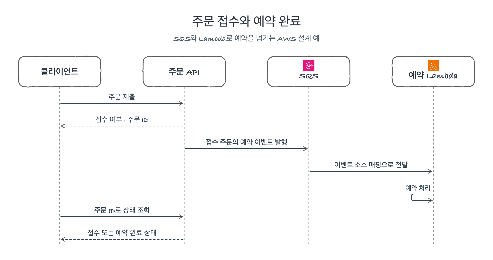

# Designing Serverless Microservices on AWS

주문 API가 주문 접수까지만 책임지고, 오래 걸리는 후속 예약 작업은 메시지로 전달해 별도 Lambda가 처리하는 설계를 예로 든다. 독립적인 서비스 경계는 데이터 소유권과 업무 책임을 기준으로 정한다. [AWS · Serverless Applications Lens](https://docs.aws.amazon.com/wellarchitected/latest/serverless-applications-lens/welcome.html) · [Microsoft · Microservice Data Considerations](https://learn.microsoft.com/en-us/azure/architecture/microservices/design/data-considerations) · [AWS Lambda · Using Lambda with SQS](https://docs.aws.amazon.com/lambda/latest/dg/with-sqs.html)

## 1. 동기 접수와 비동기 완료의 계약을 정한다

동기 경로에서는 주문 접수 여부와 주문 ID를 응답하고, 비동기 경로에서는 워커가 메시지를 받아 예약을 처리한다. 주문 상태 조회에서 접수와 예약 완료를 구분한다. 주문 저장과 메시지 발행을 별도 쓰기로 처리한다면 둘 사이 장애를 복구할 수 있도록 발행 기록과 재처리 절차를 설계한다. 트랜잭셔널 아웃박스를 적용한다면 주문과 발행할 이벤트를 한 저장소 트랜잭션에 기록하고 릴레이가 발행한다. [AWS · Serverless Applications Lens](https://docs.aws.amazon.com/wellarchitected/latest/serverless-applications-lens/welcome.html) · [AWS Lambda · Using Lambda with SQS](https://docs.aws.amazon.com/lambda/latest/dg/with-sqs.html) · [AWS · Transactional Outbox](https://docs.aws.amazon.com/prescriptive-guidance/latest/cloud-design-patterns/transactional-outbox.html)

그림의 근거 · [AWS · Serverless Applications Lens](https://docs.aws.amazon.com/wellarchitected/latest/serverless-applications-lens/welcome.html) · [AWS Lambda · Using Lambda with SQS](https://docs.aws.amazon.com/lambda/latest/dg/with-sqs.html) · [AWS · Transactional Outbox](https://docs.aws.amazon.com/prescriptive-guidance/latest/cloud-design-patterns/transactional-outbox.html)

## 2. 중복·부분 실패·격리를 함께 설계한다

| 상황 | 동작과 대응 | 근거 |
| --- | --- | --- |
| 메시지 중복 전달 | SQS 이벤트 소스 매핑은 최소 한 번 처리하기 때문에 같은 예약 요청이 재전달될 수 있다. 주문 ID와 작업 유형을 이용해 같은 업무 효과가 중복 반영되지 않게 한다. | [AWS Lambda · Using Lambda with SQS](https://docs.aws.amazon.com/lambda/latest/dg/with-sqs.html) |
| 배치에서 일부 실패 | ReportBatchItemFailures를 매핑에 켜고 실패한 메시지의 messageId를 batchItemFailures에 담는다. 함수가 예외를 던져 종료하면 배치 전체가 실패한다. | [AWS Lambda · SQS Error Handling](https://docs.aws.amazon.com/lambda/latest/dg/services-sqs-errorhandling.html) |
| FIFO에서 실패 | 순서를 보존하려면 첫 실패에서 처리를 중단하고 실패한 메시지와 아직 처리하지 않은 메시지를 함께 실패 목록에 반환한다. | [AWS Lambda · SQS Error Handling](https://docs.aws.amazon.com/lambda/latest/dg/services-sqs-errorhandling.html) |
| 반복 실패와 재처리 | SQS redrive policy로 DLQ에 보낼 수 있다. 오류 원인을 해결하고 멱등성을 확인한 뒤 재처리하며, DLQ 메시지와 대기 시간을 관측한다. | [AWS Lambda · Configure SQS](https://docs.aws.amazon.com/lambda/latest/dg/services-sqs-configure.html) · [Amazon SQS · Dead-Letter Queues](https://docs.aws.amazon.com/AWSSimpleQueueService/latest/SQSDeveloperGuide/sqs-dead-letter-queues.html) |

## 3. Lambda와 하위 시스템의 처리량을 맞춘다

함수 타임아웃은 SQS 가시성 타임아웃 이하로 설정한다. 실제 배치 처리 시간과 재시도 여유를 포함해 가시성 타임아웃을 잡는다. DB 연결 수가 병목이라면 이벤트 소스 매핑의 최대 동시성으로 유입을 제한하고, 큐의 대기 시간과 작업 성공률이 서비스 목표를 충족하는지 확인한다. [AWS Lambda · Configure SQS](https://docs.aws.amazon.com/lambda/latest/dg/services-sqs-configure.html) · [AWS Lambda · SQS Scaling](https://docs.aws.amazon.com/lambda/latest/dg/services-sqs-scaling.html) · [AWS Lambda · Using Lambda with SQS](https://docs.aws.amazon.com/lambda/latest/dg/with-sqs.html)
