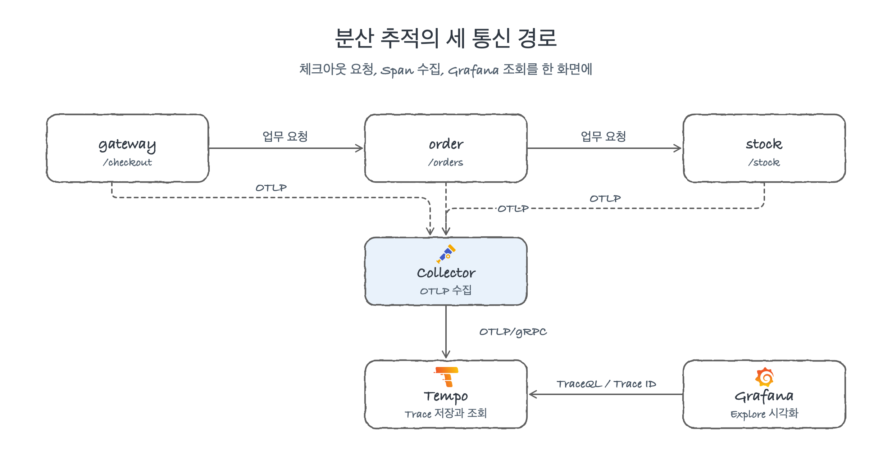

# Distributed Tracing Overview and Target Architecture

체크아웃 응답이 느려졌을 때 어느 서비스의 어떤 작업이 지연을 만들었는지 요청 한 건을 따라 확인한다. OpenTelemetry SDK가 Span을 만들고 Collector가 수집하며, Tempo가 저장·검색하고 Grafana가 조회 결과를 시각화한다. [Tempo 2.10 아키텍처](https://grafana.com/docs/tempo/v2.10.x/introduction/architecture/) · [OpenTelemetry Traces](https://opentelemetry.io/docs/concepts/signals/traces/) · [Grafana Tempo 데이터 소스](https://grafana.com/docs/grafana/latest/datasources/tempo/configure-tempo-data-source/)

## 1. 요청 경로와 텔레메트리 경로

실습의 비즈니스 요청은 gateway → order → stock 순서로 이동한다. 각 서버에서 만든 Span은 별도 OTLP 연결로 Collector에 모이고, Grafana의 조회 요청은 Tempo의 HTTP API로 들어간다. [Tempo 2.10 아키텍처](https://grafana.com/docs/tempo/v2.10.x/introduction/architecture/) · [OTLP 명세](https://opentelemetry.io/docs/specs/otlp/) · [Tempo 2.10 HTTP API](https://grafana.com/docs/tempo/v2.10.x/api_docs/)

그림의 근거 · [Tempo 2.10 아키텍처](https://grafana.com/docs/tempo/v2.10.x/introduction/architecture/) · [OTLP 명세](https://opentelemetry.io/docs/specs/otlp/) · [Tempo 2.10 HTTP API](https://grafana.com/docs/tempo/v2.10.x/api_docs/)

## 2. 어떤 증거로 장애를 좁히는가

지표에서 영향 범위와 시간대를 찾고, 그 구간의 Trace에서 오래 걸리거나 실패한 작업을 확인한다. 해당 Span과 Trace ID를 연결한 로그까지 확보하면 어떤 조건에서 오류가 났는지 조사할 수 있다. [OpenTelemetry Traces](https://opentelemetry.io/docs/concepts/signals/traces/) · [Grafana Trace↔Log 연동](https://grafana.com/docs/grafana/latest/datasources/tempo/configure-tempo-data-source/configure-trace-to-logs/) · [Grafana Explore Traces](https://grafana.com/docs/grafana/latest/visualizations/explore/trace-integration/)

## 3. 실습의 기준

Tempo 2.10.8의 classic 구성 요소를 단일 프로세스에서 실행한다. Tempo 3.0으로 업그레이드할 때는 배포 모드와 마이그레이션 조건을 별도로 확인한다. [Tempo 배포 모드](https://grafana.com/docs/tempo/v2.10.x/set-up-for-tracing/setup-tempo/deploy/) · [Tempo v2.10.8 공식 예제](https://raw.githubusercontent.com/grafana/tempo/v2.10.8/example/docker-compose/local/tempo.yaml) · [Tempo 3.0 마이그레이션](https://grafana.com/docs/tempo/latest/set-up-for-tracing/setup-tempo/migrate-to-3/)
