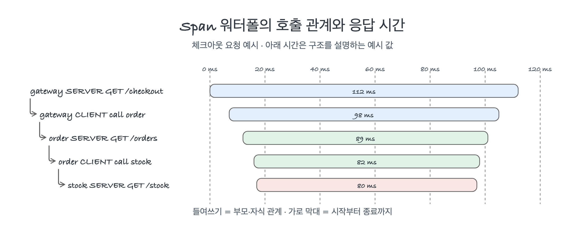

# Trace Data Model and Waterfall Visualization

Trace ID는 요청에 참여하는 Span을 묶고, 각 Span의 ID와 부모 Span ID는 호출 트리를 만든다. 타임라인은 Span의 시작 시각과 지속 시간을 나란히 보여준다. [OpenTelemetry Traces](https://opentelemetry.io/docs/concepts/signals/traces/) · [Grafana Explore Traces](https://grafana.com/docs/grafana/latest/visualizations/explore/trace-integration/)

## 1. 트리에서 서비스 경계를 읽기

실습에서 gateway의 SERVER Span 아래에 order 호출을 나타내는 CLIENT Span이 생긴다. order의 SERVER Span은 전파된 CLIENT Span을 부모로 삼는다. stock 호출도 같은 구조로 이어진다. [OpenTelemetry Traces](https://opentelemetry.io/docs/concepts/signals/traces/) · [OpenTelemetry 컨텍스트 전파](https://opentelemetry.io/docs/concepts/context-propagation/) · [W3C Trace Context](https://www.w3.org/TR/trace-context/)

```text
gateway  SERVER  GET /checkout
└─ gateway  CLIENT  call order
   └─ order  SERVER  GET /orders
      └─ order  CLIENT  call stock
         └─ stock  SERVER  GET /stock
```

## 2. Span에 담기는 데이터

| 항목 | 읽는 법 | 근거 |
| --- | --- | --- |
| Resource | `service.name`처럼 Span을 생성한 주체의 속성 | [OpenTelemetry Traces](https://opentelemetry.io/docs/concepts/signals/traces/) · [OpenTelemetry Python 계측](https://opentelemetry.io/docs/languages/python/instrumentation/) |
| Attributes | 작업의 특징을 나타내는 키와 값 | [OpenTelemetry Traces](https://opentelemetry.io/docs/concepts/signals/traces/) |
| Events | 예외처럼 Span 수명 안에서 특정 시각에 생긴 사건 | [OpenTelemetry Traces](https://opentelemetry.io/docs/concepts/signals/traces/) |
| Links | 다른 Span들의 컨텍스트를 참조하는 관계. 여러 메시지를 모아 처리하는 소비자가 각 메시지의 Span과 연결할 수 있다 | [OpenTelemetry Traces](https://opentelemetry.io/docs/concepts/signals/traces/) |
| Status | Span 작업의 결과로 `Unset`, `Ok`, `Error`를 사용 | [OpenTelemetry Traces](https://opentelemetry.io/docs/concepts/signals/traces/) |

## 3. 워터폴의 가로 막대를 해석하기

부모 Span의 시간에는 자식 호출 대기가 포함될 수 있다. 서로 겹치는 막대의 지속 시간을 합하면 같은 시간 구간을 중복 계산한다. 긴 막대를 발견하면 자식 Span과 겹치는 범위부터 확인한다. [OpenTelemetry Traces](https://opentelemetry.io/docs/concepts/signals/traces/) · [Grafana Explore Traces](https://grafana.com/docs/grafana/latest/visualizations/explore/trace-integration/)



그림의 근거 · [OpenTelemetry Traces](https://opentelemetry.io/docs/concepts/signals/traces/) · [Grafana Explore Traces](https://grafana.com/docs/grafana/latest/visualizations/explore/trace-integration/)
