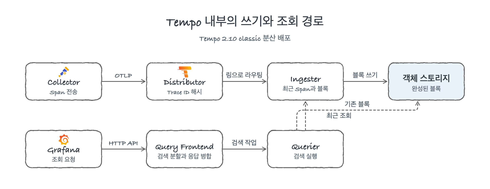
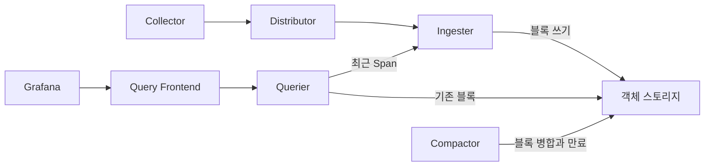

# Tempo Microservices Write and Read Paths

Tempo 2.10 classic의 쓰기 경로는 Distributor와 Ingester가, 읽기 경로는 Query Frontend와 Querier가 맡는다. Compactor는 저장된 블록을 관리한다. [Tempo 2.10 아키텍처](https://grafana.com/docs/tempo/v2.10.x/introduction/architecture/)

## 1. 쓰기 경로와 Trace ID 라우팅

Distributor는 수신한 Span을 Trace ID 해시와 Ingester 링을 기준으로 라우팅한다. 확장 배포에서 복제 설정을 적용할 수 있고, Ingester는 받은 Trace 데이터를 블록으로 모아 백엔드에 기록한다. [Tempo 2.10 아키텍처](https://grafana.com/docs/tempo/v2.10.x/introduction/architecture/) · [Tempo 2.10 설정](https://grafana.com/docs/tempo/v2.10.x/configuration/)

## 2. 읽기 경로와 조회 범위

Grafana는 Query Frontend에 조회를 요청한다. Query Frontend는 검색 범위를 나누어 Querier가 처리하게 하고 응답을 합친다. Querier는 조회 범위에 따라 Ingester에서 최근 데이터를, 백엔드에서 이미 저장된 블록을 읽는다. [Tempo 2.10 아키텍처](https://grafana.com/docs/tempo/v2.10.x/introduction/architecture/) · [Tempo 2.10 HTTP API](https://grafana.com/docs/tempo/v2.10.x/api_docs/)

그림의 근거 · [Tempo 2.10 아키텍처](https://grafana.com/docs/tempo/v2.10.x/introduction/architecture/) · [Tempo 2.10 HTTP API](https://grafana.com/docs/tempo/v2.10.x/api_docs/) · [Tempo 2.10 설정](https://grafana.com/docs/tempo/v2.10.x/configuration/)

## 3. 장애 구간 가르기

새 Trace만 누락되면 Distributor 수신, 링과 Ingester, 최근 조회 경로를 조사한다. 과거 범위만 비면 블록 쓰기, 백엔드 권한, 보존 기간과 조회 시간 범위를 확인한다. Grafana에서만 실패하면 같은 조건의 Tempo API 응답부터 비교한다. [Tempo 2.10 아키텍처](https://grafana.com/docs/tempo/v2.10.x/introduction/architecture/) · [Tempo 2.10 HTTP API](https://grafana.com/docs/tempo/v2.10.x/api_docs/) · [Tempo 2.10 설정](https://grafana.com/docs/tempo/v2.10.x/configuration/)
