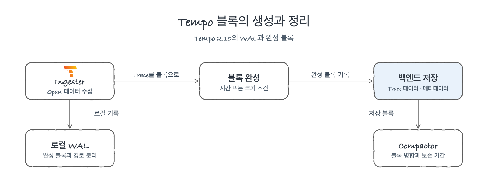

# Tempo Block Storage, WAL, and Compaction

Tempo 2.10에서 Ingester는 데이터를 로컬 WAL 경로와 블록 생성 과정으로 관리하고, 완성한 블록을 설정된 스토리지에 쓴다. WAL 경로와 완성 블록 경로는 설정에서 구분된다. [Tempo 2.10 아키텍처](https://grafana.com/docs/tempo/v2.10.x/introduction/architecture/) · [Tempo 2.10 설정](https://grafana.com/docs/tempo/v2.10.x/configuration/) · [Tempo v2.10.8 공식 예제](https://raw.githubusercontent.com/grafana/tempo/v2.10.8/example/docker-compose/local/tempo.yaml)

## 1. Span이 저장 블록이 되는 과정

Ingester는 일정 시간이나 크기 조건에 따라 블록을 닫고 백엔드에 기록한다. 완성 블록에는 Trace 데이터와 조회를 위한 메타데이터가 저장된다. Trace ID 조회에 사용하는 블룸 필터는 후보를 줄이고, 실제 Trace 데이터는 블록에서 읽는다. [Tempo 2.10 아키텍처](https://grafana.com/docs/tempo/v2.10.x/introduction/architecture/) · [Tempo 2.10 설정](https://grafana.com/docs/tempo/v2.10.x/configuration/)

그림의 근거 · [Tempo 2.10 아키텍처](https://grafana.com/docs/tempo/v2.10.x/introduction/architecture/) · [Tempo 2.10 설정](https://grafana.com/docs/tempo/v2.10.x/configuration/) · [Tempo v2.10.8 공식 예제](https://raw.githubusercontent.com/grafana/tempo/v2.10.8/example/docker-compose/local/tempo.yaml) · [Docker Volume](https://docs.docker.com/engine/storage/volumes/)

## 2. Parquet에서 속성을 읽는 비용

Parquet 블록은 Span과 Resource의 정보를 컬럼에 저장한다. 자주 필터링하는 속성에 전용 컬럼을 지정하면 일반 속성 컬럼 전체를 읽는 비용을 줄일 수 있다. 기존 블록의 컬럼 구성은 설정을 바꾸는 즉시 바뀌지 않으므로 효과를 볼 때 데이터가 기록된 시점을 같이 본다. [Tempo Parquet 블록](https://grafana.com/docs/tempo/v2.10.x/configuration/parquet/) · [Tempo 전용 속성 컬럼](https://grafana.com/docs/tempo/v2.10.x/operations/dedicated_columns/) · [Tempo 검색 성능](https://grafana.com/docs/tempo/v2.10.x/operations/backend_search/)

## 3. 압축과 만료의 단위

Compactor는 블록을 합쳐 검색 대상 블록 수를 줄이고 보존 기간에 도달한 블록을 만료 처리한다. 실습의 `/var/tempo/wal`과 `/var/tempo/blocks`는 같은 Docker 볼륨에 놓지만 역할은 각각 WAL과 로컬 백엔드다. [Tempo 2.10 아키텍처](https://grafana.com/docs/tempo/v2.10.x/introduction/architecture/) · [Tempo v2.10.8 공식 예제](https://raw.githubusercontent.com/grafana/tempo/v2.10.8/example/docker-compose/local/tempo.yaml) · [Docker Volume](https://docs.docker.com/engine/storage/volumes/)
