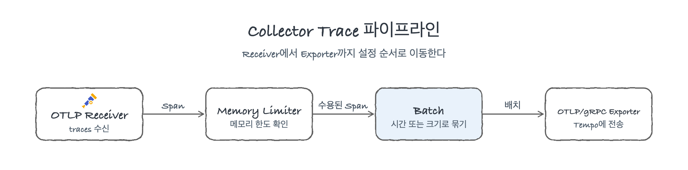

# Collector Architecture and Pipeline Components

Collector 설정은 구성 요소 정의와 실제 활성화 지점을 구분한다. `service.pipelines`에 참조한 Receiver, Processor, Exporter가 해당 신호의 데이터 경로에 연결된다. [Collector 구성](https://opentelemetry.io/docs/collector/configuration/)

## 1. Trace 파이프라인에서 데이터가 흐르는 순서

Receiver가 신호를 파이프라인에 전달하면 Processor 목록을 선언 순서대로 지나 Exporter로 전달한다. `traces`, `metrics`, `logs` 파이프라인은 각 신호를 지원하는 구성 요소를 사용한다. [Collector 구성](https://opentelemetry.io/docs/collector/configuration/)



그림의 근거 · [Collector 구성](https://opentelemetry.io/docs/collector/configuration/)

```text
OTLP Receiver
  → Memory Limiter Processor
  → Batch Processor
  → OTLP/gRPC Exporter
  → Tempo
```

## 2. Connector와 Extension

| 구성 요소 | 활성화 방식 | 근거 |
| --- | --- | --- |
| Connector | 앞 파이프라인에서 Exporter로, 다음 파이프라인에서 Receiver로 참조한다. 지원하는 신호 조합을 확인한다 | [Collector 구성](https://opentelemetry.io/docs/collector/configuration/) |
| Extension | 파이프라인 바깥에서 동작하며 `service.extensions`로 활성화한다. 상태 확인이나 파일 기반 큐 스토리지 등에 사용한다 | [Collector 구성](https://opentelemetry.io/docs/collector/configuration/) · [Collector 복원력](https://opentelemetry.io/docs/collector/resiliency/) |

## 3. 이름과 배포판 확인하기

`otlp_grpc/tempo`의 앞부분은 구성 요소 타입이고 뒤쪽은 같은 타입의 인스턴스를 구별하는 이름이다. 실제 설정을 올리기 전에 배포판과 버전을 고정하고 그 바이너리의 `validate`로 파이프라인을 검사한다. [Collector 구성](https://opentelemetry.io/docs/collector/configuration/) · [Collector 0.144 OTLP/gRPC Exporter](https://github.com/open-telemetry/opentelemetry-collector/blob/v0.144.0/exporter/otlpexporter/README.md)
