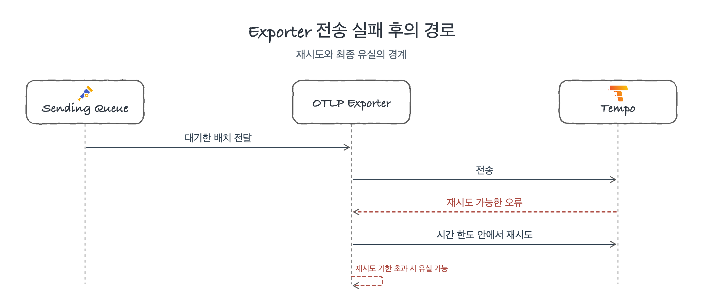

# Collector Exporters, Queues, Retries, and Delivery

Exporter는 파이프라인의 텔레메트리를 목적지로 전송한다. 실습의 `otlp_grpc/tempo`는 Compose DNS 이름 `tempo`의 4317 포트로 Trace를 보낸다. [Collector 구성](https://opentelemetry.io/docs/collector/configuration/) · [Collector 0.144 OTLP/gRPC Exporter](https://github.com/open-telemetry/opentelemetry-collector/blob/v0.144.0/exporter/otlpexporter/README.md) · [Docker Compose 네트워킹](https://docs.docker.com/compose/how-tos/networking/)

## 1. 전송 실패와 큐를 분리해서 관찰하기

Sending Queue는 백엔드가 잠시 느려지거나 전송이 밀릴 때 작업을 보관한다. 재시도는 실패 유형과 시간 한도에 따라 진행되고, 큐가 꽉 차거나 재시도 기한이 끝나면 데이터가 유실될 수 있다. [Collector 복원력](https://opentelemetry.io/docs/collector/resiliency/) · [OTLP 명세](https://opentelemetry.io/docs/specs/otlp/)

그림의 근거 · [Collector 복원력](https://opentelemetry.io/docs/collector/resiliency/) · [OTLP 명세](https://opentelemetry.io/docs/specs/otlp/)

## 2. 프로세스가 다시 시작되는 경우

인메모리 큐는 재시작 때 사라질 수 있다. 재시작 후 이어서 보내려면 이를 지원하는 배포판에 `file_storage` Extension과 영속 볼륨을 구성하고 Exporter 큐가 그 Extension을 사용하게 한다. 파일 시스템 용량과 재시도 조건은 별도로 관리한다. [Collector 복원력](https://opentelemetry.io/docs/collector/resiliency/) · [Collector 구성](https://opentelemetry.io/docs/collector/configuration/) · [Docker Volume](https://docs.docker.com/engine/storage/volumes/)

## 3. 운영 전송 설정을 검증하기

목적지 주소, OTLP 프로토콜, TLS와 인증 설정을 함께 확인한다. Collector 수신 성공은 해당 구간의 인수를 뜻한다. 끝까지 전송됐는지는 Exporter의 성공·실패 지표와 목적지에서 Trace를 직접 조회해 대조한다. [Collector 0.144 OTLP/gRPC Exporter](https://github.com/open-telemetry/opentelemetry-collector/blob/v0.144.0/exporter/otlpexporter/README.md) · [OTLP 명세](https://opentelemetry.io/docs/specs/otlp/) · [Collector 자체 텔레메트리](https://opentelemetry.io/docs/collector/internal-telemetry/)
