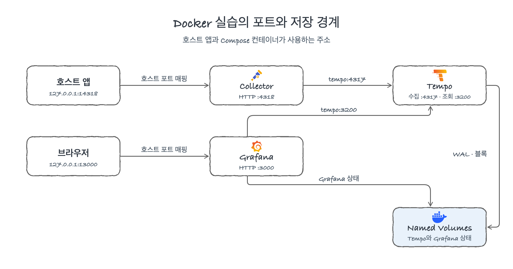

# Running the Tracing Stack with Docker Compose

[15번 설정 파일](15_configuring_grafana_collector_and_tempo.md) 세 개와 아래 `compose.yaml`을 같은 실습 디렉터리에 저장한다. 애플리케이션은 호스트에서 실행하며 Grafana, Collector, Tempo는 컨테이너에 둔다. [Tempo v2.10.8 Compose 예제](https://raw.githubusercontent.com/grafana/tempo/v2.10.8/example/docker-compose/local/docker-compose.yaml) · [Docker Compose 네트워킹](https://docs.docker.com/compose/how-tos/networking/) · [Docker Bind Mount](https://docs.docker.com/engine/storage/bind-mounts/)

## 1. compose.yaml에서 네트워크와 마운트를 묶기

설정 파일은 읽기 전용 Bind Mount, Tempo와 Grafana의 상태는 Named Volume에 둔다. 외부에 열 필요가 없는 Tempo 수집 포트 4317은 컨테이너 네트워크에서만 쓰고 호스트에서 접근할 포트는 loopback에 게시한다. [Docker Bind Mount](https://docs.docker.com/engine/storage/bind-mounts/) · [Docker Volume](https://docs.docker.com/engine/storage/volumes/) · [Docker Compose 네트워킹](https://docs.docker.com/compose/how-tos/networking/) · [Docker Compose 포트](https://docs.docker.com/reference/compose-file/services/#ports) · [Tempo v2.10.8 공식 예제](https://raw.githubusercontent.com/grafana/tempo/v2.10.8/example/docker-compose/local/tempo.yaml)



그림의 근거 · [Docker Bind Mount](https://docs.docker.com/engine/storage/bind-mounts/) · [Docker Volume](https://docs.docker.com/engine/storage/volumes/) · [Docker Compose 네트워킹](https://docs.docker.com/compose/how-tos/networking/) · [Docker Compose 포트](https://docs.docker.com/reference/compose-file/services/#ports) · [Tempo v2.10.8 공식 예제](https://raw.githubusercontent.com/grafana/tempo/v2.10.8/example/docker-compose/local/tempo.yaml)

```yaml
services:
  tempo:
    image: grafana/tempo:2.10.8
    command: ["-config.file=/etc/tempo.yaml"]
    volumes:
      - ./tempo.yaml:/etc/tempo.yaml:ro
      - tempo-data:/var/tempo
    ports:
      - "127.0.0.1:13200:3200"

  collector:
    image: otel/opentelemetry-collector:0.144.0
    command: ["--config=/etc/otelcol/config.yaml"]
    volumes:
      - ./collector.yaml:/etc/otelcol/config.yaml:ro
    ports:
      - "127.0.0.1:14318:4318"
    depends_on: [tempo]

  grafana:
    image: grafana/grafana:12.4.11
    volumes:
      - ./tempo-datasource.yaml:/etc/grafana/provisioning/datasources/tempo.yaml:ro
      - grafana-data:/var/lib/grafana
    ports:
      - "127.0.0.1:13000:3000"
    depends_on: [tempo]

volumes:
  tempo-data:
  grafana-data:
```

## 2. 설정을 검사하고 실행하기

Compose 파일을 먼저 해석하고 Collector 바이너리로 설정을 검사한 뒤 실행한다. `depends_on`은 시작 순서를 정하므로 애플리케이션을 켜기 전에 Tempo의 `/ready`가 HTTP 200을 반환하는지 확인한다. [Docker Compose 시작 순서](https://docs.docker.com/compose/how-tos/startup-order/) · [Collector 구성](https://opentelemetry.io/docs/collector/configuration/) · [Tempo 2.10 HTTP API](https://grafana.com/docs/tempo/v2.10.x/api_docs/)

```bash
docker compose -p backend-engineering-handbook-tracing config --quiet
docker compose -p backend-engineering-handbook-tracing run --rm --no-deps collector \
  validate --config=/etc/otelcol/config.yaml
docker compose -p backend-engineering-handbook-tracing up -d
docker compose -p backend-engineering-handbook-tracing ps
curl --fail --silent --show-error http://127.0.0.1:13200/ready
```

## 3. 로그 확인과 종료

준비 확인이 실패하면 `docker compose -p backend-engineering-handbook-tracing logs tempo collector grafana`에서 설정 파싱, 포트 충돌, 전송 오류를 확인한다. `down`은 기본적으로 Named Volume을 보존한다. 실습 데이터도 지울 때만 `down --volumes`를 사용한다. [Tempo 2.10 HTTP API](https://grafana.com/docs/tempo/v2.10.x/api_docs/) · [Collector 복원력](https://opentelemetry.io/docs/collector/resiliency/) · [Docker Volume](https://docs.docker.com/engine/storage/volumes/)
