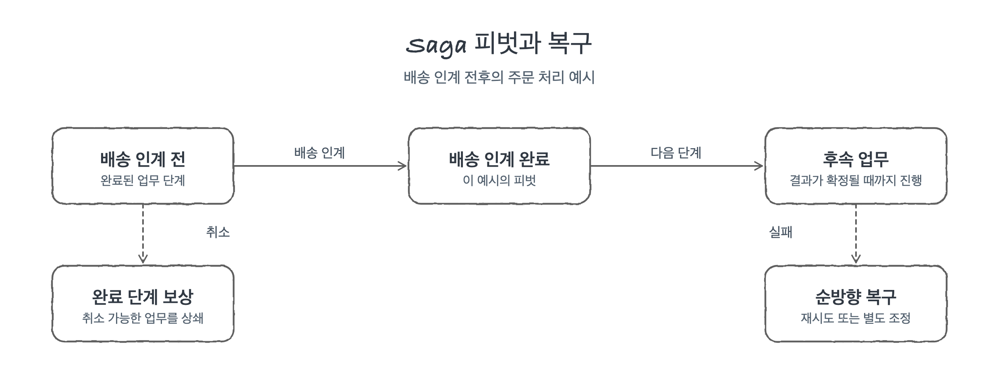

# Modeling Saga States and Recovery

Saga의 구현에는 단계별 상태, 참가자 요청 키, 역방향 보상 또는 순방향 재개 규칙이 필요하다. [Microsoft · Saga](https://learn.microsoft.com/en-us/azure/architecture/patterns/saga) · [AWS · Saga Orchestration](https://docs.aws.amazon.com/prescriptive-guidance/latest/cloud-design-patterns/saga-orchestration.html) · [AWS · Making Retries Safe with Idempotent APIs](https://aws.amazon.com/builders-library/making-retries-safe-with-idempotent-APIs/)

## 1. 실행 상태와 식별자를 저장한다

sagaId는 전체 주문을 추적하고 operationId는 재고 차감 같은 개별 변경을 식별하며 eventId는 전송된 이벤트를 구분한다. 참가자는 멱등 상태와 업무 변경을 같은 로컬 트랜잭션에 기록하고, 이벤트를 내보낼 때는 아웃박스를 같은 경계에 둔다. [AWS · Making Retries Safe with Idempotent APIs](https://aws.amazon.com/builders-library/making-retries-safe-with-idempotent-APIs/) · [AWS · Transactional Outbox](https://docs.aws.amazon.com/prescriptive-guidance/latest/cloud-design-patterns/transactional-outbox.html) · [AWS · Saga Orchestration](https://docs.aws.amazon.com/prescriptive-guidance/latest/cloud-design-patterns/saga-orchestration.html)

## 2. 보상 가능 단계와 피벗 이후 단계를 구분한다

예를 들어 배송 인계 전에 주문을 취소할 수 있다면, 인계가 완료되는 시점을 피벗 후보로 둔다. 그 뒤 작업은 명확한 결과가 나올 때까지 재시도하거나 별도 조정 절차로 넘긴다. 피벗은 업무 요건에 따라 정하고 각 상태에서 허용되는 다음 전이를 표현한다. [Microsoft · Saga](https://learn.microsoft.com/en-us/azure/architecture/patterns/saga) · [Microsoft · Compensating Transaction](https://learn.microsoft.com/en-us/azure/architecture/patterns/compensating-transaction)

그림의 근거 · [Microsoft · Saga](https://learn.microsoft.com/en-us/azure/architecture/patterns/saga) · [Microsoft · Compensating Transaction](https://learn.microsoft.com/en-us/azure/architecture/patterns/compensating-transaction)

## 3. 경쟁 요청이 볼 수 있는 상태를 정의한다

중간 커밋이 다른 요청에 보일 수 있으므로 재고가 이미 차감됐거나 포인트가 보류된 상태의 의미를 정한다. 필요하면 업무 예약, 조건부 갱신, 상태에 따른 접근 제한을 적용한다. [Microsoft · Saga](https://learn.microsoft.com/en-us/azure/architecture/patterns/saga) · [Apache Seata 2.4 · TCC Mode](https://seata.apache.org/docs/v2.4/user/mode/tcc/) · [MySQL 8.4 · InnoDB Statement Locks](https://dev.mysql.com/doc/refman/8.4/en/innodb-locks-set.html)
