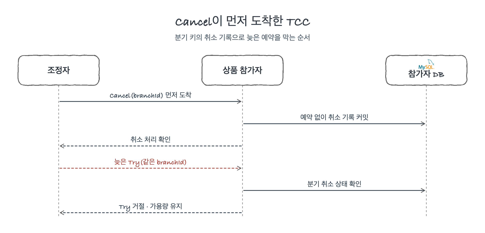

# Designing TCC Reservations in MySQL

TCC는 Try에서 자원을 가용량에서 보류하고, Confirm에서 확정하거나 Cancel에서 가용량으로 돌린다. MySQL 예에서는 자원 카운터와 분기 상태를 같은 DB 트랜잭션에 저장한다. [Apache Seata 2.4 · TCC Mode](https://seata.apache.org/docs/v2.4/user/mode/tcc/) · [Apache Seata · TCC Fence](https://seata.apache.org/blog/seata-tcc-fence/) · [MySQL 8.4 · InnoDB Statement Locks](https://dev.mysql.com/doc/refman/8.4/en/innodb-locks-set.html)

## 1. 카운터와 분기 상태를 함께 모델링한다

상품에는 available과 reserved를, 분기에는 고유 branchId와 상품·수량·상태를 둔다. Try에서 available을 줄이고 reserved를 늘린다. Confirm은 reserved만 줄이고 Cancel은 reserved를 available로 옮긴다. [Apache Seata 2.4 · TCC Mode](https://seata.apache.org/docs/v2.4/user/mode/tcc/) · [MySQL 8.4 · InnoDB Statement Locks](https://dev.mysql.com/doc/refman/8.4/en/innodb-locks-set.html) · [MySQL 8.4 · CHECK Constraints](https://dev.mysql.com/doc/refman/8.4/en/create-table-check-constraints.html)

## 2. 뒤늦은 Try와 키 충돌을 막는다

Cancel이 Try보다 먼저 오면 아무 자원도 돌려주지 않고 같은 키로 취소 기록을 만든다. 이후 Try는 그 상태를 보고 예약을 거절한다. 원래 상품·수량과 다른 요청으로 동일 키를 쓰면 충돌로 응답한다. [상품 Try SQL](16_implementing_the_product_try_api.md)부터 참가자 구현을 이어간다. [Apache Seata · TCC Fence](https://seata.apache.org/blog/seata-tcc-fence/) · [AWS · Making Retries Safe with Idempotent APIs](https://aws.amazon.com/builders-library/making-retries-safe-with-idempotent-APIs/) · [MySQL 8.4 · INSERT ON DUPLICATE KEY UPDATE](https://dev.mysql.com/doc/refman/8.4/en/insert-on-duplicate.html)

그림의 근거 · [Apache Seata · TCC Fence](https://seata.apache.org/blog/seata-tcc-fence/) · [AWS · Making Retries Safe with Idempotent APIs](https://aws.amazon.com/builders-library/making-retries-safe-with-idempotent-APIs/) · [MySQL 8.4 · INSERT ON DUPLICATE KEY UPDATE](https://dev.mysql.com/doc/refman/8.4/en/insert-on-duplicate.html)
