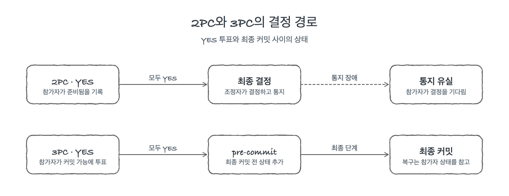

# Comparing Three-Phase Commit with Two-Phase Commit

3PC는 원자적 커밋 과정에 사전 확정(pre-commit) 상태를 추가해 특정 장애 가정에서 복구자가 결정에 필요한 상태를 구별할 수 있게 한다. [Skeen · Nonblocking Commit Protocols](https://web.eecs.umich.edu/~manosk/assets/papers/Ske81.pdf) · [Gray·Lamport · Consensus on Transaction Commit](https://arxiv.org/pdf/cs/0408036)

## 1. 중간 상태가 해결하는 문제

전통적인 2PC에서 YES 투표 뒤 결정 통지를 받지 못한 참가자는 조정자의 결정을 혼자 추론할 수 없다. 3PC에서는 투표와 최종 커밋 사이에 pre-commit 단계를 두고 종료 프로토콜이 참가자들의 상태를 감안해 진행한다. [Gray·Lamport · Consensus on Transaction Commit](https://arxiv.org/pdf/cs/0408036) · [Skeen · Nonblocking Commit Protocols](https://web.eecs.umich.edu/~manosk/assets/papers/Ske81.pdf)

그림의 근거 · [Gray·Lamport · Consensus on Transaction Commit](https://arxiv.org/pdf/cs/0408036) · [Skeen · Nonblocking Commit Protocols](https://web.eecs.umich.edu/~manosk/assets/papers/Ske81.pdf)

## 2. 비차단 보장의 적용 범위를 확인한다

고전적인 3PC의 비차단 동작은 타임아웃을 해석할 수 있는 통신·장애 가정에 의존한다. 네트워크가 분할될 수 있는 일반 시스템에서 서로 연락할 수 없는 참가자에게 로컬 타임아웃만으로 독립 결정하게 하면 분할 간 결정이 어긋날 수 있다. 추가 왕복과 가정의 타당성을 함께 비교한다. [Skeen · Nonblocking Commit Protocols](https://web.eecs.umich.edu/~manosk/assets/papers/Ske81.pdf) · [Gray·Lamport · Consensus on Transaction Commit](https://arxiv.org/pdf/cs/0408036)

## 3. 업무 보상과 커밋 합의를 구분한다

2PC와 3PC는 참가자 원자적 커밋 프로토콜이다. TCC는 업무 예약의 확정·해제를 조정하고, Saga는 이미 완료된 업무를 필요에 따라 보상한다. 선택은 참가자 계약과 중간 결과 노출 요구에서 시작한다. [Gray·Lamport · Consensus on Transaction Commit](https://arxiv.org/pdf/cs/0408036) · [Skeen · Nonblocking Commit Protocols](https://web.eecs.umich.edu/~manosk/assets/papers/Ske81.pdf) · [Apache Seata 2.4 · TCC Mode](https://seata.apache.org/docs/v2.4/user/mode/tcc/) · [Microsoft · Saga](https://learn.microsoft.com/en-us/azure/architecture/patterns/saga)
