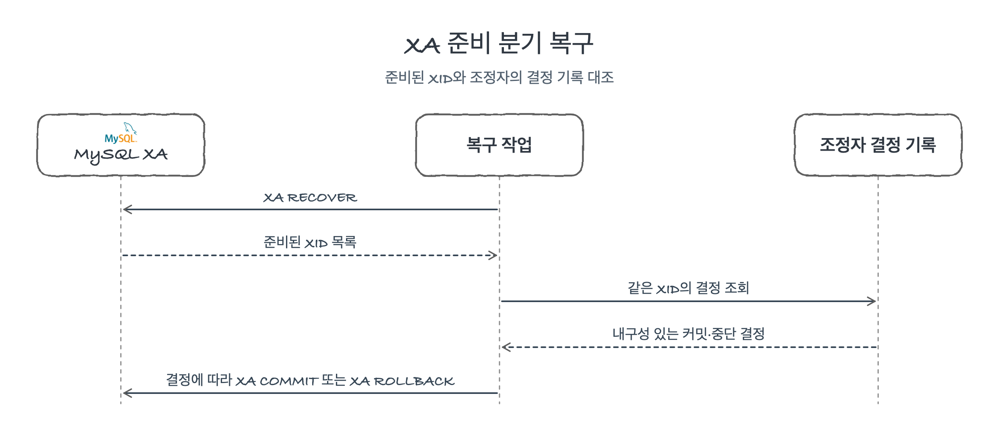

# Understanding Two-Phase Commit

2PC는 조정자가 참가자의 준비 여부를 수집해 단일 커밋 또는 중단 결정을 전달하는 원자적 커밋 프로토콜이다. 참가하는 모든 자원이 준비와 결과 적용 계약을 지원해야 한다. [Gray·Lamport · Consensus on Transaction Commit](https://arxiv.org/pdf/cs/0408036) · [MySQL 8.4 · XA Statements](https://dev.mysql.com/doc/refman/8.4/en/xa-statements.html)

## 1. 준비와 최종 결정의 순서

조정자는 준비를 요청한다. 참가자는 커밋 가능 상태를 내구성 있게 저장한 뒤 YES를 응답한다. 모두 YES이면 조정자는 커밋 결정을 기록하고 전파한다. 커밋 결정을 내리기 전 준비가 실패하면 중단 경로를 택한다. 준비 뒤 결정이 오지 않으면 참가자는 필요한 자원을 보유하면서 결정을 기다릴 수 있다. [Gray·Lamport · Consensus on Transaction Commit](https://arxiv.org/pdf/cs/0408036) · [MySQL 8.4 · XA States](https://dev.mysql.com/doc/refman/8.4/en/xa-states.html)

## 2. MySQL XA에서 미결 분기를 확인한다

MySQL 8.4에서 XA START → XA END → XA PREPARE로 준비 상태에 도달한다. XA RECOVER에는 준비 상태의 XID가 나오며 조회 권한이 필요하다. 조정자의 내구성 있는 결정과 XID를 대조한 뒤 XA COMMIT 또는 XA ROLLBACK을 실행한다. 분기 목록이나 체류 시간만으로 결과를 결정하지 않는다. [MySQL 8.4 · XA Statements](https://dev.mysql.com/doc/refman/8.4/en/xa-statements.html) · [MySQL 8.4 · XA States](https://dev.mysql.com/doc/refman/8.4/en/xa-states.html) · [Gray·Lamport · Consensus on Transaction Commit](https://arxiv.org/pdf/cs/0408036)

그림의 근거 · [MySQL 8.4 · XA Statements](https://dev.mysql.com/doc/refman/8.4/en/xa-statements.html) · [MySQL 8.4 · XA States](https://dev.mysql.com/doc/refman/8.4/en/xa-states.html) · [Gray·Lamport · Consensus on Transaction Commit](https://arxiv.org/pdf/cs/0408036)
