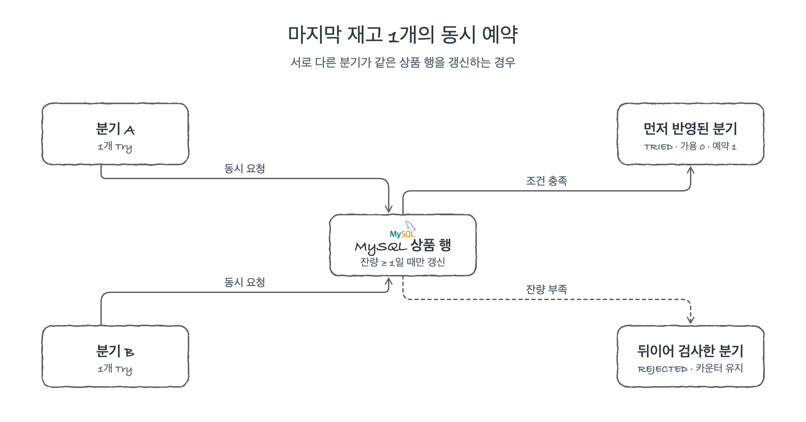

# Preventing Concurrent TCC Over-Reservations

가용 수량 읽기와 갱신을 분리하면 두 주문이 마지막 재고를 동시에 통과할 수 있다. 참가자는 잔량 조건을 갱신문에 넣어 한 행에서 검사와 변경을 처리한다. [MySQL 8.4 · InnoDB Statement Locks](https://dev.mysql.com/doc/refman/8.4/en/innodb-locks-set.html) · [MySQL 8.4 · Locking Reads](https://dev.mysql.com/doc/refman/8.4/en/innodb-locking-reads.html)

## 1. 동일 상품과 동일 분기 경쟁을 각각 본다

다른 키로 같은 상품을 예약하면 두 갱신은 상품 행에서 경쟁한다. 같은 키이면 분기 기본 키와 잠금이 최초 한 번의 상태 전이만 허용한다. 분기 행을 먼저, 상품 행을 나중에 잡는 순서를 세 참가 API에서 유지한다. [MySQL 8.4 · InnoDB Statement Locks](https://dev.mysql.com/doc/refman/8.4/en/innodb-locks-set.html) · [MySQL 8.4 · INSERT ON DUPLICATE KEY UPDATE](https://dev.mysql.com/doc/refman/8.4/en/insert-on-duplicate.html) · [MySQL 8.4 · Locking Reads](https://dev.mysql.com/doc/refman/8.4/en/innodb-locking-reads.html)

## 2. 두 세션에서 마지막 수량을 검증한다

가용 1인 상품에 서로 다른 분기 키로 동시에 1개씩 Try를 호출한다. 결과는 TRIED 1건과 REJECTED 1건이고, 가용은 0, 예약은 1이어야 한다. 데드락은 전체 로컬 트랜잭션을 재시도하고, 잠금 대기 시간 초과는 기본 설정에서 문장만 롤백될 수 있으므로 실패 트랜잭션을 끝낸 뒤 재시도한다. [MySQL 8.4 · InnoDB Statement Locks](https://dev.mysql.com/doc/refman/8.4/en/innodb-locks-set.html) · [MySQL 8.4 · InnoDB Error Handling](https://dev.mysql.com/doc/refman/8.4/en/innodb-error-handling.html) · [AWS · Timeouts, Retries, and Backoff with Jitter](https://aws.amazon.com/builders-library/timeouts-retries-and-backoff-with-jitter/)

그림의 근거 · [MySQL 8.4 · InnoDB Statement Locks](https://dev.mysql.com/doc/refman/8.4/en/innodb-locks-set.html) · [MySQL 8.4 · InnoDB Error Handling](https://dev.mysql.com/doc/refman/8.4/en/innodb-error-handling.html) · [AWS · Timeouts, Retries, and Backoff with Jitter](https://aws.amazon.com/builders-library/timeouts-retries-and-backoff-with-jitter/)
