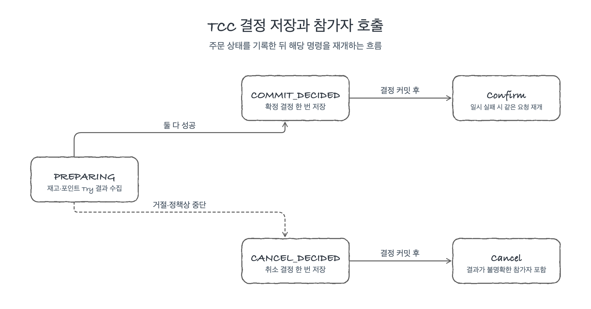

# Coordinating TCC in the Order Service

Order Service는 전체 진행 상태와 참가자의 분기 키를 내구성 있게 보관한다. 각 참가자의 Try를 모은 뒤 두 결정 중 하나를 기록한다. [Apache Seata 2.4 · TCC Mode](https://seata.apache.org/docs/v2.4/user/mode/tcc/) · [Apache Seata · TCC Fence](https://seata.apache.org/blog/seata-tcc-fence/) · [AWS · Saga Orchestration](https://docs.aws.amazon.com/prescriptive-guidance/latest/cloud-design-patterns/saga-orchestration.html)

## 1. 결정을 저장하고 그 결정의 요청만 보낸다

PREPARING에서 두 Try의 성공이 확인되면 COMMIT_DECIDED, 거절 또는 정책상 중단이면 CANCEL_DECIDED로 전이한다. 버전이나 현재 상태를 조건으로 한 갱신으로 결정을 한 번만 저장한다. 저장하기 전에는 Confirm을 보내지 않는다. [Apache Seata 2.4 · TCC Mode](https://seata.apache.org/docs/v2.4/user/mode/tcc/) · [AWS · Saga Orchestration](https://docs.aws.amazon.com/prescriptive-guidance/latest/cloud-design-patterns/saga-orchestration.html) · [MySQL 8.4 · InnoDB Statement Locks](https://dev.mysql.com/doc/refman/8.4/en/innodb-locks-set.html) · [Gray·Lamport · Consensus on Transaction Commit](https://arxiv.org/pdf/cs/0408036)

그림의 근거 · [Apache Seata 2.4 · TCC Mode](https://seata.apache.org/docs/v2.4/user/mode/tcc/) · [AWS · Saga Orchestration](https://docs.aws.amazon.com/prescriptive-guidance/latest/cloud-design-patterns/saga-orchestration.html) · [MySQL 8.4 · InnoDB Statement Locks](https://dev.mysql.com/doc/refman/8.4/en/innodb-locks-set.html) · [Gray·Lamport · Consensus on Transaction Commit](https://arxiv.org/pdf/cs/0408036)

CANCEL_DECIDED는 Try를 보냈으나 결과가 불명확했던 참가자도 포함한다. 참가자의 Cancel 선행 방지 기록이 지연 Try를 차단한다. 확정 결정을 저장한 뒤 일시 실패가 생기면 같은 Confirm을 재개한다. [Apache Seata · TCC Fence](https://seata.apache.org/blog/seata-tcc-fence/) · [Apache Seata 2.4 · TCC Mode](https://seata.apache.org/docs/v2.4/user/mode/tcc/) · [AWS · Making Retries Safe with Idempotent APIs](https://aws.amazon.com/builders-library/making-retries-safe-with-idempotent-APIs/)

## 2. 성과 상태는 참가자 응답을 반영해 정한다

모든 확정이 확인되면 COMPLETED, 필요한 모든 해제가 확인되면 CANCELED로 전이한다. 실패한 작업, 다음 재시도 시각, 지연 원인을 별도로 기록해 복구 시 사용한다. [AWS · Saga Orchestration](https://docs.aws.amazon.com/prescriptive-guidance/latest/cloud-design-patterns/saga-orchestration.html) · [Apache Seata 2.4 · TCC Mode](https://seata.apache.org/docs/v2.4/user/mode/tcc/) · [AWS · Timeouts, Retries, and Backoff with Jitter](https://aws.amazon.com/builders-library/timeouts-retries-and-backoff-with-jitter/)
