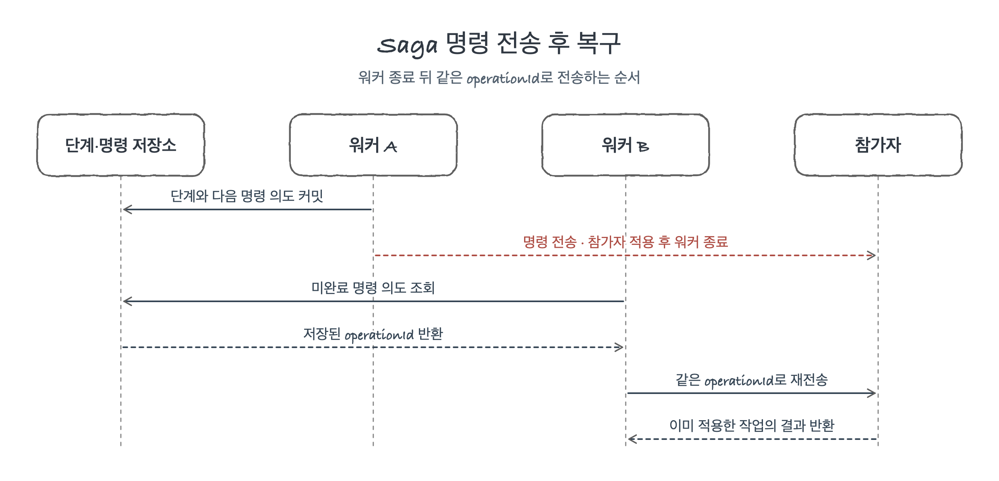

# Hardening an Orchestrated Saga for Recovery

요청 스레드의 메모리에만 흐름을 두면 재시작 중 참가자가 이미 커밋한 변경을 잃어버릴 수 있다. 단계와 재개 의도를 내구성 있게 저장한다. [AWS · Saga Orchestration](https://docs.aws.amazon.com/prescriptive-guidance/latest/cloud-design-patterns/saga-orchestration.html) · [AWS · Transactional Outbox](https://docs.aws.amazon.com/prescriptive-guidance/latest/cloud-design-patterns/transactional-outbox.html) · [AWS · Making Retries Safe with Idempotent APIs](https://aws.amazon.com/builders-library/making-retries-safe-with-idempotent-APIs/)

## 1. 기록·전송·응답 사이의 장애 창을 다룬다

단계 변경과 다음 명령 의도를 함께 커밋한다. 별도 워커가 이 기록을 사용해 전송하고, 전송 직후 종료돼도 다음 워커가 같은 operationId의 명령을 다시 실행하게 한다. 중복 효과는 참가자의 작업 키가 막는다. [AWS · Transactional Outbox](https://docs.aws.amazon.com/prescriptive-guidance/latest/cloud-design-patterns/transactional-outbox.html) · [AWS · Saga Orchestration](https://docs.aws.amazon.com/prescriptive-guidance/latest/cloud-design-patterns/saga-orchestration.html) · [AWS · Making Retries Safe with Idempotent APIs](https://aws.amazon.com/builders-library/making-retries-safe-with-idempotent-APIs/)

그림의 근거 · [AWS · Transactional Outbox](https://docs.aws.amazon.com/prescriptive-guidance/latest/cloud-design-patterns/transactional-outbox.html) · [AWS · Saga Orchestration](https://docs.aws.amazon.com/prescriptive-guidance/latest/cloud-design-patterns/saga-orchestration.html) · [AWS · Making Retries Safe with Idempotent APIs](https://aws.amazon.com/builders-library/making-retries-safe-with-idempotent-APIs/)

## 2. 동시 복구와 장기 실패에 대응한다

버전 조건이나 작업 리스를 사용해 워커의 경쟁을 관리하되 리스 만료가 이미 전송한 요청을 취소해 주지는 않으므로 멱등 처리를 유지한다. 반복 실패는 마지막 정상 단계와 원인을 기록해 자동 재개와 수동 처리를 구분한다. [AWS · Saga Orchestration](https://docs.aws.amazon.com/prescriptive-guidance/latest/cloud-design-patterns/saga-orchestration.html) · [AWS · Making Retries Safe with Idempotent APIs](https://aws.amazon.com/builders-library/making-retries-safe-with-idempotent-APIs/) · [AWS · Timeouts, Retries, and Backoff with Jitter](https://aws.amazon.com/builders-library/timeouts-retries-and-backoff-with-jitter/) · [Microsoft · Compensating Transaction](https://learn.microsoft.com/en-us/azure/architecture/patterns/compensating-transaction)
