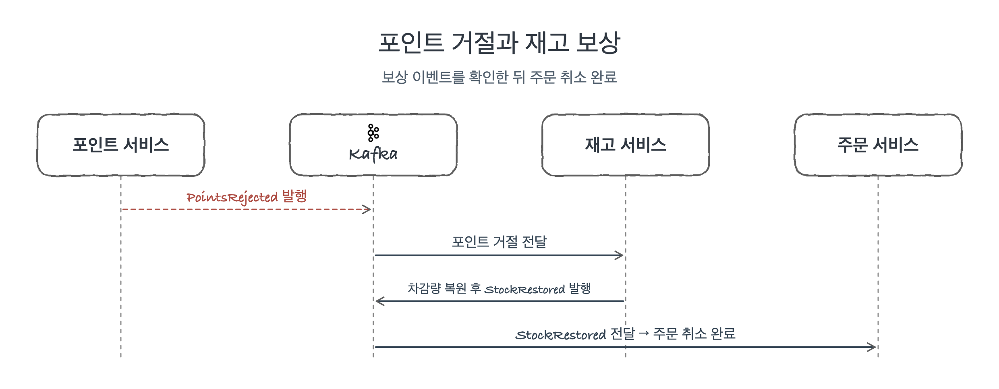

# Completing or Compensating an Order After Points Events

PointsDeducted는 주문 확정을, PointsRejected는 앞선 재고 차감의 보상을 시작한다. 두 이벤트에는 같은 Saga의 상관 키가 들어 있다. [AWS · Saga Choreography](https://docs.aws.amazon.com/prescriptive-guidance/latest/cloud-design-patterns/saga-choreography.html) · [Microsoft · Saga](https://learn.microsoft.com/en-us/azure/architecture/patterns/saga) · [Microsoft · Compensating Transaction](https://learn.microsoft.com/en-us/azure/architecture/patterns/compensating-transaction)

## 1. 업무 성공과 보상 완료를 상태로 표현한다

주문 서비스는 PointsDeducted를 적용해 주문을 확정한다. PointsRejected는 재고 서비스가 처리해 원본 차감량을 한 번 복원하고 StockRestored를 발행한다. 주문 서비스는 보상 대기 중일 수 있고, StockRestored를 적용한 뒤 취소 완료로 전이한다. [AWS · Saga Choreography](https://docs.aws.amazon.com/prescriptive-guidance/latest/cloud-design-patterns/saga-choreography.html) · [Microsoft · Compensating Transaction](https://learn.microsoft.com/en-us/azure/architecture/patterns/compensating-transaction) · [AWS · Transactional Outbox](https://docs.aws.amazon.com/prescriptive-guidance/latest/cloud-design-patterns/transactional-outbox.html)

그림의 근거 · [AWS · Saga Choreography](https://docs.aws.amazon.com/prescriptive-guidance/latest/cloud-design-patterns/saga-choreography.html) · [Microsoft · Compensating Transaction](https://learn.microsoft.com/en-us/azure/architecture/patterns/compensating-transaction) · [AWS · Transactional Outbox](https://docs.aws.amazon.com/prescriptive-guidance/latest/cloud-design-patterns/transactional-outbox.html)

## 2. 인과관계와 상태 전이를 검증한다

토픽이 다르거나 소비자별 처리 속도가 다르면 주문 서비스의 중간 상태 갱신 순서가 달라질 수 있다. 완료한 상태가 늦은 중간 이벤트로 되돌아가지 않게 현재 상태와 이벤트 종류를 대조한다. 예상 밖의 종착 결과 조합은 대사 대상으로 남긴다. [Apache Kafka 4.2 · Introduction](https://kafka.apache.org/42/getting-started/introduction/) · [AWS · Saga Choreography](https://docs.aws.amazon.com/prescriptive-guidance/latest/cloud-design-patterns/saga-choreography.html) · [Microsoft · Saga](https://learn.microsoft.com/en-us/azure/architecture/patterns/saga)
