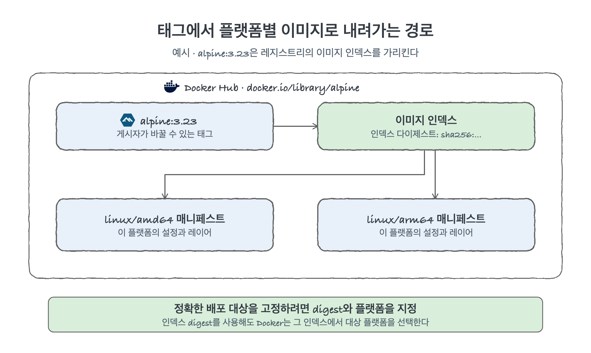
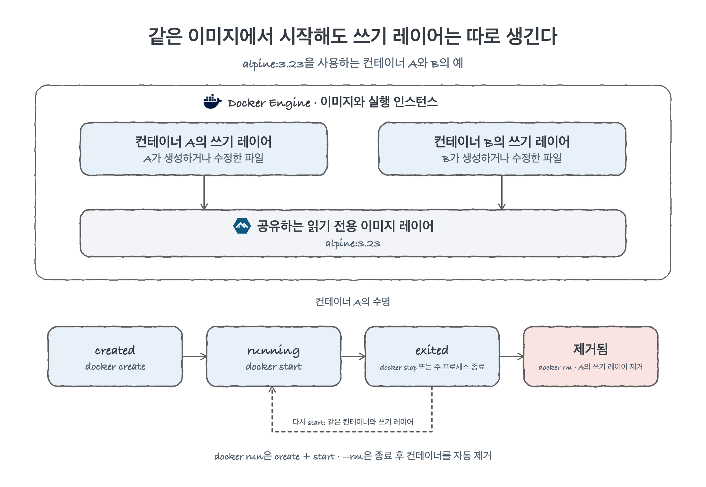

# Operating Docker Images and Containers

이미지는 파일시스템 레이어와 기본 실행 설정을 묶은 배포 단위다. 컨테이너를 생성하면 Docker는 이미지 위에 컨테이너 전용 쓰기 레이어를 추가하고, 컨테이너를 시작할 때 설정된 주 프로세스를 실행한다. 같은 이미지에서 시작한 두 컨테이너는 이미지 레이어를 공유하고 각자의 쓰기 레이어를 갖는다. [Docker 이미지 레이어](https://docs.docker.com/learn/content/how-image-layers-and-the-build-cache-work/) · [컨테이너 실행](https://docs.docker.com/engine/containers/run/)

## 1. Docker Hub에서 이미지 선택하기

Docker Hub에서 이미지를 고를 때는 배포 주체, 버전 태그, 필요한 OS와 CPU 아키텍처를 확인한다. 실습은 Docker Official Image인 `alpine:3.23`을 사용한다. **Tags** 탭에서 버전과 지원 플랫폼을 보고, **Overview**에서 유지보수 정보와 사용법을 확인할 수 있다. [Alpine 공식 이미지](https://hub.docker.com/_/alpine) · [Alpine 태그](https://hub.docker.com/_/alpine/tags)

아래 명령은 Docker 엔진이 실행 중인 환경에서 Bash 또는 Zsh 터미널 하나에 순서대로 입력한다. `mktemp`가 만든 디렉터리 이름을 사용해 실습마다 별개의 컨테이너 이름과 로컬 태그를 만든다.

```bash
docker version

image=alpine:3.23
lab_dir=$(mktemp -d "${TMPDIR:-/tmp}/lounge-docker.XXXXXXXX")
lab=${lab_dir##*/}
short_run="${lab}-short"
worker="${lab}-worker"
shell_box="${lab}-shell"
lab_image="lounge-docker-study:$lab"

docker image pull "$image"
docker image ls --digests "$image"
```

이미지 참조 `docker.io/library/alpine:3.23`은 레지스트리 `docker.io`, 네임스페이스 `library`, 저장소 `alpine`, 태그 `3.23`으로 읽는다. Docker Hub 공식 이미지는 `alpine:3.23`처럼 줄여 쓸 수 있다. 태그를 생략하면 Docker는 `latest`를 사용한다. `latest`도 게시자가 붙이는 태그이며, `3.23` 같은 버전 태그도 배포에 따라 다른 콘텐츠를 가리킬 수 있다. [이미지 참조와 태그](https://docs.docker.com/reference/cli/docker/image/tag/) · [이미지 내려받기](https://docs.docker.com/reference/cli/docker/image/pull/)

## 2. 다이제스트와 플랫폼 확인하기

다이제스트는 매니페스트 또는 여러 플랫폼을 묶은 이미지 인덱스의 콘텐츠 해시다. `저장소@sha256:…` 형식으로 내려받으면 같은 레지스트리 콘텐츠를 지정할 수 있다. 아래 명령은 방금 내려받은 이미지에서 저장소 다이제스트를 읽어 다시 요청한다. `docker image ls`의 `IMAGE ID`는 로컬 이미지 식별자다. [다이제스트로 내려받기](https://docs.docker.com/reference/cli/docker/image/pull/#pull-an-image-by-digest-immutable-identifier)

```bash
image_ref=$(docker image inspect --format '{{index .RepoDigests 0}}' "$image")
printf '%s\n' "$image_ref"
docker image pull "$image_ref"

docker image inspect --format '{{.Os}}/{{.Architecture}}' "$image"
# Buildx가 설치된 환경에서 레지스트리의 플랫폼 목록 확인
docker buildx imagetools inspect "$image"
```

`linux/amd64`와 `linux/arm64`는 각각 Linux용 x86-64, ARM 64비트 이미지다. 멀티플랫폼 태그를 내려받으면 Docker가 엔진에 맞는 매니페스트를 선택한다. 특정 플랫폼이 필요할 때는 `docker image pull --platform linux/amd64 "$image"`처럼 지정할 수 있다. 다른 아키텍처용 이미지를 실행하려면 해당 아키텍처를 지원하는 호스트나 에뮬레이션이 필요하다. 멀티플랫폼 인덱스의 다이제스트로 고정해도 플랫폼별 매니페스트 선택은 이어지므로, 배포 대상을 고정할 때는 플랫폼도 명시한다. [멀티플랫폼 이미지](https://docs.docker.com/build/building/multi-platform/) · [레지스트리 이미지 정보 조회](https://docs.docker.com/reference/cli/docker/buildx/imagetools/inspect/)



그림의 근거 · [Alpine 3.23 태그](https://raw.githubusercontent.com/docker-library/official-images/master/library/alpine) · [멀티플랫폼 선택](https://docs.docker.com/build/building/multi-platform/) · [다이제스트로 이미지 지정](https://docs.docker.com/reference/cli/docker/image/pull/#pull-an-image-by-digest-immutable-identifier)

## 3. 이미지 레이어, 캐시, 태그 정리

Docker는 로컬에 있는 동일한 레이어를 재사용해 다운로드와 저장 공간을 줄인다. 빌드 캐시는 이전 빌드 단계의 입력과 결과를 재사용한다. 입력 변경으로 한 단계의 캐시가 무효화되면 그 결과에 의존하는 후속 단계도 다시 처리한다. `docker image history`로 이미지가 만들어진 단계와 크기를 확인할 수 있다. [이미지 레이어와 빌드 캐시](https://docs.docker.com/learn/content/how-image-layers-and-the-build-cache-work/) · [캐시 무효화](https://docs.docker.com/build/cache/invalidation/)

```bash
docker image history "$image"
docker image tag "$image" "$lab_image"
docker image ls "$lab_image"
docker image rm "$lab_image"
docker image ls --filter dangling=true
```

`docker image tag`는 같은 이미지에 새 참조를 추가한다. 여기서 `docker image rm`의 대상은 방금 만든 로컬 태그다. 새 빌드가 기존 태그를 가져가면 이전 이미지가 태그를 잃을 수 있다. `dangling=true`는 태그가 없고 이미지 트리 끝에 있는 이미지를 보여준다. 목록에서는 `<none>:<none>`으로 표시된다. `docker image prune`은 엔진 전체의 댕글링 이미지를 대상으로 하며, `-a`를 더하면 기존 컨테이너가 참조하지 않는 태그 있는 이미지까지 정리 범위가 넓어진다. [이미지 삭제](https://docs.docker.com/reference/cli/docker/image/rm/) · [이미지 목록 필터](https://docs.docker.com/reference/cli/docker/image/ls/) · [이미지 정리 범위](https://docs.docker.com/reference/cli/docker/image/prune/)

## 4. 포그라운드와 백그라운드 실행

`docker run`은 새 컨테이너를 생성하고 시작한다. 기본 포그라운드 모드에서는 주 프로세스의 출력을 현재 터미널로 전달한다. `-d`를 붙이면 컨테이너 ID를 출력하고 터미널로 돌아온다. 두 모드 모두 기본적으로 주 프로세스가 끝나면 실행도 끝난다. `--rm`은 종료된 컨테이너를 자동으로 제거한다. [컨테이너 실행 모드](https://docs.docker.com/engine/containers/run/)

```bash
docker run --rm "$image" sh -c 'echo "foreground: done"'

docker run -d --name "$short_run" "$image" sh -c 'echo "background: done"'
docker container wait "$short_run"
docker container logs "$short_run"
docker container ls -a --filter "name=$short_run"
```

백그라운드 예제는 `wait`에서 종료 코드 `0`을, `logs`에서 `background: done`을 출력한다. 기본 `docker ps` 목록에는 실행 중인 컨테이너가 표시된다. 종료된 컨테이너를 조사할 때는 `docker ps -a`를 사용한다. [컨테이너 목록](https://docs.docker.com/reference/cli/docker/container/ls/) · [종료 대기](https://docs.docker.com/reference/cli/docker/container/wait/)

## 5. 생성, 시작, 로그, 중지, 재시작

`docker create`는 컨테이너를 `created` 상태로 만들고, `docker start`가 주 프로세스를 시작한다. 아래 예제는 2초마다 UTC 시각을 표준 출력에 기록한다. [컨테이너 생성](https://docs.docker.com/reference/cli/docker/container/create/) · [컨테이너 시작](https://docs.docker.com/reference/cli/docker/container/start/)

```bash
docker create --name "$worker" "$image" sh -c \
  'trap "exit 0" TERM; while :; do date -u +%H:%M:%S; sleep 2; done'
docker container inspect --format '{{.State.Status}}' "$worker"
docker start "$worker"
docker container inspect --format '{{.State.Status}}' "$worker"
docker logs --tail 3 --timestamps --follow "$worker"
```

`inspect`에서 `created`, `running`을 차례로 확인할 수 있다. `logs --follow`는 이전 로그를 지정한 만큼 보여준 뒤 표준 출력과 표준 오류에 추가된 로그를 스트리밍한다. `Ctrl+C`로 로그 조회를 종료하고 다음 명령을 입력한다. [컨테이너 상태 조회](https://docs.docker.com/reference/cli/docker/container/inspect/) · [로그 스트리밍](https://docs.docker.com/reference/cli/docker/container/logs/)

```bash
docker stop "$worker"
docker container inspect --format '{{.State.Status}}' "$worker"
docker start "$worker"
docker restart "$worker"
docker container inspect --format '{{.State.Status}}' "$worker"
```

`stop`은 기본적으로 주 프로세스에 `SIGTERM`을 보내고, 유예 시간이 지나도 실행 중이면 `SIGKILL`을 보낸다. 이 예제의 `trap`은 `SIGTERM`을 받으면 셸을 종료한다. `stop` 뒤에는 `exited`, 마지막 `inspect`에서는 `running`을 확인할 수 있다. `start`와 `restart`는 기존 컨테이너 ID와 쓰기 레이어를 재사용한다. [컨테이너 중지](https://docs.docker.com/reference/cli/docker/container/stop/) · [컨테이너 재시작](https://docs.docker.com/reference/cli/docker/container/restart/)



그림의 근거 · [이미지와 컨테이너 레이어](https://docs.docker.com/engine/storage/drivers/) · [컨테이너 생성](https://docs.docker.com/reference/cli/docker/container/create/) · [실행 및 자동 제거](https://docs.docker.com/engine/containers/run/) · [컨테이너 재시작](https://docs.docker.com/reference/cli/docker/container/start/)

## 6. 실행 중인 컨테이너 조사와 정리

`docker exec`는 실행 중인 컨테이너에 새 프로세스를 시작한다. 이미지에 셸이 들어 있으면 `docker exec -it "$worker" sh`로 별도 셸을 열고 `exit`로 닫을 수 있다. `docker cp`는 호스트와 컨테이너 사이에서 파일을 복사한다. [컨테이너에서 명령 실행](https://docs.docker.com/reference/cli/docker/container/exec/) · [컨테이너 파일 복사](https://docs.docker.com/reference/cli/docker/container/cp/)

```bash
docker exec "$worker" sh -c 'echo "saved in container" > /tmp/lab-note.txt'
docker cp "${worker}:/tmp/lab-note.txt" "$lab_dir/lab-note.txt"
cat "$lab_dir/lab-note.txt"
```

`docker attach`는 이미 실행 중인 주 프로세스의 입출력에 연결한다. 아래는 `-i`로 표준 입력을 열어 두고 `-t`로 가상 터미널을 할당한 셸이다. 연결 후 `echo attached`를 입력하고 `Ctrl+P`, `Ctrl+Q`를 차례로 누르면 셸을 실행한 채 터미널로 돌아온다. 이 셸에서 `exit`를 입력하면 컨테이너도 종료된다. [컨테이너에 연결하고 분리하기](https://docs.docker.com/reference/cli/docker/container/attach/)

```bash
docker run -dit --name "$shell_box" "$image" sh
docker attach "$shell_box"
```

이 실습에서 만든 컨테이너와 임시 파일을 정리한다. [컨테이너 삭제](https://docs.docker.com/reference/cli/docker/container/rm/)

```bash
docker stop --timeout 3 "$worker" "$shell_box"
docker rm "$short_run" "$worker" "$shell_box"
rm "$lab_dir/lab-note.txt"
rmdir "$lab_dir"
```
