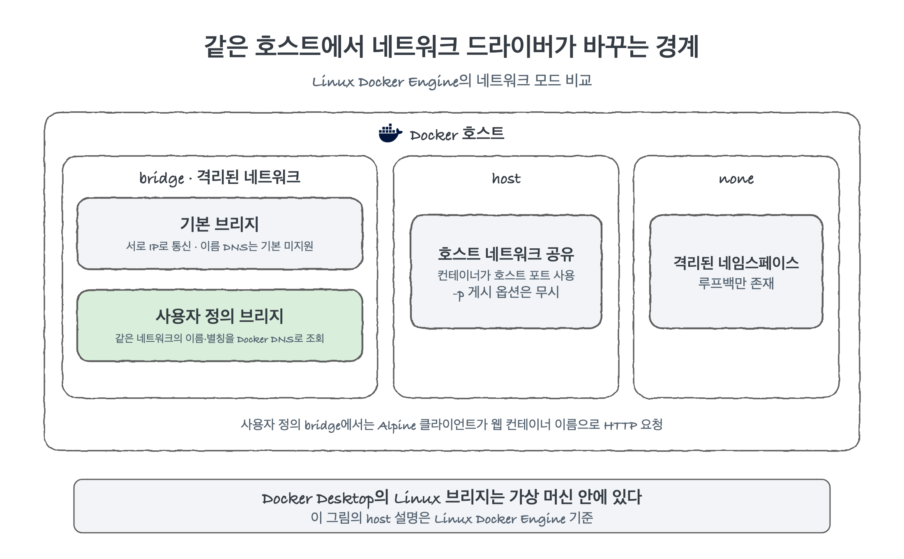
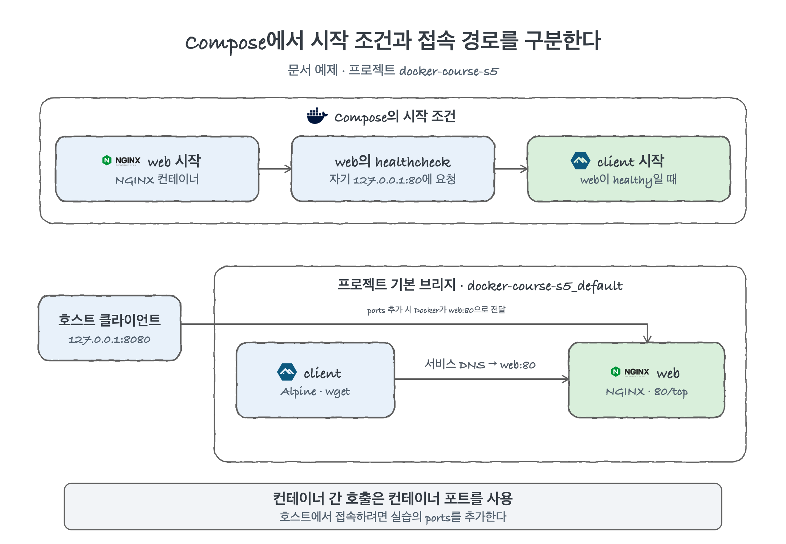

# Connecting Containers with Docker Networks and Compose

하나의 컨테이너가 다른 컨테이너의 HTTP 서버를 호출하려면 두 컨테이너가 통신 가능한 네트워크에 연결되어 있어야 한다. 사용자 정의 브리지를 만들면 컨테이너 이름으로 상대를 찾을 수 있다. Compose에서는 같은 연결을 `compose.yaml`에 선언하고 서비스 이름으로 요청을 보낸다. 이 실습에서는 Linux 컨테이너를 실행하는 Docker와 `docker compose` 명령을 사용한다. [Bridge network driver](https://docs.docker.com/engine/network/drivers/bridge/) · [Networking in Compose](https://docs.docker.com/compose/how-tos/networking/)

## 1. 네트워크 드라이버 선택하기

| 드라이버 | 연결 방식 | 사용 예시 |
| --- | --- | --- |
| `bridge` | 같은 Docker 호스트에서 컨테이너를 가상 브리지에 연결한다. 기본 설정에서는 `docker run`에 네트워크를 지정하지 않으면 `bridge`에 연결된다. | 앱과 데이터베이스가 같은 호스트에서 통신한다. [Bridge network driver](https://docs.docker.com/engine/network/drivers/bridge/) |
| `host` | Linux의 Docker Engine에서 컨테이너가 호스트의 네트워크 네임스페이스를 공유한다. 앱이 열려는 포트가 호스트에서 비어 있어야 하며 `-p`는 무시된다. | 프로세스가 호스트 포트에서 직접 연결을 받아야 할 때 사용한다. [Host network driver](https://docs.docker.com/engine/network/drivers/host/) |
| `none` | 컨테이너에 루프백 인터페이스만 만든다. | 입출력을 파일로 처리하는 작업을 네트워크에서 분리한다. [None network driver](https://docs.docker.com/engine/network/drivers/none/) |

Docker Desktop에서 Linux 컨테이너의 브리지는 가상 머신 안에 있다. 호스트에서 웹 서비스에 접속하는 실습에는 포트 게시를 사용하면 된다. Docker Desktop 4.34 이상에서 `host` 모드를 사용하려면 설정에서 활성화해야 하며, Desktop의 이 기능은 Linux 컨테이너의 TCP·UDP 통신을 지원한다. [Docker Desktop networking how-tos](https://docs.docker.com/desktop/features/networking/networking-how-tos/) · [Host network driver](https://docs.docker.com/engine/network/drivers/host/)

## 2. 브리지에 컨테이너 연결하기

Docker Engine이 기본으로 만드는 `bridge`에는 컨테이너 이름을 서로 조회하는 DNS 기능이 없다. 기본 브리지에 연결된 컨테이너끼리는 IP 주소로 통신할 수 있다. 같은 사용자 정의 브리지에 연결된 컨테이너는 Docker DNS에서 컨테이너 이름이나 네트워크 별칭을 조회할 수 있다. 컨테이너를 교체하면 IP 주소가 달라질 수 있으므로 연결 주소에는 이름을 사용한다. [Bridge network driver](https://docs.docker.com/engine/network/drivers/bridge/)

먼저 Nginx를 기본 `bridge`에서 실행하고, 같은 기본 브리지의 Alpine 컨테이너에서 이름으로 접속한다. 이름 조회가 실패하는 것이 이 단계의 예상 결과다.

```bash
docker run --rm -d --name docker-course-s5-web --network bridge nginx:1.27-alpine
docker run --rm --network bridge alpine:3.20 \
  wget -T 5 -O - http://docker-course-s5-web:80/
```

이어서 사용자 정의 브리지를 만들고 기존 웹 컨테이너를 여기에 연결한 뒤 기본 브리지에서 분리한다. `docker network inspect`에 `docker-course-s5-web`이 표시되고, 새 브리지에서 보낸 요청은 Nginx 기본 페이지의 HTML을 출력한다. 웹 컨테이너를 처음부터 새 브리지에서 실행할 경우 `docker run --network docker-course-s5-lab`으로 바로 연결할 수 있다. [docker network connect](https://docs.docker.com/reference/cli/docker/network/connect/)

```bash
docker network create --driver bridge docker-course-s5-lab
docker network connect docker-course-s5-lab docker-course-s5-web
docker network disconnect bridge docker-course-s5-web
docker network inspect --format '{{range .Containers}}{{println .Name}}{{end}}' docker-course-s5-lab

docker run --rm --network docker-course-s5-lab alpine:3.20 \
  wget -q -T 5 -O - http://docker-course-s5-web:80/
```

웹 컨테이너는 `--rm` 옵션으로 실행했으므로 정지하면 삭제된다. 컨테이너를 정지한 다음 실습 네트워크를 지운다.

```bash
docker stop docker-course-s5-web
docker network rm docker-course-s5-lab
```



그림의 근거 · [브리지의 이름 확인](https://docs.docker.com/engine/network/drivers/bridge/) · [호스트 네트워크](https://docs.docker.com/engine/network/drivers/host/) · [None 드라이버](https://docs.docker.com/engine/network/drivers/none/) · [Docker Desktop 네트워크](https://docs.docker.com/desktop/features/networking/networking-how-tos/)

## 3. Compose에서 서비스와 네트워크 선언하기

빈 실습 디렉터리에 다음 내용을 `compose.yaml`로 저장한다. `services`에 HTTP 서버 `web`과 요청을 한 번 보내는 `client`를 정의한다. 최상위 `networks.default`는 두 서비스가 쓸 프로젝트의 기본 브리지를 선언한다. 이 항목을 생략해도 Compose는 프로젝트 전용 기본 네트워크를 만든다. 예제에서 네트워크 이름은 `docker-course-s5_default`다. [Networking in Compose](https://docs.docker.com/compose/how-tos/networking/) · [Compose networks](https://docs.docker.com/reference/compose-file/networks/)

```yaml
name: docker-course-s5

services:
  web:
    image: nginx:1.27-alpine
    healthcheck:
      test: ["CMD", "wget", "-q", "-T", "2", "-O", "/dev/null", "http://127.0.0.1:80/"]
      interval: 2s
      timeout: 3s
      retries: 10

  client:
    image: alpine:3.20
    depends_on:
      web:
        condition: service_healthy
    command: ["wget", "-q", "-T", "5", "-O", "-", "http://web:80/"]

networks:
  default:
    driver: bridge
```

Compose의 기본 네트워크에는 서비스 이름을 조회할 수 있는 DNS가 있다. `client`는 `web`을 조회한 뒤 웹 컨테이너의 `80`번 포트에 연결한다. 서비스를 여러 네트워크로 나눌 때는 최상위 `networks`에 이름을 선언하고 각 서비스의 `networks`에 참여할 네트워크를 지정한다. 이름을 조회하고 직접 요청을 보낼 두 서비스에는 공통 네트워크가 필요하다. [Networking in Compose](https://docs.docker.com/compose/how-tos/networking/) · [Compose networks](https://docs.docker.com/reference/compose-file/networks/)

### 시작 순서와 요청 준비 상태

`depends_on`의 짧은 문법은 의존 서비스의 시작 순서를 지정한다. `condition: service_healthy`를 쓰면 Compose가 `web`의 `healthcheck` 성공을 기다린 뒤 `client`를 시작한다. `web` 내부의 `127.0.0.1`은 그 웹 컨테이너 자신을 가리킨다. 웹 서비스가 HTTP 요청을 처리할 수 있는지는 상태 검사로 확인하고, 다른 컨테이너에서도 이름을 조회해 요청할 수 있는지는 `client`의 결과로 확인한다. 실행 중에 웹 컨테이너가 교체되어 연결이 끊기면 장시간 동작하는 클라이언트는 서비스 이름을 다시 조회하고 연결을 재시도한다. [Control startup and shutdown order in Compose](https://docs.docker.com/compose/how-tos/startup-order/) · [Networking in Compose](https://docs.docker.com/compose/how-tos/networking/)

## 4. 설정 확인부터 종료까지

`compose.yaml`이 있는 디렉터리에서 아래 명령을 차례로 실행한다. `config`는 기본값과 변수 치환을 반영한 Compose 설정을 출력한다. `up -d`로 프로젝트를 시작한 뒤 `ps -a`에서 `web`의 `healthy`와 `client`의 종료 코드 `0`을 확인한다. `client`는 한 번 요청하고 끝나는 작업이므로 잠깐 실행 중으로 보이면 `ps -a`를 다시 확인한다. `logs client`에는 응답으로 받은 Nginx 기본 페이지가 표시된다. [docker compose config](https://docs.docker.com/reference/cli/docker/compose/config/) · [docker compose up](https://docs.docker.com/reference/cli/docker/compose/up/) · [docker compose logs](https://docs.docker.com/reference/cli/docker/compose/logs/)

```bash
docker compose config
docker compose up -d
docker compose ps -a
docker compose logs client
docker network inspect docker-course-s5_default
```

### 호스트에서 웹 서비스에 접속하기

`client`의 `http://web:80/` 요청은 Compose 네트워크 안에서 서비스 DNS와 컨테이너 포트를 사용한다. 포트 게시는 호스트에서도 접속할 수 있는 경로를 추가한다. 호스트에서 확인하려면 `web` 서비스에 아래 `ports`를 추가하고 `docker compose up -d`를 다시 실행한다. 호스트에서 `http://127.0.0.1:8080/`에 접속하면 Docker가 웹 컨테이너의 `80`번 포트로 요청을 전달한다. `8080`이 이미 사용 중이면 `DOCKER_COURSE_HOST_PORT=18080 docker compose up -d`처럼 비어 있는 포트를 지정하고 해당 포트로 접속한다. [Networking in Compose](https://docs.docker.com/compose/how-tos/networking/) · [Port publishing and mapping](https://docs.docker.com/engine/network/port-publishing/) · [Compose interpolation](https://docs.docker.com/reference/compose-file/interpolation/)

```yaml
    ports:
      - "127.0.0.1:${DOCKER_COURSE_HOST_PORT:-8080}:80"
```

실습이 끝나면 `down`으로 프로젝트의 서비스 컨테이너와 네트워크를 정리한다. 기본 `down`은 볼륨을 보존한다. `-v` 옵션을 추가하면 Compose 파일에 선언한 이름 있는 볼륨과 연결된 익명 볼륨도 삭제 대상이 된다. [docker compose down](https://docs.docker.com/reference/cli/docker/compose/down/)

```bash
docker compose down
```



그림의 근거 · [Compose 시작 조건](https://docs.docker.com/compose/how-tos/startup-order/) · [Compose 서비스 DNS와 포트](https://docs.docker.com/compose/how-tos/networking/) · [포트 게시](https://docs.docker.com/engine/network/port-publishing/)
