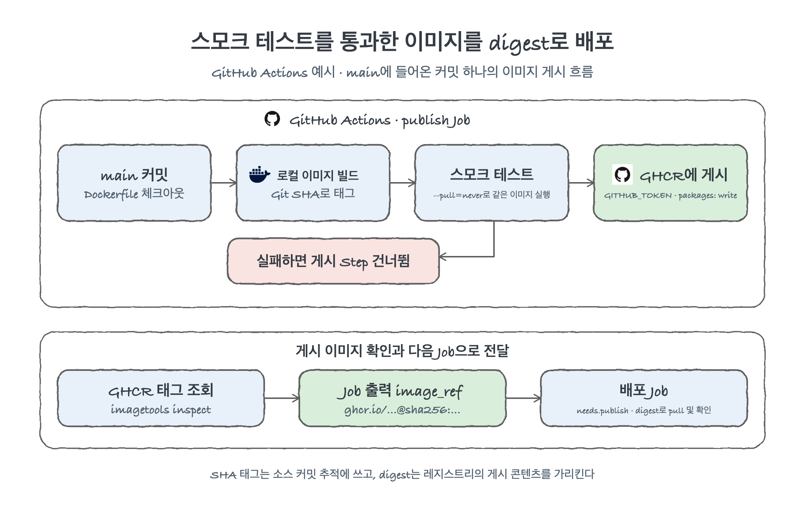

# Publishing Docker Images to Registries with CI/CD

Docker Hub에는 공개 이미지를, GitHub Container Registry(GHCR)에는 접근을 제한한 이미지를 게시할 수 있다. 두 레지스트리에서 모두 이미지에 목적지 이름과 태그를 붙이고, 게시 권한으로 로그인한 뒤 `docker push`를 실행한다. 배포 명세에서 digest를 사용하면 태그가 이동해도 검증한 이미지 내용을 지정할 수 있다. [Docker Hub · Push Images](https://docs.docker.com/docker-hub/repos/manage/hub-images/push/) · [GitHub · Container Registry](https://docs.github.com/en/packages/working-with-a-github-packages-registry/working-with-the-container-registry)

## 1. 빌드할 이미지와 배포 식별자 정하기

아래를 실습용 애플리케이션 디렉터리의 `Dockerfile`로 저장한다. 이 이미지는 컨테이너의 기본 명령으로 한 줄을 출력하고 종료한다. 각 명령은 이 디렉터리에서 실행한다. 이미지의 레이어와 Dockerfile 빌드 과정은 [02번 빌드 문서](02_configuring_container_storage_and_optimizing_docker_builds.md)에서 다룬다.

```dockerfile
FROM alpine:3.23
ENTRYPOINT ["/bin/echo", "docker-release-lab"]
```

```bash
local_image=backend-engineering-handbook-docker-release:local
docker build -t "$local_image" . &&
  output=$(docker run --rm --pull=never "$local_image") &&
  test "$output" = docker-release-lab
```

`docker image tag`는 같은 로컬 이미지에 이름을 하나 더 붙인다. 이름에 레지스트리 호스트를 지정하면 그 호스트로 게시한다. `v1.0.0` 같은 태그는 릴리스를 찾는 데 쓰고, CI에서는 소스 커밋 SHA를 태그로 사용해 빌드의 출처를 찾기 쉽게 한다. 이미지나 멀티플랫폼 인덱스의 digest는 레지스트리에서 조회한다. [Docker · Image Tag](https://docs.docker.com/reference/cli/docker/image/tag/) · [Docker · Imagetools Inspect](https://docs.docker.com/reference/cli/docker/buildx/imagetools/inspect/)

## 2. Docker Hub에 공개 이미지 게시하기

Docker Hub에서 자신의 사용자 또는 조직 네임스페이스에 `docker-release-lab` 저장소를 만들고, 외부에 공개할 이미지라면 가시성을 **Public**으로 선택한다. 아래 `DOCKERHUB_USER`에는 로그인할 Docker ID를, `DOCKERHUB_NAMESPACE`에는 게시할 네임스페이스를, `DOCKERHUB_TOKEN`에는 그 저장소에 쓰기 권한이 있는 토큰을 넣는다. 토큰은 로컬 자격 증명 관리 도구에서 환경 변수로 전달하고, `--password-stdin`으로 로그인에 사용한다. [Docker Hub · Create a Repository](https://docs.docker.com/docker-hub/repos/create/) · [Docker · Personal Access Tokens](https://docs.docker.com/security/access-tokens/personal-access-tokens/) · [Docker · Login](https://docs.docker.com/reference/cli/docker/login/)

```bash
hub_image="docker.io/${DOCKERHUB_NAMESPACE:?}/docker-release-lab:v1.0.0"
printf '%s' "${DOCKERHUB_TOKEN:?}" |
  docker login --username "${DOCKERHUB_USER:?}" --password-stdin
docker image tag "$local_image" "$hub_image"
docker push "$hub_image"
docker buildx imagetools inspect "$hub_image"
```

Docker Hub의 **Tags** 화면에서 `v1.0.0`과 대상 플랫폼이 표시되는지 확인한다. 공개 설정을 검증하려면 Docker Hub에 로그인하지 않은 별도 환경에서 직접 pull한다. 레지스트리에서 출력한 `sha256:…` 값은 `docker.io/<namespace>/docker-release-lab@sha256:…` 형식으로 사용할 수 있다. [Docker Hub · Tags](https://docs.docker.com/docker-hub/repos/manage/hub-images/tags/) · [Docker · Pull by Digest](https://docs.docker.com/reference/cli/docker/image/pull/#pull-an-image-by-digest-immutable-identifier)

## 3. GHCR에 비공개 이미지 게시하기

GHCR의 경로는 `ghcr.io/<owner>/<image>:<tag>`다. 여기서 `GHCR_OWNER`는 소문자로 쓴 사용자 또는 조직 이름이고 `GHCR_USER`는 토큰을 발급한 로그인 계정이다. 로컬에서 게시할 때는 패키지 쓰기 권한이 있는 GitHub PAT(classic)의 `write:packages` 범위를 사용한다. 별도 배포 환경에서 읽기만 한다면 패키지 접근 권한과 `read:packages`만 부여한다. [GitHub · Container Registry Authentication](https://docs.github.com/en/packages/working-with-a-github-packages-registry/working-with-the-container-registry#authenticating-to-the-container-registry)

```bash
ghcr_image="ghcr.io/${GHCR_OWNER:?}/docker-release-lab:v1.0.0"
printf '%s' "${GHCR_WRITE_TOKEN:?}" |
  docker login ghcr.io --username "${GHCR_USER:?}" --password-stdin
docker image tag "$local_image" "$ghcr_image"
docker push "$ghcr_image"
docker buildx imagetools inspect "$ghcr_image"
```

새 패키지의 기본 가시성은 **Private**이다. 게시한 뒤에도 **Package settings**에서 가시성과 이미지를 내려받는 계정이나 팀의 읽기 권한을 확인한다. 이미 만든 패키지에 다른 저장소의 Workflow가 접근해야 한다면 **Manage Actions access**에서 그 저장소에 필요한 권한을 준다. 이미지에 `org.opencontainers.image.source` 라벨로 소스 저장소를 연결할 수도 있다. [GitHub · Publishing Container Images](https://docs.github.com/en/packages/working-with-a-github-packages-registry/working-with-the-container-registry#pushing-container-images) · [GitHub · Package Access Control](https://docs.github.com/en/packages/learn-github-packages/configuring-a-packages-access-control-and-visibility)

## 4. GitHub Actions에서 검증한 이미지를 게시하기

아래는 Dockerfile이 있는 애플리케이션 저장소의 `.github/workflows/publish-image.yml` 예제다. `main`에 변경이 들어오면 SHA 태그로 이미지를 빌드하고, 그 로컬 이미지의 종료 코드와 출력을 확인한 뒤 같은 이미지를 GHCR에 올린다. 레지스트리 인증에는 Workflow의 `GITHUB_TOKEN`을 사용하며, 게시 Job에 `packages: write`를 부여한다. [GitHub · Publish Docker Images](https://docs.github.com/en/actions/tutorials/publish-packages/publish-docker-images) · [actions/checkout v7.0.1](https://github.com/actions/checkout/releases/tag/v7.0.1)

```yaml
name: Publish container image

on:
  push:
    branches: [main]

jobs:
  publish:
    runs-on: ubuntu-24.04
    permissions:
      contents: read
      packages: write
    outputs:
      image_ref: ${{ steps.push.outputs.image_ref }}
    steps:
      - uses: actions/checkout@3d3c42e5aac5ba805825da76410c181273ba90b1 # v7.0.1
        with:
          persist-credentials: false

      - name: Build and smoke test
        shell: bash
        run: |
          image="ghcr.io/${GITHUB_REPOSITORY,,}"
          tag="$image:$GITHUB_SHA"
          docker build --pull \
            --label "org.opencontainers.image.source=${GITHUB_SERVER_URL}/${GITHUB_REPOSITORY}" \
            --tag "$tag" .
          output=$(docker run --rm --pull=never "$tag")
          test "$output" = docker-release-lab

      - name: Push and record digest
        id: push
        shell: bash
        env:
          GHCR_TOKEN: ${{ secrets.GITHUB_TOKEN }}
        run: |
          image="ghcr.io/${GITHUB_REPOSITORY,,}"
          tag="$image:$GITHUB_SHA"
          printf '%s' "$GHCR_TOKEN" |
            docker login ghcr.io --username "$GITHUB_ACTOR" --password-stdin
          docker push "$tag"
          digest=$(docker buildx imagetools inspect "$tag" --format '{{json .Manifest}}' |
            jq -er '.digest | select(test("^sha256:[0-9a-f]{64}$"))')
          printf 'image_ref=%s@%s\n' "$image" "$digest" >> "$GITHUB_OUTPUT"
```

스모크 테스트가 실패하면 일반적인 Step 실행 조건에 따라 게시 Step이 건너뛰어진다. 이미지를 배포하는 다음 Job에서 `needs: publish`를 지정하면 `${{ needs.publish.outputs.image_ref }}`로 게시된 digest 참조를 읽을 수 있다. 배포 대상에서 같은 참조로 이미지를 내려받아 재검증한다. 여러 CPU 아키텍처가 필요하면 Buildx 멀티플랫폼 빌드에서 각각의 실행 조건을 검증하고, 게시된 이미지 인덱스의 digest를 사용한다. [GitHub · Passing Job Outputs](https://docs.github.com/en/actions/how-tos/write-workflows/choose-what-workflows-do/pass-job-outputs) · [Docker · Multi-platform Builds](https://docs.docker.com/build/building/multi-platform/) · [GitOps로 이어지는 컨테이너 CI 예제](../observability/03_building_container_ci_with_github_actions.md)



그림의 근거 · [GHCR 게시 권한](https://docs.github.com/en/actions/tutorials/publish-packages/publish-docker-images) · [Step 상태 조건](https://docs.github.com/en/actions/reference/workflows-and-actions/expressions#status-check-functions) · [게시 이미지 조회](https://docs.docker.com/reference/cli/docker/buildx/imagetools/inspect/) · [Job 출력 전달](https://docs.github.com/en/actions/how-tos/write-workflows/choose-what-workflows-do/pass-job-outputs) · [이미지 digest로 pull](https://docs.docker.com/reference/cli/docker/image/pull/#pull-an-image-by-digest-immutable-identifier)
