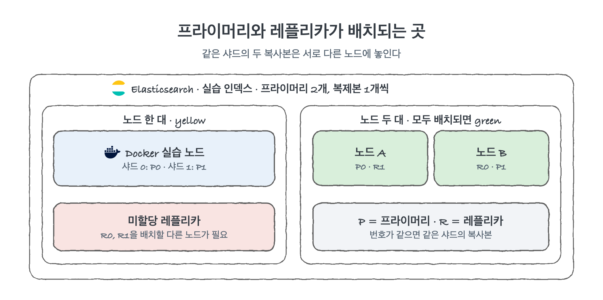

# Elasticsearch Fundamentals and Cluster Architecture

Elasticsearch는 JSON 문서를 색인해 전문 검색과 집계를 처리한다. Elastic Stack에서 Elasticsearch는 저장·검색을, Kibana는 탐색과 시각화를 맡는다. Elastic Agent나 Beats로 데이터를 수집하고, 변환이 필요한 파이프라인에는 Logstash를 사용할 수 있다. [Elastic Stack](https://www.elastic.co/elastic-stack/)

## 1. Docker로 단일 노드 실행

Docker를 설치한 뒤 아래 명령을 실행한다. 예제는 Elasticsearch 9.4.2 기준이며, 호스트의 `127.0.0.1:19200`에 연결한다. 보안 기능을 끈 이 설정은 루프백에서만 쓰는 로컬 실습용이다. Elasticsearch의 보안 자동 설정과 Kibana 연결 방법은 공식 설치 문서를 참고한다. [Docker 설치](https://docs.docker.com/get-docker/) · [Elastic Docker 설치](https://www.elastic.co/docs/deploy-manage/deploy/self-managed/install-elasticsearch-docker-basic)

```bash
docker run --rm -d --name es-search-lab \
  -p 127.0.0.1:19200:9200 -m 2g \
  -e discovery.type=single-node \
  -e xpack.security.enabled=false \
  docker.elastic.co/elasticsearch/elasticsearch:9.4.2

export ES_URL=http://127.0.0.1:19200
curl -fsS "$ES_URL/"
curl -fsS "$ES_URL/_cluster/health?pretty"
```

준비가 끝나기 전 연결에 실패하면 잠시 기다린 뒤 다시 요청하거나 `docker logs es-search-lab`으로 기동 상태를 확인한다. 문서의 `METHOD /path` 예제는 Kibana Dev Tools의 Console 문법이다. 터미널에서는 다음처럼 URL과 본문을 넘긴다.

```bash
curl -fsS -X PUT "$ES_URL/es-shard-lab" \
  -H 'Content-Type: application/json' \
  --data '{"settings":{"number_of_shards":2,"number_of_replicas":1}}'
curl -fsS "$ES_URL/_cat/shards/es-shard-lab?v"
curl -fsS "$ES_URL/_cluster/health/es-shard-lab?pretty"
```

실습 인덱스를 보존하려면 이름 있는 데이터 볼륨을 연결한다. 위 명령의 `--rm` 설정에서는 컨테이너가 종료될 때 실습 데이터도 사라진다.

## 2. 클러스터, 샤드, 복제

| 구성 | 역할 |
| --- | --- |
| 클러스터 | 노드들이 인덱스와 샤드 상태를 공유한다. 선출된 마스터가 클러스터 상태 변경을 조정한다. |
| 인덱스 | 매핑과 설정을 공유하는 문서 집합이다. |
| 프라이머리 샤드 | 인덱스 문서를 나눠 관리하는 Lucene 인덱스다. 자기 복제 그룹의 쓰기를 처리한다. |
| 레플리카 샤드 | 다른 노드에 배치되는 샤드 사본이다. 검색·읽기를 처리할 수 있고, 프라이머리에 장애가 나면 적격 사본이 승격될 수 있다. |

예제는 프라이머리 2개와 각 프라이머리의 레플리카 1개를 요청한다. 단일 노드에서는 같은 샤드의 프라이머리와 레플리카를 함께 배치할 수 없어서, 두 프라이머리가 준비돼도 레플리카는 `UNASSIGNED`이고 상태는 `yellow`다. `green`은 모든 프라이머리와 레플리카가 할당된 상태다. 할당되지 않은 프라이머리가 있으면 `red`다. 실습 예제의 나머지 인덱스는 `number_of_replicas: 0`을 사용한다. 복제는 노드 장애에 대응하며, 오삭제나 전체 클러스터 손실에 대응하려면 별도 스냅샷이 필요하다. [Elastic 샤드와 레플리카](https://www.elastic.co/docs/deploy-manage/distributed-architecture/clusters-nodes-shards) · [클러스터 상태 진단](https://www.elastic.co/docs/troubleshoot/elasticsearch/red-yellow-cluster-status)



그림의 근거 · [샤드와 레플리카](https://www.elastic.co/docs/deploy-manage/distributed-architecture/clusters-nodes-shards) · [미할당과 상태 색상](https://www.elastic.co/docs/troubleshoot/elasticsearch/red-yellow-cluster-status)
