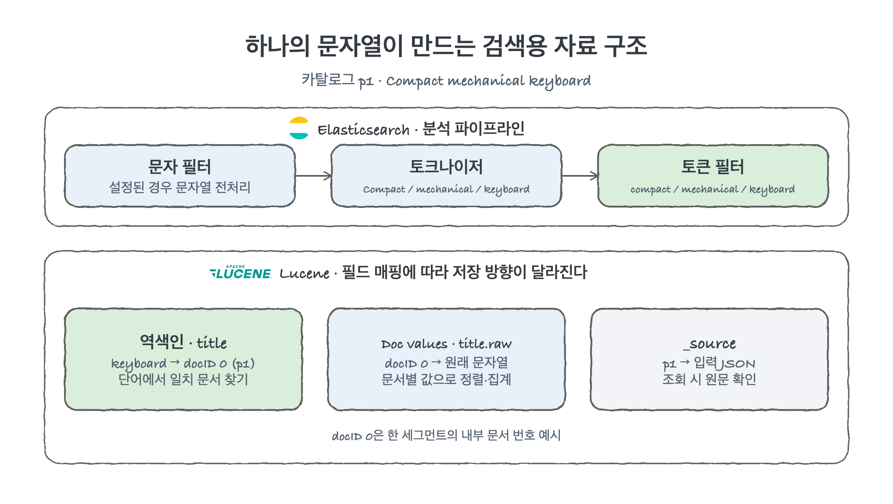
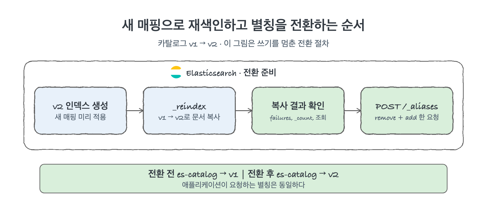

# Elasticsearch Text Analysis and Field Mapping

텍스트 분석기는 문자 필터, 토크나이저 한 개, 토큰 필터 순서로 텍스트를 처리한다. 역색인은 분석 후 각 용어가 포함된 문서를 찾을 수 있게 한다. 쿼리 분석기가 검색어를 만드는 방식과 인덱스에 저장된 용어를 함께 확인해야 한다. [텍스트 분석](https://www.elastic.co/docs/manage-data/data-store/text-analysis)

## 1. 분석기와 역색인

`standard` 분석기는 일반 텍스트를 토큰으로 나누고 소문자로 정규화한다. `english`는 영어 불용어 제거와 어간 추출을 적용한다. 어간 추출은 관련 활용형을 함께 찾는 데 도움이 되며, 정확한 문구·식별자 검색에서는 원래 값을 그대로 색인하는 편이 맞을 수 있다.

```http
POST /_analyze
{"analyzer":"standard","text":"The runners are running"}

POST /_analyze
{"analyzer":"english","text":"The runners are running"}

POST /_analyze
{
  "char_filter":["html_strip"],
  "tokenizer":"standard",
  "filter":["lowercase"],
  "text":"<b>Mechanical Keyboard</b>"
}
```

역색인에서 `keyboard`는 이 용어가 들어간 문서 목록으로 연결된다. 전문 검색은 이 목록을 이용한다. 원본 JSON은 `_source`에서 조회하고, 정렬·집계에는 보통 `keyword`나 숫자·날짜의 doc values를 사용한다. [Analyze API](https://www.elastic.co/docs/api/doc/elasticsearch/operation/operation-indices-analyze) · [언어별 분석기](https://www.elastic.co/docs/reference/text-analysis/analysis-lang-analyzer)

## 2. 매핑, 필드 타입, 템플릿

아래 템플릿과 상품 데이터를 만들면 이후 검색·페이지네이션·집계 예제에서 `es-catalog` 별칭으로 사용할 수 있다.

```http
PUT /_index_template/es-catalog-lab
{
  "index_patterns":["es-catalog-v*"],
  "template":{
    "settings":{"number_of_shards":1,"number_of_replicas":0},
    "mappings":{
      "dynamic":"strict",
      "properties":{
        "productId":{"type":"keyword"},
        "title":{"type":"text","fields":{"raw":{"type":"keyword","ignore_above":256}}},
        "description":{"type":"text"},
        "category":{"type":"keyword"},
        "price":{"type":"integer"},
        "stock":{"type":"long"},
        "releasedAt":{"type":"date","format":"strict_date_optional_time||epoch_millis"},
        "sku":{"type":"keyword"},
        "offers":{
          "type":"nested",
          "properties":{"seller":{"type":"keyword"},"price":{"type":"integer"}}
        }
      }
    }
  }
}

PUT /es-catalog-v1
{"aliases":{"es-catalog":{"is_write_index":true}}}

POST /es-catalog/_bulk?refresh=wait_for
{"index":{"_id":"p1"}}
{"productId":"p1","title":"Compact mechanical keyboard","description":"Quiet keys and wired connectivity","category":"accessories","price":80,"stock":12,"releasedAt":"2026-01-03T09:00:00Z","sku":"key-100","offers":[{"seller":"store-a","price":80},{"seller":"store-b","price":70}]}
{"index":{"_id":"p2"}}
{"productId":"p2","title":"Wireless mouse","description":"Compact mouse with silent switches","category":"accessories","price":35,"stock":18,"releasedAt":"2026-02-10","sku":"mouse-200","offers":[{"seller":"store-a","price":35}]}
{"index":{"_id":"p3"}}
{"productId":"p3","title":"Monitor stand","description":"Aluminum stand for compact desks","category":"furniture","price":35,"stock":4,"releasedAt":"2026-03-05"}

GET /es-catalog/_mapping

GET /es-catalog/_search
{"query":{"range":{"releasedAt":{"gte":"2026-02-01","lt":"2026-03-01"}}}}
```

`title`은 전문 검색을, `title.raw`는 같은 값을 변환하지 않고 정렬·집계하는 멀티 필드다. `ignore_above`를 초과한 값은 `_source`에 있어도 해당 `keyword` 필드에 색인되지 않는다. `index:false`는 역색인을 비활성화한다. 필드 타입이 doc values를 지원하고 활성화한 경우 검색 가능 여부와 비용은 타입에 따라 달라진다. 날짜는 지정한 형식으로 파싱해 UTC 기준 타임스탬프로 검색·정렬한다. 인덱스 템플릿은 앞으로 생성하는 인덱스에 적용된다. [매핑](https://www.elastic.co/docs/manage-data/data-store/mapping) · [Multi-fields](https://www.elastic.co/docs/reference/elasticsearch/mapping-reference/multi-fields) · [인덱스 템플릿](https://www.elastic.co/docs/manage-data/data-store/templates)



그림의 근거 · [텍스트 분석](https://www.elastic.co/docs/manage-data/data-store/text-analysis) · [Doc values](https://www.elastic.co/docs/reference/elasticsearch/mapping-reference/doc-values) · [멀티 필드](https://www.elastic.co/docs/reference/elasticsearch/mapping-reference/multi-fields) · [_source 필드](https://www.elastic.co/docs/reference/elasticsearch/mapping-reference/mapping-source-field)

## 3. 동적 매핑과 매핑 변경

`dynamic:true`는 새 필드의 타입을 추론한다. `false`는 새 필드를 매핑에 추가하지 않고 원본에 유지하며, `strict`는 미등록 필드를 포함한 문서를 거절한다. `runtime`은 지원되는 새 필드를 런타임 필드로 추가할 수 있다. 아래 동적 템플릿은 `labels` 아래 JSON 문자열을 `keyword`로 만든다. 일치하는 여러 규칙이 있으면 배열에서 먼저 나온 규칙이 적용된다.

```http
PUT /es-dynamic-lab
{
  "settings":{"number_of_replicas":0},
  "mappings":{
    "dynamic":"strict",
    "dynamic_templates":[
      {"label_strings":{"path_match":"labels.*","match_mapping_type":"string","mapping":{"type":"keyword"}}}
    ],
    "properties":{"labels":{"type":"object","dynamic":true}}
  }
}

PUT /es-dynamic-lab/_doc/1
{"labels":{"region":"ap-northeast","tier":"standard"}}

GET /es-dynamic-lab/_mapping
```

기존 매핑에 새 필드를 추가하거나 일부 매핑 매개변수를 수정할 수 있다. 필드 타입 자체를 바꿀 때는 새 인덱스에 매핑을 먼저 선언하고 재색인한다. 이미 들어온 문서에 새 멀티 필드가 필요하면 기존 문서도 다시 색인해야 한다. 이 실습에서는 쓰기가 없는 동안 복사하고, `failures`가 비어 있고 두 인덱스 문서 수가 같은지 확인한 다음 별칭을 전환한다.

```http
PUT /es-catalog-v2
{"mappings":{"properties":{"stock":{"type":"integer"}}}}

POST /_reindex?refresh=true
{"source":{"index":"es-catalog-v1"},"dest":{"index":"es-catalog-v2"}}

GET /es-catalog-v1/_count

GET /es-catalog-v2/_count

POST /_aliases
{
  "actions":[
    {"remove":{"index":"es-catalog-v1","alias":"es-catalog"}},
    {"add":{"index":"es-catalog-v2","alias":"es-catalog","is_write_index":true}}
  ]
}
```

운영 중 전환할 때는 재색인 시작 이후 들어온 변경도 새 인덱스에 반영할 방법을 마련한다. 별칭 전환은 하나의 요청으로 적용한다. [Dynamic mapping](https://www.elastic.co/docs/manage-data/data-store/mapping/dynamic-mapping) · [Reindex API](https://www.elastic.co/docs/api/doc/elasticsearch/operation/operation-reindex) · [Aliases](https://www.elastic.co/docs/manage-data/data-store/aliases)



그림의 근거 · [Reindex API](https://www.elastic.co/docs/api/doc/elasticsearch/operation/operation-reindex) · [별칭 갱신](https://www.elastic.co/docs/manage-data/data-store/aliases)
