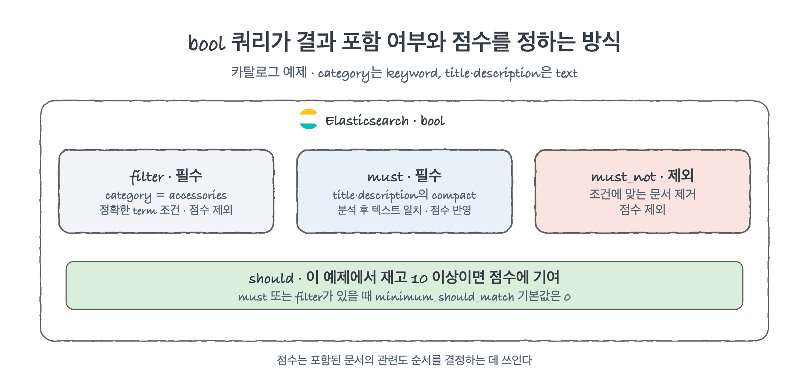
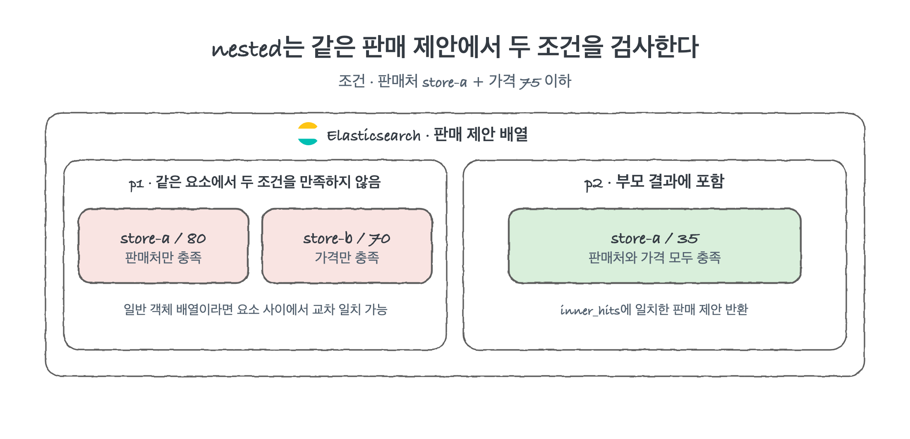

# Elasticsearch Query DSL and Relevance

검색 응답의 `hits.hits`에는 일치한 문서가 들어간다. 점수순 검색의 `_score`는 해당 쿼리에 대한 상대적인 관련도다. 아래 예제는 [카탈로그 매핑과 샘플 데이터](03_elasticsearch_text_analysis_and_field_mapping.md)를 사용한다. [Query DSL](https://www.elastic.co/docs/reference/query-languages/query-dsl)

## 1. 정확한 조건과 전문 검색

`term`은 색인된 용어에 직접 비교하고, `match`는 입력을 분석한 후 검색한다. 범주나 SKU에는 `keyword` 필드와 `term`을, 분석된 상품명에는 `text` 필드와 `match`를 사용한다. `ids`는 검색 쿼리 안에서 한 개 이상의 `_id`를 찾으며, 한 문서를 ID로 읽을 때는 `GET /es-catalog/_doc/p1`을 쓸 수 있다.

```http
GET /es-catalog/_search
{"query":{"term":{"category":"accessories"}}}

GET /es-catalog/_search
{"query":{"ids":{"values":["p1","p3"]}}}

GET /es-catalog/_search
{"query":{"exists":{"field":"sku"}}}

GET /es-catalog/_search
{"query":{"match":{"title":{"query":"mechanical keyboard","operator":"and"}}}}
```

`exists`는 색인된 값이 있는지 검사한다. 값이 `null`이거나 빈 배열이면 일반적으로 일치하지 않는다. 매핑의 `null_value`나 색인 조건에 따라 결과가 달라질 수 있다. [Term-level queries](https://www.elastic.co/docs/reference/query-languages/query-dsl/term-level-queries) · [Full-text queries](https://www.elastic.co/docs/reference/query-languages/query-dsl/full-text-queries)

## 2. 접두어, 와일드카드, 정규식

`prefix`는 시작 부분이 같은 용어를 찾는다. `wildcard`는 `*`나 `?`를, `regexp`는 Lucene 정규식 문법을 사용한다. 예제는 입력이 분석되지 않는 SKU 필드에서 실행한다.

```http
GET /es-catalog/_search
{"query":{"prefix":{"sku":"key-"}}}

GET /es-catalog/_search
{"query":{"wildcard":{"sku":{"value":"mouse-*"}}}}

GET /es-catalog/_search
{"query":{"regexp":{"sku":{"value":"key-[0-9]+"}}}}
```

앞쪽 와일드카드와 넓은 정규식은 탐색 범위를 크게 늘릴 수 있다. 자주 실행하는 접두어 검색은 매핑과 입력 제약을 함께 검토한다. [Wildcard query](https://www.elastic.co/docs/reference/query-languages/query-dsl/query-dsl-wildcard-query) · [Regexp query](https://www.elastic.co/docs/reference/query-languages/query-dsl/query-dsl-regexp-query)

## 3. 여러 필드와 관련도 조정

`term`과 `match` 같은 리프 쿼리는 개별 조건을 검사한다. `bool` 같은 복합 쿼리는 조건을 조합한다. `must`는 필수 일치 조건이고, `filter`는 점수를 매기지 않는 필수 조건이다. `should`는 점수를 더하거나 `minimum_should_match`에 따라 필수 일치 조건이 된다. `must_not`은 제외 조건이다.

```http
GET /es-catalog/_search
{
  "query":{
    "bool":{
      "must":[{"multi_match":{"query":"compact","fields":["title^3","description"]}}],
      "filter":[{"term":{"category":"accessories"}}],
      "should":[{"range":{"stock":{"gte":10}}}]
    }
  }
}

GET /es-catalog/_search
{
  "query":{
    "boosting":{
      "positive":{"match":{"description":"compact"}},
      "negative":{"term":{"category":"furniture"}},
      "negative_boost":0.4
    }
  }
}

GET /es-catalog/_search
{
  "query":{
    "dis_max":{
      "queries":[{"match":{"title":"compact"}},{"match":{"description":"compact"}}],
      "tie_breaker":0.1
    }
  }
}
```

`title^3`는 제목 일치의 기여도를 높인다. `boosting`의 `negative` 조건은 일치한 문서를 빼는 대신 점수에 `negative_boost`를 곱한다. `dis_max`는 점수가 가장 높은 하위 쿼리를 중심으로 점수를 계산하고, 추가로 일치한 점수에는 `tie_breaker`를 적용한다. [Compound queries](https://www.elastic.co/docs/reference/query-languages/query-dsl/compound-queries) · [Multi-match query](https://www.elastic.co/docs/reference/query-languages/query-dsl/query-dsl-multi-match-query)



그림의 근거 · [Boolean query](https://www.elastic.co/docs/reference/query-languages/query-dsl/query-dsl-bool-query) · [Term query](https://www.elastic.co/docs/reference/query-languages/query-dsl/query-dsl-term-query) · [Multi-match query](https://www.elastic.co/docs/reference/query-languages/query-dsl/query-dsl-multi-match-query)

## 4. Nested query와 inner hits

상품별 판매처 배열에서 같은 판매 제안이 `store-a`이면서 가격이 75 이하인 항목을 찾는다. 일반 객체 배열은 내부 필드의 값이 서로 다른 배열 요소에서 충족될 수 있다. `nested`는 각 요소를 독립적으로 검사하며, `inner_hits`에서 일치한 판매 제안을 확인할 수 있다. 결과는 마우스 `p2`다. 키보드 `p1`의 70은 `store-b`의 가격이다.

```http
GET /es-catalog/_search
{
  "query":{
    "nested":{
      "path":"offers",
      "query":{
        "bool":{
          "filter":[
            {"term":{"offers.seller":"store-a"}},
            {"range":{"offers.price":{"lte":75}}}
          ]
        }
      },
      "inner_hits":{"size":2}
    }
  }
}
```

[중첩 쿼리](https://www.elastic.co/docs/reference/query-languages/query-dsl/query-dsl-nested-query) · [Inner hits](https://www.elastic.co/docs/reference/elasticsearch/rest-apis/retrieve-inner-hits)



그림의 근거 · [Nested query](https://www.elastic.co/docs/reference/query-languages/query-dsl/query-dsl-nested-query) · [Inner hits](https://www.elastic.co/docs/reference/elasticsearch/rest-apis/retrieve-inner-hits)
