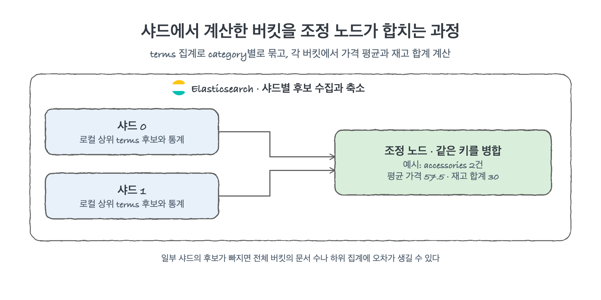

# Elasticsearch Metric and Bucket Aggregations

메트릭 집계는 문서의 값에서 평균, 합계, 최댓값 같은 수치를 만든다. 버킷 집계는 문서를 범주나 구간으로 묶는다. 버킷마다 메트릭을 계산하면 분류별 통계를 만들 수 있다. [Aggregations](https://www.elastic.co/docs/explore-analyze/query-filter/aggregations)

## 1. 숫자 통계

[카탈로그 데이터](03_elasticsearch_text_analysis_and_field_mapping.md)의 액세서리만 골라 통계를 계산한다. `size:0`은 검색 히트를 반환하지 않도록 지정한다. 액세서리 상품 두 개의 평균 가격은 `57.5`이고 재고 합계는 `30`이다.

```http
GET /es-catalog/_search
{
  "size":0,
  "query":{"term":{"category":"accessories"}},
  "aggs":{
    "average_price":{"avg":{"field":"price"}},
    "total_stock":{"sum":{"field":"stock"}},
    "price_stats":{"stats":{"field":"price"}}
  }
}
```

결과는 `aggregations.average_price.value` 등 집계 이름 아래에 들어간다. `stats`는 개수, 최솟값, 최댓값, 평균, 합계를 함께 반환한다. 값이 없는 문서는 기본적으로 해당 필드 집계에 기여하지 않는다. [Metric aggregations](https://www.elastic.co/docs/reference/aggregations/metrics)

## 2. 범주별 버킷과 하위 집계

`terms`로 상품 분류별 버킷을 만들고 각 버킷 안의 평균 가격을 구한다. 함께 요청하는 `date_histogram`은 상품 출시일을 달력 기준 월로 묶는다.

```http
GET /es-catalog/_search
{
  "size":0,
  "aggs":{
    "by_category":{
      "terms":{"field":"category","size":10},
      "aggs":{"average_price":{"avg":{"field":"price"}}}
    },
    "releases_by_month":{
      "date_histogram":{"field":"releasedAt","calendar_interval":"month","min_doc_count":1}
    }
  }
}
```

`buckets`의 `key`에는 범주 또는 기간, `doc_count`에는 문서 수가 들어간다. 여러 샤드에서 `terms`를 실행하면 샤드별 상위 후보만 모으기 때문에 일부 문서 수에 오차가 생길 수 있다. `doc_count_error_upper_bound`와 `sum_other_doc_count`를 확인한다. 모든 고유한 버킷을 순회하려면 `composite`의 `after_key`를 사용한다. [Terms aggregation](https://www.elastic.co/docs/reference/aggregations/search-aggregations-bucket-terms-aggregation) · [Date histogram aggregation](https://www.elastic.co/docs/reference/aggregations/search-aggregations-bucket-datehistogram-aggregation) · [Composite aggregation](https://www.elastic.co/docs/reference/aggregations/search-aggregations-bucket-composite-aggregation)



그림의 근거 · [Terms aggregation](https://www.elastic.co/docs/reference/aggregations/search-aggregations-bucket-terms-aggregation) · [메트릭 집계](https://www.elastic.co/docs/reference/aggregations/metrics)
