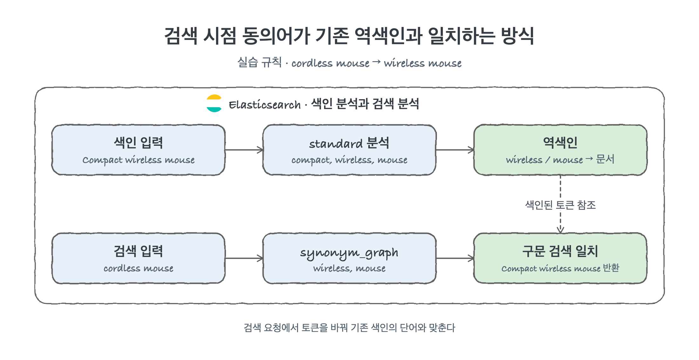

# Improving Elasticsearch Search Relevance

구문 검색은 단어 사이의 거리를, 퍼지 검색은 편집 거리를, 동의어는 표현의 차이를 처리한다. 하이라이트는 히트에서 일치한 구절을 표시하는 기능이다.

## 1. 근접 검색과 오타 허용

[카탈로그](03_elasticsearch_text_analysis_and_field_mapping.md)의 상품명이 `Compact mechanical keyboard`일 때 `compact keyboard`는 기본 구문 검색으로 일치하지 않는다. `slop:1`은 두 검색어 사이에 토큰 하나가 있는 경우를 허용한다. `keybord`처럼 글자가 하나 빠진 입력은 `match`의 `fuzziness`로 허용할 수 있다.

```http
GET /es-catalog/_search
{"query":{"match_phrase":{"title":{"query":"compact keyboard","slop":1}}}}

GET /es-catalog/_search
{"query":{"match":{"title":{"query":"keybord","fuzziness":"AUTO","prefix_length":2}}}}
```

위 요청은 둘 다 `p1`에 일치한다. 퍼지 검색은 가까운 색인 용어를 찾아준다. 교정된 문자열을 별도 제안으로 반환하려면 suggester를 검토한다. 짧은 키워드에 오타를 넓게 허용하면 관련 없는 결과가 늘 수 있다. [Match phrase query](https://www.elastic.co/docs/reference/query-languages/query-dsl/query-dsl-match-query-phrase) · [Match query](https://www.elastic.co/docs/reference/query-languages/query-dsl/query-dsl-match-query)

## 2. 검색 시점 동의어

`synonym_graph`는 여러 단어로 된 동의어를 쿼리 분석 단계에서 처리한다. 아래 매핑은 원문을 `standard`로 색인하고, 검색 시 `cordless mouse`를 `wireless mouse`로 바꾼다. 단방향 규칙이다.

```http
PUT /es-synonym-lab
{
  "settings":{
    "number_of_replicas":0,
    "analysis":{
      "filter":{
        "product_synonyms":{
          "type":"synonym_graph",
          "synonyms":["cordless mouse => wireless mouse"]
        }
      },
      "analyzer":{
        "product_search":{
          "tokenizer":"standard",
          "filter":["lowercase","product_synonyms"]
        }
      }
    }
  },
  "mappings":{
    "properties":{
      "title":{"type":"text","analyzer":"standard","search_analyzer":"product_search"}
    }
  }
}

PUT /es-synonym-lab/_doc/mouse-1?refresh=wait_for
{"title":"Compact wireless mouse"}

POST /es-synonym-lab/_analyze
{"analyzer":"product_search","text":"Cordless Mouse"}

GET /es-synonym-lab/_search
{"query":{"match_phrase":{"title":"cordless mouse"}}}
```

`_analyze`에서 `wireless`와 `mouse` 토큰을 확인할 수 있다. 운영에서 동의어를 관리할 때는 동의어 세트를 먼저 생성한 뒤 검색 분석기에서 참조하고, 변경 전후에 검색 결과를 비교한다. [Synonym graph token filter](https://www.elastic.co/docs/reference/text-analysis/analysis-synonym-graph-tokenfilter) · [동의어 검색](https://www.elastic.co/docs/solutions/search/full-text/search-with-synonyms)



그림의 근거 · [Synonym graph token filter](https://www.elastic.co/docs/reference/text-analysis/analysis-synonym-graph-tokenfilter) · [검색 시점 동의어](https://www.elastic.co/docs/solutions/search/full-text/search-with-synonyms)

## 3. 결과 하이라이트

하이라이트는 문서의 `highlight`에 반환된다. 예제의 `encoder:html`은 원문의 특수 문자를 HTML 엔티티로 변환하고 설정한 강조 태그를 적용한다.

```http
GET /es-catalog/_search
{
  "query":{"match":{"title":"keyboard"}},
  "highlight":{
    "encoder":"html",
    "pre_tags":["<mark>"],
    "post_tags":["</mark>"],
    "fields":{"title":{"number_of_fragments":0}}
  }
}
```

`highlight.title`에서 `Compact mechanical <mark>keyboard</mark>`를 확인한다. 하이라이트는 표시용이며, 검색 결과의 관련도와 정렬 규칙은 쿼리에서 정한다. [Highlighting](https://www.elastic.co/docs/reference/elasticsearch/rest-apis/highlighting)
