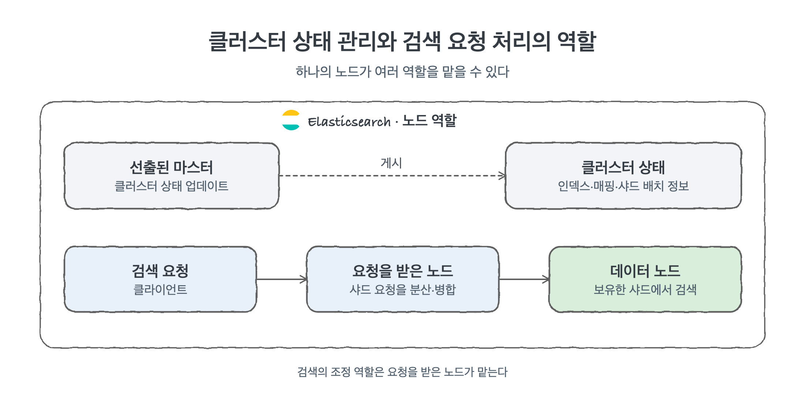

# Elasticsearch Cluster Topology and Index Design

[클러스터와 복제 실습](01_elasticsearch_fundamentals_and_cluster_architecture.md)을 바탕으로 노드 역할을 확인하고, 인덱스 경계·샤드 수·필드 매핑을 정할 때 어떤 질문을 해야 하는지 살펴본다. 실습은 기존 Elasticsearch 9.4.2 Docker 노드를 사용한다.

## 1. 노드 역할과 요청 조정

| 역할 | 담당하는 작업 |
| --- | --- |
| 마스터 적격 노드 | 선거에 참여한다. 선출된 마스터는 인덱스 생성, 매핑 변경과 샤드 할당 등 클러스터 상태를 관리한다. |
| 데이터 노드 | 샤드를 저장하고 샤드 수준의 색인·검색·집계를 실행한다. |
| 인제스트 노드 | 인제스트 파이프라인의 프로세서로 문서를 색인 전에 변환한다. |
| 요청을 받은 노드 | 요청을 적절한 샤드로 보내고 결과를 모은다. 모든 노드가 이 조정 역할을 할 수 있다. |

단일 노드에서는 한 노드가 여러 역할을 맡는다. `_nodes`의 역할 목록과 `_cat/master`에서 현재 선출된 마스터를 비교한다. [Node roles](https://www.elastic.co/docs/deploy-manage/distributed-architecture/clusters-nodes-shards/node-roles) · [Node information API](https://www.elastic.co/docs/api/doc/elasticsearch/operation/operation-nodes-info)

```http
GET /_nodes?filter_path=nodes.*.name,nodes.*.roles

GET /_cat/master?v=true&h=id,node

GET /_cat/shards/es-shard-lab?v=true&h=index,shard,prirep,state,node
```



그림의 근거 · [노드 역할](https://www.elastic.co/docs/deploy-manage/distributed-architecture/clusters-nodes-shards/node-roles) · [분산 읽기 경로](https://www.elastic.co/docs/deploy-manage/distributed-architecture/reading-and-writing-documents)

## 2. 인덱스 경계와 샤드 수

인덱스는 매핑과 수명 주기를 함께 관리할 문서를 묶는 단위다. 샤드는 그 인덱스의 데이터를 나누는 Lucene 인덱스다. 검색할 인덱스와 샤드가 많아지면 조정 노드가 더 많은 응답을 모아야 한다. 샤드가 커지면 장애 후 사본을 옮기거나 복구하는 시간이 늘 수 있다. 실제 문서 크기·검색 패턴·목표 복구 시간을 기준으로 샤드 수를 정한다.

일반 인덱스의 프라이머리 샤드 수는 생성 시 정하고, 이후 바꿔야 하면 새 인덱스로 재색인하거나 요건이 맞을 때 `split` 또는 `shrink`를 사용한다. 레플리카 수는 설정으로 조정할 수 있다. 사본을 분산할 데이터 노드가 충분한지도 함께 확인한다. [샤드 크기와 개수](https://www.elastic.co/docs/deploy-manage/production-guidance/optimize-performance/size-shards) · [인덱스 설정](https://www.elastic.co/docs/reference/elasticsearch/index-settings/index-modules)

## 3. 쿼리에서 매핑 역으로 설계하기

[카탈로그 예제](03_elasticsearch_text_analysis_and_field_mapping.md)의 `es-catalog`에서 상품명은 `text`로 검색하고, 이름순 정렬에는 `title.raw`를 사용한다. 가격 범위에는 숫자 타입을, 출시일 필터에는 날짜 타입을 쓴다. 판매처와 가격이 같은 배열 요소에서 동시에 일치해야 하므로 `offers`를 `nested`로 지정했다.

```http
GET /es-catalog/_mapping

GET /es-catalog/_settings?filter_path=*.settings.index.number_of_shards,*.settings.index.number_of_replicas
```

애플리케이션에는 물리 인덱스 이름 대신 별칭을 노출할 수 있다. 새 매핑이 필요하면 데이터 복사와 검증을 마친 뒤 별칭을 바꾼다. [매핑](https://www.elastic.co/docs/manage-data/data-store/mapping) · [Aliases](https://www.elastic.co/docs/manage-data/data-store/aliases)
