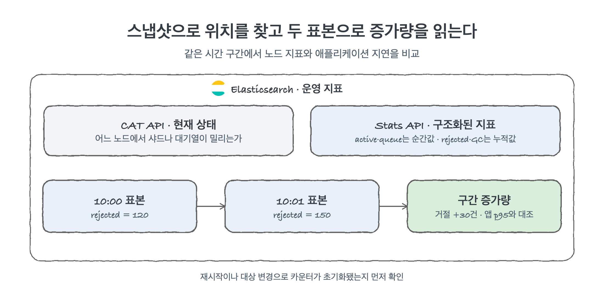

# Monitoring Elasticsearch with CAT APIs and Node Stats

CAT API로 현재 클러스터 상태를 빠르게 훑고, Node Stats와 Index Stats를 일정 간격으로 수집해 시간에 따른 변화를 확인한다. [Docker 실습](01_elasticsearch_fundamentals_and_cluster_architecture.md)과 [카탈로그 인덱스](03_elasticsearch_text_analysis_and_field_mapping.md)를 준비한다.

## 1. CAT API로 상태 확인

`v=true`는 열 이름을 표시하고, `h`는 열을 선택하며, `s`는 정렬을 지정한다. CAT의 출력은 콘솔에서 사람이 읽는 데 사용한다. 지속 수집과 알림에는 구조화된 Stats API를 사용한다. [CAT APIs](https://www.elastic.co/docs/api/doc/elasticsearch/group/endpoint-cat)

```http
GET /_cat/nodes?v=true&h=name,node.role,master,heap.percent,ram.percent,cpu

GET /_cat/indices/es-catalog?v=true&h=health,index,pri,rep,docs.count,store.size

GET /_cat/shards/es-shard-lab?v=true&h=index,shard,prirep,state,node,unassigned.reason&s=state

GET /_cat/allocation?v=true&h=node,shards,disk.percent,disk.avail&s=disk.percent:desc

GET /_cat/thread_pool/search,write,write_coordination?v=true&h=node_name,name,active,queue,rejected,completed
```

`docs.count`는 Lucene 문서 수다. `nested` 배열 요소의 내부 문서까지 포함할 수 있으므로, 상품 개수는 `GET /es-catalog/_count`로 확인한다. [CAT indices API](https://www.elastic.co/docs/api/doc/elasticsearch/operation/operation-cat-indices) · [Count API](https://www.elastic.co/docs/api/doc/elasticsearch/operation/operation-count)

## 2. 구조화된 지표와 해석

```http
GET /_cluster/health?filter_path=status,number_of_nodes,active_primary_shards,unassigned_shards

GET /_nodes/stats/jvm,fs,thread_pool,breaker,indexing_pressure?filter_path=nodes.*.name,nodes.*.jvm.mem.pools.old,nodes.*.jvm.gc.collectors,nodes.*.fs.total,nodes.*.thread_pool.write,nodes.*.breakers.*.tripped,nodes.*.indexing_pressure.memory

GET /es-catalog/_stats/indexing,search,refresh,merge?level=shards
```

| 지표 | 읽는 방법 |
| --- | --- |
| 상태와 미할당 샤드 | `status`와 `unassigned_shards`를 확인하고 `prirep`로 프라이머리와 레플리카를 구분한다. |
| 여유 디스크 | `fs.total.available_in_bytes`와 노드의 사용률 추세를 본다. 여러 데이터 경로를 쓰면 경로별 여유도 확인한다. |
| 힙과 GC | Old 영역의 사용량과 최대값을 비교한다. GC 횟수 및 소요 시간의 변화량을 응답 지연과 대조한다. |
| 색인과 검색 | `index_total`, `query_total`과 누적 시간을 비교한다. 샤드 단계의 평균은 애플리케이션 요청 지연과 별도로 기록한다. |
| 대기열과 거절 | `active`와 `queue`는 현재 값이다. `rejected`, `completed`와 breaker의 `tripped`는 관측 구간의 증가량을 본다. |
| 리프레시와 병합 | Refresh·merge 시간 및 처리량이 쓰기 지연이 증가한 시점과 겹치는지 확인한다. |

동일한 노드·샤드의 두 표본을 비교한다. 노드가 재시작하거나 샤드가 이동하면 카운터 기준이 바뀔 수 있다. 운영에서는 요청량, 오류율, p95 지연을 앱에서도 기록해 Elasticsearch 지표와 같은 시간축에서 비교한다. [Nodes Stats API](https://www.elastic.co/docs/api/doc/elasticsearch/operation/operation-nodes-stats) · [Index Stats API](https://www.elastic.co/docs/api/doc/elasticsearch/operation/operation-indices-stats)



그림의 근거 · [CAT API](https://www.elastic.co/docs/api/doc/elasticsearch/group/endpoint-cat) · [Nodes stats](https://www.elastic.co/docs/api/doc/elasticsearch/operation/operation-nodes-stats)
