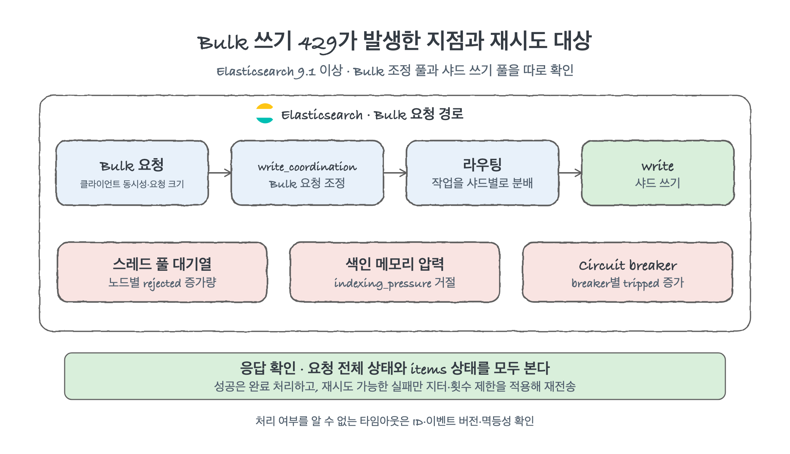

# Diagnosing Elasticsearch Write Thread Pool Rejections

쓰기 거절이 늘면 같은 시간 구간의 `429` 응답, 대기열과 거절 증가량을 비교한다. 모니터링 화면에 `ThreadpoolWriteRejected`가 보이면 해당 지표가 어느 스레드 풀의 `rejected` 값을 수집하는지 확인한다. Elasticsearch 9.4.2에서는 Bulk 요청의 조정 단계와 각 샤드의 쓰기 단계를 서로 다른 스레드 풀이 담당한다. [Thread pool settings](https://www.elastic.co/docs/reference/elasticsearch/configuration-reference/thread-pool-settings)

## 1. 거절 지점 찾기

| 관찰할 지표 | 확인할 작업 |
| --- | --- |
| `write_coordination.rejected` 증가 | Bulk 조정 작업의 대기 상태와 클라이언트에서 동시에 보낸 Bulk 수를 확인한다. 이 풀은 Elasticsearch 9.1부터 제공된다. |
| `write.rejected` 증가 | 쓰기 풀의 대기 상태를 노드별로 비교한다. 특정 노드에 몰리면 해당 노드의 쓰기 샤드와 라우팅 분포를 확인한다. |
| `indexing_pressure` 거절 증가 | 진행 중인 색인 작업의 바이트 수가 한도에 도달했는지 확인한다. 스레드 풀과 별도의 제한이다. |
| `breakers.*.tripped` 증가 | `circuit_breaking_exception`과 같은 시점인지 확인하고 해당 breaker의 종류를 찾는다. |

```http
GET /_cat/thread_pool/write,write_coordination?v=true&h=node_name,name,active,queue,rejected,completed

GET /_nodes/stats/thread_pool,indexing_pressure,breaker?filter_path=nodes.*.name,nodes.*.thread_pool.write,nodes.*.thread_pool.write_coordination,nodes.*.indexing_pressure.memory,nodes.*.breakers.*.tripped
```

노드별로 동일 간격에서 카운터를 두 번 읽고, 두 시점의 차이를 비교한다. 시작 전 거절이 120건이고 1분 뒤 150건이라면 그 1분 동안 30건이 늘어난 것이다. 단일 스냅샷에서 `queue`가 0이어도 앞서 발생한 거절은 누적 카운터에 남는다. 앱에서 Bulk 요청 전체의 상태와 `items[]` 안에 있는 상태를 모두 집계한다. [Rejected requests](https://www.elastic.co/docs/troubleshoot/elasticsearch/rejected-requests) · [Indexing pressure](https://www.elastic.co/docs/reference/elasticsearch/configuration-reference/indexing-pressure-settings)

## 2. 부하를 낮추고 실패 항목 재처리

1. Bulk 본문의 바이트 크기와 동시에 전송하는 요청 수를 각각 확인한다. 동시성을 먼저 줄여 거절 증가가 멈추는지 보고, 큰 요청이 메모리 압력을 높이면 한 요청의 배치를 나눈다.
2. 노드 한 곳에 거절이 집중되면 [샤드와 지표](11_monitoring_elasticsearch_with_cat_apis_and_node_stats.md)를 확인한다. 특정 라우팅 값이나 쓰기 인덱스에 요청이 몰리는지 살펴본다.
3. 재시도 가능한 항목에 횟수 제한과 지터를 넣은 지수 백오프를 적용한다. 항목별 응답이 있다면 성공 항목은 완료 처리하고, 거절된 항목만 다시 보낸다. 매핑 오류는 데이터를 수정하고 재처리한다.
4. 타임아웃처럼 처리 결과가 불명확할 때는 ID, 이벤트 버전과 작업의 멱등성을 확인한다. 같은 ID로 다시 색인해도 뒤늦은 재시도가 더 최신 데이터를 덮을 수 있다. 카운터 증가 스크립트는 중복 실행되면 값이 달라진다.
5. 재처리 후 `429` 비율, 처리량, p95 쓰기 지연, 생산자 대기열을 같은 기간에 비교한다. 애플리케이션이 받아야 할 입력량에 맞춰 동시성을 조정한다.

스레드 풀 대기열 확대는 처리량을 직접 늘리지 않는다. 대기열을 늘리면 밀린 작업이 더 오래 남고 메모리를 더 사용할 수 있다. 먼저 입력량과 병목을 확인한다. [Tune for indexing speed](https://www.elastic.co/docs/deploy-manage/production-guidance/optimize-performance/indexing-speed)



그림의 근거 · [Thread pool settings](https://www.elastic.co/docs/reference/elasticsearch/configuration-reference/thread-pool-settings) · [Rejected requests](https://www.elastic.co/docs/troubleshoot/elasticsearch/rejected-requests) · [Indexing pressure](https://www.elastic.co/docs/reference/elasticsearch/configuration-reference/indexing-pressure-settings) · [Bulk API](https://www.elastic.co/docs/api/doc/elasticsearch/operation/operation-bulk) · [색인 속도 튜닝](https://www.elastic.co/docs/deploy-manage/production-guidance/optimize-performance/indexing-speed)
